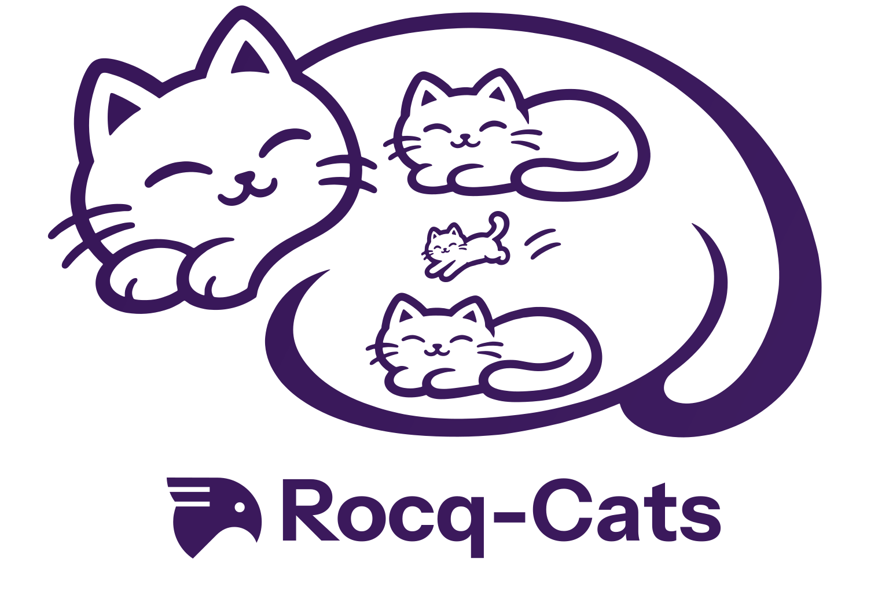

# ~~Rocq Abstract Nonsense~~ :)

# Rocq-Cats

Rocq-Cats is a constructive category theory library for learning and research.
Sets carry a specified equality, and universal properties supply witnesses that
can be used in computations. The library uses [Minks](minks/README.md) to
assemble mathematical structures from shared components.

Start with the [library guide](docs/theory/LibraryGuide.md) for a route through
the theories, or the [documentation index](docs/README.md) for a specific topic.

## Build

With the [project toolchain](docs/development/Testing.md#toolchain) installed,
run the library build from the repository root. Dune builds Minks from this
checkout as a dependency.

```sh
opam exec --switch=rocq-cats -- dune build @check-library
```

For a local edit, build the affected module and its consumers. The
[testing guide](docs/development/Testing.md) lists the available targets.
See [contributor instructions](AGENTS.md) for development conventions and
[reading editions](docs/development/Documentation.md) for HTML and PDF builds.
