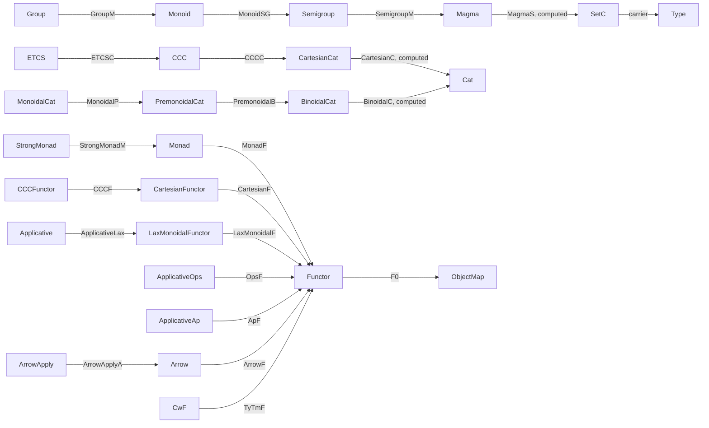

# Bundled interfaces and underlying views

# 打包接口与底层视图

The [current whole-library audit](#library-wide-structure-and-naming-audit)
started with all 87 class/record interfaces at baseline `5d87331`. Its
inventory now includes 100 interfaces after the structural hierarchy slices
and the synchronized integrated baseline,
alongside the structural naming and inheritance findings after the CCC changes.

[当前全库审计](#library-wide-structure-and-naming-audit)基于 `5d87331`，
起初分类全部 87 个类／记录接口；清单现包含结构层级批次及已同步集成基线后的 100 个接口，
并记录 CCC 修改后的结构命名与继承问题。

The lax monoidal interface now bundles its underlying functor and structure
in one class, exposing a single coercion to `Functor`. The first follow-up
from the library-wide survey now adds bundled cartesian and cartesian closed
functors. Existing fixed-data preservation interfaces remain available for
general theorems alongside those bundles.

Lax monoidal 接口现已将底层函子及结构打包在同一个类中，只提供一条到
`Functor` 的强制转换。全库调查后的首项后续工作现已添加打包的笛卡尔函子及
笛卡尔闭函子。已有固定数据保持性接口继续与打包接口共存，服务于一般定理。

## Scope and decision rule

## 范围及判断标准

The survey was performed on 2026-11-09 in the issue #35 task worktree,
based on integrated commit `8ae7cbd9f09c1738e9e30f4c637004552338036d`
plus the uncommitted issue #35 work. It inventories all 246 theory source
modules: 50 `Class` declarations, 25 `Record` declarations, field coercions,
and the two explicit `Coercion` declarations. Candidate interfaces and
their principal clients were then read directly. This is an interface
survey, not a review of every proof body.

本次调查于 2026-11-09 在 #35 任务 worktree 中进行，基于集成提交
`8ae7cbd9f09c1738e9e30f4c637004552338036d` 及尚未提交的 #35 工作。
扫描覆盖全部 246 个理论源模块：50 个 `Class`、25 个 `Record`、字段强制转换
及两个显式 `Coercion` 声明；随后直接阅读候选接口及其主要客户端。
这是接口调查，不是对每个证明体的审查。

Use a bundle when an object has a distinguished underlying map, functor or
carrier together with chosen structure. Keep the data and laws in one
record/class, with one underlying view exposed through `:>`. Use `::` for
inherited instances. Derived representations are separate constructions,
and comparisons use designated equality or natural isomorphism.

当对象具有明确的底层映射、函子或载体及选定结构时，适合打包。数据和定律
保存在同一记录／类中，通过 `:>` 暴露一个底层视图；`::` 用于继承实例。
派生表示保留为独立构造，比较使用指定相等或自然同构。

A property or chosen operation on already fixed data has a different role.
Such interfaces may also contain computational witnesses in `Type`: for
example, product preservation contains universal mediators, and invertibility
contains an inverse. Calling them fixed-data interfaces does not discard
those witnesses or assert proof irrelevance.

已有固定数据上的性质或选定运算具有另一种职责。这些接口也可能携带 `Type`
中的计算见证，例如积保持性包含泛中介，可逆性包含逆。称其为固定数据接口，
不意味着丢弃这些见证或假定证明无关性。

## Implemented bundles

## 已实现的打包接口

[LaxMonoidalFunctor MC MD](../theories/Cat/Monoidal/Functor.v) now stores
`LaxMonoidalF :> Functor C D`, the unit comparison, natural tensorator and
three coherence laws. Clients use `L X` and `fmap L f`. The
[identity](../theories/Cat/Monoidal/Functor.v) and
[constant](../theories/Cat/Monoidal/Constant.v) constructors explicitly
choose their underlying functors. The
[monoid transport](../theories/Cat/Monoidal/Transport.v) remains derived
from `L`, including its action on homomorphisms.

[LaxMonoidalFunctor MC MD](../theories/Cat/Monoidal/Functor.v) 现在保存
`LaxMonoidalF :> Functor C D`、单位比较、自然 tensorator 及三条相干律。
客户端使用 `L X`、`fmap L f`。
[恒等构造](../theories/Cat/Monoidal/Functor.v)与
[常值构造](../theories/Cat/Monoidal/Constant.v)显式选择底层函子。
[幺半群传输](../theories/Cat/Monoidal/Transport.v)及其同态作用仍由 `L` 派生。

Only the base functor is a coercion target. Storing an independent functor
on monoid objects would require additional compatibility data with the base
functor; the current construction determines its operations and arrow action
directly, so no such independent choice is needed.

只有基底函子作为强制转换目标。如果另外存储一个独立的幺半群对象函子，就
需要补充其与基底函子的相容数据；当前构造直接确定运算和箭头作用，不需要
这项独立选择。

The 2026-11-10 follow-up, based on integrated commit
`b7455f5869a76862c0388967f31719058789fc47`, implements the first two survey
candidates. [CartesianFunctor](../theories/Cat/Functor/Cartesian.v) stores one
`Functor` with inherited `IsCartesianF` evidence. It requires only the named
source terminal/products. [CCCFunctor](../theories/Cat/Functor/Closed.v) adds
exponential comparison invertibility, with the single coercion chain
`CCCFunctor → CartesianFunctor → Functor`. Its derived `IsCCCF` instance
shares the stored cartesian evidence. Preservation adapters, identity and
composition constructors reuse the existing proofs and computational witnesses.

2026-11-10 的后续工作基于集成提交
`b7455f5869a76862c0388967f31719058789fc47`，实现了调查中的前两个候选。
[CartesianFunctor](../theories/Cat/Functor/Cartesian.v) 保存一个 `Functor`
及继承的 `IsCartesianF` 证据，仅要求具名来源终对象／积。
[CCCFunctor](../theories/Cat/Functor/Closed.v) 增加指数比较可逆性，唯一强制
转换链为 `CCCFunctor → CartesianFunctor → Functor`；派生的 `IsCCCF` 实例
共享保存的笛卡尔证据。保持性适配器、恒等和复合构造复用已有证明及计算见证。

General theorems keep accepting fixed `F` and preservation evidence. STLC
interpretations can therefore be packaged without changing their universal
properties; their broad migration remains a separate task. No second direct
CCC-to-functor coercion or globally chosen concrete functor is introduced.

一般定理继续接受固定 `F` 及保持性证据，因此 STLC 解释可直接打包，无须改变
通用性质；其全面迁移仍是独立任务。不引入第二条 CCC 到函子的直接强制转换，
也不全局选定具体函子。

## Existing bundles that already fit

## 已符合原则的打包接口

| Interface / 接口 | Underlying view / 底层视图 | Finding / 结论 |
| --- | --- | --- |
| [SetC and FunS_resp](../theories/Set/Morphism.v), [SetC carrier](../theories/Set/Core.v) | Carrier or respectful function / 载体或保相等函数 | Already bundled; preserve pointwise setoid equality / 已打包，保留逐点广集相等 |
| [Functor](../theories/Cat/Functor/Core.v), [Nat](../theories/Cat/Natural.v) | Object map or component family / 对象映射或分量族 | Already expose the unique computational view / 已暴露唯一计算视图 |
| [Monad](../theories/Cat/Monad/Core.v), [MonoidObject](../theories/Cat/Monoidal/Monoid.v) | Endofunctor or ambient carrier / 自函子或所在范畴的载体 | Model for the new lax bundle; fixed-data law predicates also remain / 可作为 lax 打包范式，同时保留固定数据定律谓词 |
| [CwF](../theories/DTT/CwF.v) | `TyTmF :> Functor (C^op) FamCat` | Already bundles the functor and context extension; inherited terminal/context structures use `::` / 已打包函子和上下文扩张，用 `::` 继承结构 |
| [GraphMap](../theories/Graph/Morphism.v), [GeneratorNat](../theories/Cat/Diagram/Generator.v), [Chain](../theories/Cat/Chain.v) | Vertex map or component family / 顶点映射或分量族 | Existing coercions support direct application / 已支持直接作用 |
| [FamS](../theories/Instance/Set/Fam/Core.v), [FamMap](../theories/Instance/Set/Fam/Fixed.v), [FamC and FamF](../theories/Instance/Set/Fam/Cat.v) | Fiber family, fiberwise maps or base map / 纤维族、逐纤维映射或基底映射 | Keep the selected view; other family components stay explicit / 保持选定视图，其他族分量显式访问 |
| [SectionS_resp](../theories/Instance/Set/Fam/Section.v), [SieveMatching](../theories/Instance/Set/Sieve/Matching.v) | Section or generator values / 截面或生成元处的值 | Already apply directly and compare values without proof-field equality / 已可直接作用，按值比较而不比较证明字段 |
| [Mono and Sub](../theories/Cat/Morphism.v), [SliceHom](../theories/Cat/Slice/Core.v) | Underlying arrow / 底层箭头 | Already bundled; `Mono` also has an explicit domain-object view, which should be considered during any future coercion changes / 已打包；`Mono` 还有显式定义域对象视图，未来修改强制转换时须一并考虑 |
| [Cone](../theories/Cat/Diagram/Core.v), [Cocone](../theories/Cat/Diagram/Dual.v) | Natural transformation / 自然变换 | Cone is a specialization of `Nat`; cocone exposes the ordinary view through `CoconeN` and reuses opposite-cone data / 锥特化 `Nat`，余锥通过 `CoconeN` 暴露通常视图并复用反锥数据 |

## Named parameter views and hierarchy audit

## 具名参数视图及层级调查

The `monoidal-cat-view` follow-up starts from integrated commit
`a7c849423f6f03193c82d5f6bb20230acf63d0a0`. Its fresh inventory covers all
256 theory modules, 52 `Class` declarations, 27 `Record` declarations,
24 existing field coercions and two explicit `Coercion` commands. The
monoidal change adds one field coercion. This inventory excludes the
unintegrated `ccc-equivalence-23` task and supplements the historical
survey above. All declared interfaces were classified; inheritance fields
and the source of each coercion were inspected. Proof bodies were not
audited individually.

`monoidal-cat-view` 后续任务从集成提交
`a7c849423f6f03193c82d5f6bb20230acf63d0a0` 开始，重新扫描全部 256 个
理论模块、52 个 `Class`、27 个 `Record`、已有的 24 个字段强制转换及两个
显式 `Coercion` 命令；此次幺半修改新增一个字段强制转换。调查不包含尚未集成的
`ccc-equivalence-23` 任务，并补充上文的历史调查。所有声明的接口均已分类，
继承字段和每个强制转换的来源均已核查；没有逐一审计证明体。

[MonoidalCat C](../theories/Cat/Monoidal/Core.v) initially gained the computed
field `MonoidalC :> Cat := C`. It exposes the supplied category without
storing another one or changing any constructor argument. Clients can write
`Functor MC MD`, `@Ob MC` and `Functor (MC ×C MC) MC`. Tensor, associators,
unitors and their laws still use the named category and selected structure.
Two monoidal structures on the same category remain distinct choices;
recovering their category does not identify their tensor data. The conversion
does not enable any concrete monoidal instance.

[MonoidalCat C](../theories/Cat/Monoidal/Core.v) 起初通过计算字段
`MonoidalC :> Cat := C` 暴露给定范畴，不另存一个范畴，也不改变构造器参数。
客户端可写 `Functor MC MD`、`@Ob MC`、`Functor (MC ×C MC) MC`。张量、
结合子、单位子及其定律仍使用具名范畴和选定结构。同一范畴上的两个幺半结构
仍是不同选择，恢复底层范畴不等于识别其张量数据，也不会启用任何具体幺半实例。

A computed view of an existing parameter is compatible with a fixed-data
interface. It is different from replacing that interface by an unindexed
bundle. However, its usefulness and the whole coercion graph still need
checking: `::` supplies instance search, whereas `:>` inserts a conversion
in a term. Neither mechanism should choose a model's structure by import.

为已有参数提供计算视图，与保留固定数据接口相容，不需要将其替换为无索引的
结构包。不过，仍须检查实际用途和整张强制转换图：`::` 服务于实例搜索，
`:>` 才会在项中插入转换。两种机制都不应因导入模块而替模型选定结构。

| Family / 接口族 | Current chain or boundary / 当前链或边界 | Decision / 结论 |
| --- | --- | --- |
| [CCCFunctor](../theories/Cat/Functor/Closed.v) | `CCCFunctor → CartesianFunctor → Functor → object function` / 经笛卡尔函子和普通函子到对象函数 | Already complete; no direct bypass / 已完整，不增加直接旁路 |
| [LaxMonoidalFunctor](../theories/Cat/Monoidal/Functor.v), [Monad](../theories/Cat/Monad/Core.v), [VertexFunctor](../theories/Instance/Set/Vertex/Functor.v) | Each goes through its unique `Functor` to the object function / 各自经唯一底层函子到对象函数 | Keep `fmap` for arrows; the respectful vertex-map adapter stays explicit / 态射保留 `fmap`，保相等顶点映射的适配器保持显式 |
| [CwF](../theories/DTT/CwF.v) | `CwF → Functor → object function`; an image is a [FamC](../theories/Instance/Set/Fam/Cat.v) / 函子像为相干族 | Its selected primary view is the type-and-term functor; adding a category view needs a separate interface decision / 主要视图已选为类型与项函子，增加范畴视图须另行决定 |
| [FamC and FamF](../theories/Instance/Set/Fam/Cat.v), [FamS](../theories/Instance/Set/Fam/Core.v) | `FamC → FamS → fiber function`; `FamF → FunS_resp → base function`; fibers go through `SetC → Type` / 相干族到纤维函数，相干族态射到基底函数，纤维经广集到类型 | Already chainable; the fiber action of a family morphism remains explicit / 已可连续使用，族态射的纤维作用保持显式 |
| [Cocone](../theories/Cat/Diagram/Dual.v), [Nat](../theories/Cat/Natural.v) | `Cocone → Nat → component function` / 余锥经自然变换到分量函数 | Already complete; keep the opposite-cone construction underneath / 已完整，底层保留反范畴上的锥构造 |
| [Sub and Mono](../theories/Cat/Morphism.v), [SliceHom](../theories/Cat/Slice/Core.v) | Subobjects reach a monomorphism, then its ambient arrow; `Mono` also exposes its domain object / 子对象经单态射到所在范畴的箭头，单态射还暴露定义域对象 | Preserve existing targets; check both paths before extending / 保留现有目标，扩展前核对两条路径 |
| [MonoidObject](../theories/Cat/Monoidal/Monoid.v) | The carrier target is `@Ob C`, not a fixed record such as `SetC` / 载体目标是所在范畴的对象类型，而非固定广集记录 | Dependent targets can stop chaining; use `MonoidCarrier A` when a concrete further view is needed / 依赖目标可能中断连续转换，具体底层视图需要时显式使用载体投影 |
| [CCC](../theories/Cat/CCC.v) | `CCC → CartesianCat → Cat`; the parent shares terminal and product choices / 经笛卡尔父结构到普通范畴，共享终对象与积选择 | Implemented in the cumulative hierarchy below; no direct bypass / 已在下述累次层级中实现，不增加直接旁路 |
| [ETCS](../theories/ETCS/Core.v) | `ETCS → CCC → CartesianCat → Cat` | One `ETCSC` parent shares all inherited choices; terminal-dependent fields use that same terminal / 唯一 `ETCSC` 父结构共享继承选择，依赖终对象的字段使用同一终对象 |
| [Group](../theories/Algebra/Group/Core.v), [Monoid](../theories/Algebra/Monoid/Core.v), [Semigroup](../theories/Algebra/Semigroup/Core.v), [Magma](../theories/Algebra/Magma/Core.v) | `Group → Monoid → Semigroup → Magma → SetC → Type`; each parent is an inherited instance / 群经幺半群、半群、原群、广集到载体类型，各父结构均为继承实例 | Implemented in the algebra hierarchy slice below, sharing one multiplication and named setoid / 已在下述代数层级批次中实现，共享唯一乘法及具名广集 |
| [IsGroupoid](../theories/Cat/Groupoid/Core.v), [IsStrictTwoCat](../theories/Cat/Bicategory/Strict.v) | Witnesses on a fixed category/bicategory, including designated equality and comparison data / 固定范畴或双范畴上的见证，含指定相等及比较数据 | A parameter view is possible, but needs a client; do not collapse higher structure or change coherence / 参数视图技术上可行，待具体客户端；不折叠高阶结构、不改变相干性 |
| [Dual chosen structures](../theories/Cat/Colimit/Core.v), [HasInitial](../theories/Cat/Terminal.v), [HasCoproduct](../theories/Cat/Coproduct/Core.v), [HasCoequalizer](../theories/Cat/Coequalizer.v), [HasPushout](../theories/Cat/Pushout.v) | `::` inherits the original theory on opposite categories / 用实例继承反范畴上的原理论 | Keep the dual presentation and ordinary wrappers; these are choices on named data, not missing carrier bundles / 保留对偶呈现及通常包装，这是具名数据上的选择，不是缺少载体的结构包 |
| [HasLimitsOfShape](../theories/Cat/Limit/Core.v), [HasFiniteHomCover](../theories/Cat/Shape/Finite.v), [HasKanFillers](../theories/Instance/Set/Simplicial/Horn.v) | Inherited structures depend on diagrams, endpoints or horn indices / 继承结构依赖图式、端点或 horn 索引 | Use instance inheritance; no single uniform carrier conversion is needed / 使用实例继承，无须统一载体转换 |
| [Closure](../theories/Set/Closure/Core.v), respectful maps, [GraphMap](../theories/Graph/Morphism.v), [GeneratorNat](../theories/Cat/Diagram/Generator.v), [Chain](../theories/Cat/Chain.v), sections and matching families | Already expose their operation or component function / 已暴露运算或分量函数 | Keep their existing unique functional view / 保留已有唯一函数视图 |
| Remaining `Has*`/preservation interfaces, [Adjunction](../theories/Cat/Adjunction.v), [Comprehension](../theories/Cat/Comprehension.v), [Sieve](../theories/Cat/Sieve.v) | Operations, relations or multiple views on fixed data / 固定数据上的运算、关系或多个视图 | Retain explicit parameters as detailed below; no blanket category/functor coercions / 按下文保留显式参数，不统一增加范畴或函子转换 |
| [ArrowOb](../theories/Cat/Arrow/Core.v), [CommaOb](../theories/Cat/Comma/Core.v), [SliceOb](../theories/Cat/Slice/Core.v), commuting-square records, [Horn2Presentation](../theories/Instance/Set/Simplicial/Vertex/Filling.v), [is_unique](../theories/Meta.v), [LiftT](../theories/Set/Core.v) | Multiple endpoints or witness/presentation records / 多个端点或见证、呈现记录 | No new hierarchy edge justified / 不据此新增层级边 |
| [Cat](../theories/Cat/Core.v), [Graph](../theories/Graph/Core.v), [Bicat](../theories/Cat/Bicategory/Core.v) | Foundational structures, not an existing inheritance chain / 基础结构，尚非继承链 | Keep object/vertex types and derived underlying categories explicit / 对象、顶点类型及派生底层范畴保持显式 |

Temporary elaboration checks confirmed `Functor MC MD`, coexistence of two
structures on one category, unchanged lax object/arrow use, both strict
hom/equality universe orders, and transparent identities in setoid and
endofunctor models. They also checked existing family/CwF chains: with the
relevant interface modules imported, `U x : Type`, `f x : famC_base V` and
`(T X) a : Type` elaborate directly. For
`A : MonoidObject SetCartesianMonoidal`, `A : @Ob SetCat` works, but
`A : SetC` and `A : Type` do not; `MonoidCarrier A : Type` does.
The coercion graph matches declared targets, so reduction of a dependent
target to a concrete record does not automatically add another graph edge.

临时 elaboration 检查确认了 `Functor MC MD`、同一范畴上两个结构共存、
lax 对象／态射用法不变、Hom 与相等宇宙的两种严格次序，以及广集和自函子
模型的恒等运算保持透明。相干族和 CwF 的已有链也已检查：导入相关接口模块后，
`U x : Type`、`f x : famC_base V` 和 `(T X) a : Type` 均可直接使用。
对 `A : MonoidObject SetCartesianMonoidal`，`A : @Ob SetCat` 可用，
但 `A : SetC`、`A : Type` 不可用，显式 `MonoidCarrier A : Type` 可用。
强制转换图按声明的目标匹配；依赖目标能归约为某个具体记录，不会自动增加
一条新的图边。

The first change implements the monoidal category view; the continuation
below adds group/monoid views and the cumulative cartesian/CCC hierarchy.
The ETCS slice below extends this chain through its shared CCC parent.
`Cat` has no coercion to its object type, and `Functor` still uses its
object function as its sole function coercion; arrow mapping stays `fmap`.

首项修改实现幺半结构的底层范畴视图；下述后续工作增加群／幺半群视图及
笛卡尔／CCC 累次层级。下述 ETCS 批次通过共享 CCC 父结构进一步延伸此链。
`Cat` 没有到对象类型的强制转换；`Functor`
仍以对象函数为唯一函数强制转换，态射映射保留 `fmap`。

This follow-up passed `dune build @all @runtest @install` using
`opam exec --switch=rocq-cats`, Rocq/Stdlib 9.2.0, OCaml 5.3.0 and
Dune 3.23.1. Eight temporary `Print Assumptions` checks, covering the view,
ordinary and tensor functors, composition preservation, both equality
levels and concrete identity computation, reported `Closed under the
global context`. Strict bilingual HTML export generated 256 modules per
language and checked links and anchors in 517 pages; the new field's
adjacent explanations were checked in both editions. No permanent test
or shared toolchain change was needed. PDF export belongs to the next
integration batch. These are local results, not a CI-status claim.

此次后续工作使用 `opam exec --switch=rocq-cats`，在 Rocq／Stdlib 9.2.0、
OCaml 5.3.0、Dune 3.23.1 下通过 `dune build @all @runtest @install`。
八项临时 `Print Assumptions` 检查覆盖底层视图、普通及张量函子、复合保持、
两种相等层级及具体恒等计算，均报告 `Closed under the global context`。
严格双语 HTML 导出每种语言 256 个模块，检查了 517 页的链接及锚点；新增
字段旁的说明已在两种语言中核查。无需增加永久测试或修改共享工具链。
PDF 留待下一集成批次统一导出。以上为本地验证结果，不代表 CI 状态。

## Cumulative cartesian and CCC hierarchy

## 笛卡尔与 CCC 的累次层级

[CartesianCat C](../theories/Cat/Cartesian/Core.v) stores the selected
terminal object and binary products, including their computational universal
properties. Its computed field `CartesianC :> Cat := C` exposes the named
category. [CCC C](../theories/Cat/CCC.v) then stores one
`CCCC :> CartesianCat C` parent and exponentials relative to
that parent's products. The parent field directly supplies
the unique chain `CCC → CartesianCat → Cat`; there is no direct
CCC-to-category bypass and no repeated terminal/product data.

[CartesianCat C](../theories/Cat/Cartesian/Core.v) 保存选定终对象和
二元积，包含其可计算泛性质。计算字段 `CartesianC :> Cat := C` 暴露具名
范畴。[CCC C](../theories/Cat/CCC.v) 再保存一个
`CCCC :> CartesianCat C` 父结构及相对于其积的指数。父字段直接
给出唯一链 `CCC → CartesianCat → Cat`；不添加
CCC 直接到普通范畴的旁路，也不重复保存终对象或积。

The following client illustrates both mechanisms. Expected types insert
the successive coercions, while `Local Existing Instance HC` makes the
same stored choices available to instance search. `:>` supplies the
conversion; `Existing Instance CCCC` additionally registers the same
parent for instance search, without choosing another cartesian structure.

下面的客户端同时展示两种机制：期望类型插入逐层强制转换，
`Local Existing Instance HC` 则将同一份保存选择提供给实例搜索。
`:>` 提供转换；`Existing Instance CCCC` 另外将同一父结构注册给实例搜索，
不另选一个笛卡尔结构。

```coq
From Cats Require Import
  Cat.Core
  Cat.Functor.Core
  Cat.Terminal
  Cat.Product.Core
  Cat.CCC.

Section CumulativeViews.
Context {C : Cat} (HC : CCC C).
Local Existing Instance HC.

Definition cartesian_view
  : CartesianCat C
  := HC.
Definition category_view
  : Cat
  := HC.
Definition identity_view
  : Functor HC HC
  := IdF.
Definition inherited_terminal
  : HasTerminal HC
  := ltac:(typeclasses eauto).
Definition inherited_product
  : HasProduct HC
  := ltac:(typeclasses eauto).
End CumulativeViews.
```

The [setoid](../theories/Instance/Set/Cartesian.v),
[context syntax](../theories/STLC/CCC.v) and
[type syntax](../theories/STLC/TypeCategory.v) models expose explicit
cartesian bundles, reused by their existing CCC bundles. Importing them
does not choose a concrete instance. The
[cartesian monoidal construction](../theories/Cat/Monoidal/Cartesian.v)
still derives from the selected terminal and products when requested;
it is not another stored parent or coercion path. General product and
exponential theorems retain their weaker original hypotheses.

[广集](../theories/Instance/Set/Cartesian.v)、
[上下文语法](../theories/STLC/CCC.v)及
[类型语法](../theories/STLC/TypeCategory.v)模型暴露显式笛卡尔包，由原有
CCC 包复用。导入时不自动选取具体实例。
[笛卡尔幺半构造](../theories/Cat/Monoidal/Cartesian.v)仍在需要时由选定
终对象与积派生，不是另一份保存的父结构或强制转换路径。一般积与指数定理
保留原有的较弱前提。

This hierarchy change passed the full build, test and install targets with
the existing `rocq-cats` switch (Rocq/Stdlib 9.2.0, Dune 3.23.1). Forty-four
temporary `Print Assumptions` checks reported `Closed under the global
context`. They cover the coercion chain and inherited choices, both strict
hom/equality universe orders, the three model assemblies, and six concrete
setoid reductions. Negative checks confirm that import alone selects no
model and that the cartesian bundle supplies no exponential instance.
The existing universe test only updates two fully qualified projection
names to their new parent module. No permanent test or shared alias was
added. Strict bilingual HTML generated 278 modules per language and checked
561 pages; all six new or updated source pages were checked in both
languages. PDF export remains with the integration batch.

此次层级修改在已有 `rocq-cats` switch 下，以 Rocq／Stdlib 9.2.0、Dune 3.23.1
通过全库构建、测试及安装。四十四项临时 `Print Assumptions` 检查均报告
`Closed under the global context`，覆盖转换链与继承选择、Hom／相等宇宙的
两种严格次序、三个模型装配及六项具体广集归约。反向检查确认导入本身不选取
模型，笛卡尔包也不提供指数实例。原有宇宙测试仅将两个全限定投影名更新到
新父模块，没有新增永久测试或共享别名。严格双语 HTML 每种语言生成 278 个
模块，检查 561 页；六个新增或更新的源码页面均已检查英中文正文。
PDF 仍由集成批次统一导出。

## Computational-model continuation

## 计算模型接口后续工作

The continuation on `monoidal-cat-view`, following `3a47f38`, applies the
same design to the algebraic foundations of the computational models.
[Monoid M](../theories/Algebra/Monoid/Core.v) originally had the computed
field `MonoidS :> SetC := M`. The algebra slice below moves that view to
[Magma](../theories/Algebra/Magma/Core.v) as `MagmaS :> SetC := M`, and
stores the intermediate parents as `MonoidSG :> Semigroup M` and
`SemigroupM :> Magma M`. The first hierarchy-normalization slice makes
[Group G](../theories/Algebra/Group/Core.v) expose its parent directly as
`GroupM :> Monoid G`, with `Existing Instance GroupM` for inherited search.
The unique chain is now `Group → Monoid → Semigroup → Magma → SetC → Type`;
the chosen
algebraic operations and carrier are shared. The original continuation had
26 field coercions and three explicit coercion commands; the current
hierarchy uses the direct parent field instead of the separate group
coercion command.

`monoidal-cat-view` 在 `3a47f38` 之后的后续工作，将同样的设计应用到计算
模型的代数基础。[Monoid M](../theories/Algebra/Monoid/Core.v) 最初具有计算字段
`MonoidS :> SetC := M`。下述代数批次将此视图移至
[Magma](../theories/Algebra/Magma/Core.v)，名为 `MagmaS :> SetC := M`，
并以 `MonoidSG :> Semigroup M`、`SemigroupM :> Magma M` 保存中间父结构。
首批层级规范化使
[Group G](../theories/Algebra/Group/Core.v) 直接以 `GroupM :> Monoid G`
暴露父结构，并通过 `Existing Instance GroupM` 支持继承搜索。唯一链仍为
`Group → Monoid → Semigroup → Magma → SetC → Type`，共享选定代数运算及
载体。最初的后续工作有
26 个字段强制转换、三个显式转换命令；当前层级以直接父字段替换群的单独
转换命令。

Given `HG : Group G`, clients can pass `HG` where `Monoid G` or `SetC`
is expected and bind `x : HG` as an element of the original setoid. For
example, `SetMonoidObject HG` builds the internal monoid object using the
same selected operations. The [lax transport](../theories/Cat/Monoidal/Transport.v)
now uses `L A` and `Hom A B` through the existing monoid-carrier view.
Its tensorator notation keeps explicit carrier projections: constructing
a pair before checking its dependent endpoint does not distribute
coercions into both pair components.

给定 `HG : Group G`，客户端可在要求 `Monoid G` 或 `SetC` 的位置传入
`HG`，也可用 `x : HG` 绑定原广集的元素。例如 `SetMonoidObject HG` 使用
同一组选定运算构造内部幺半群对象。[Lax 运输](../theories/Cat/Monoidal/Transport.v)
现通过已有载体视图直接使用 `L A` 和 `Hom A B`。Tensorator 记号保留显式载体
投影：先构造成对输入、再检查其依赖端点，不会把强制转换分配到两个分量中。

Monad and lax monoidal functors already have their unique underlying
functor chains. Their arrow maps still use `fmap`. Recovering a Monad from
an endofunctor-monoid presentation keeps the explicit `MonoidCarrier`
projection, as required by the dependent-target boundary above. Single-object
category interpretations and Monad/monoid correspondence maps remain derived
constructions. This continuation does not select concrete instances globally
or add Applicative, computational Arrow or tensorial-strength interfaces.

Monad 和 lax 幺半函子已有唯一的底层函子转换链，态射映射继续使用 `fmap`。
从自函子幺半群呈现恢复 Monad 的适配器仍须按上文的依赖目标边界，显式使用
`MonoidCarrier`。单对象范畴解释及 Monad／幺半群对应映射保留为派生构造。
此后续工作不会全局选定具体实例，也不新增 Applicative、计算 Arrow 或张量强度接口。

The existing `rocq-cats` switch passed `dune build @all @runtest @install`
after these changes. Temporary checks cover both strict carrier/equality
universe orders, inherited instance search, two structures on the same
setoid, direct group-to-monoid model adapters and transparent Boolean-xor
operations through lax transport. Eleven temporary `Print Assumptions`
checks reported `Closed under the global context`. The checks add no
permanent test sources or shared test aliases. Strict bilingual HTML
export again generated 256 modules per language and checked 517 pages;
the added field and carrier-use explanations were checked in both languages.
PDF export remains with the integration batch.

修改后在已有 `rocq-cats` switch 下通过 `dune build @all @runtest @install`。
临时检查覆盖载体／相等宇宙的两种严格次序、继承实例搜索、同一广集上的两个
结构、群到幺半群模型的直接适配，以及经 lax 运输后布尔异或运算的透明计算。
十一项临时 `Print Assumptions` 检查均报告 `Closed under the global context`。
检查没有新增永久测试源码或共享测试别名。严格双语 HTML 导出再次为每种语言
生成 256 个模块并检查 517 页；新增字段及载体使用说明已在两种语言中核查。
PDF 仍由集成批次统一导出。

The next serial slice implements
[Applicative](../theories/Cat/Applicative/Core.v) with the single chain
`Applicative → LaxMonoidalFunctor → Functor → object function`, preserving
the selected parent functor and `fmap`. Its pure operation is a natural
transformation with unit/product compatibility, rather than a competing
function coercion. See the [computation audit](./ComputationAudit.md#lawful-applicative-slice)
for the proved laws, Reader model, size checks and remaining boundaries.

下一串行切片实现了 [Applicative](../theories/Cat/Applicative/Core.v)，唯一转换链
为 `Applicative → LaxMonoidalFunctor → Functor → object function`，保留
选定父函子和 `fmap`。纯值运算是满足单位／积相容律的自然变换，不增加竞争的
函数强制转换。已证定律、Reader 模型、大小检查及剩余边界见
[计算模型审计](./ComputationAudit.md#lawful-applicative-slice)。

The operation-comparison slice adds
[ApplicativeOps](../theories/Cat/Applicative/Operations.v) and
[ApplicativeAp](../theories/Cat/Applicative/Application.v). Each has a single
`Functor → object function` view, preserving `fmap`; pure and application
stay explicit operations. Their conversions retain that same functor and
compare the supplied operations by designated equality. No competing
coercion to the structural Applicative is registered.

运算比较切片增加 [ApplicativeOps](../theories/Cat/Applicative/Operations.v)
及 [ApplicativeAp](../theories/Cat/Applicative/Application.v)，两者均只有
`Functor → object function` 视图，保留 `fmap`；纯值及应用仍为显式运算。
转换保留同一底层函子，使用指定相等比较所给运算，不注册到结构式 Applicative
的竞争强制转换。

The strength phase adds [StrongMonad](../theories/Cat/Monad/Strength.v)
with the unique chain `StrongMonad → Monad → Functor → object function`.
Its `hasStrength` field inherits a chosen structure on that same functor;
no second functor view is introduced. The
[MonadA conversion](../theories/Cat/Monad/Applicative.v) is an explicit
construction, preserving the parent functor and `fmap`, rather than another
coercion path. The [State model](../theories/Instance/Set/State.v) likewise
provides explicitly selected values.

强度阶段增加 [StrongMonad](../theories/Cat/Monad/Strength.v)，唯一转换链为
`StrongMonad → Monad → Functor → object function`。`hasStrength` 字段继承同一
函子上的选定结构，不增加第二个函子视图。
[MonadA 转换](../theories/Cat/Monad/Applicative.v) 为显式构造，保留父函子及
`fmap`，不增加竞争的强制转换路径；[状态模型](../theories/Instance/Set/State.v)
同样只提供须显式选定的值。

The computational [Arrow](../theories/Cat/Computational/Arrow/Core.v)
adds the unique `Arrow → Functor → object function` view, with the source
monoidal structure and target category named separately. `ComputationCat`
is an explicit reindexing of that target, not another coercion. Cartesian
first/second/split/fanout are derived operations. The concrete
[StateArrow](../theories/Instance/Set/State.v) is explicitly selected and
retains independent ambient carrier/equality levels.

计算 [Arrow](../theories/Cat/Computational/Arrow/Core.v) 增加唯一的
`Arrow → Functor → object function` 视图，分别具名指定来源幺半结构及目标
范畴。`ComputationCat` 是目标的显式重索引，不增加强制转换；笛卡尔
first／second／分开组合／扇出均为导出运算。具体
[StateArrow](../theories/Instance/Set/State.v) 须显式选择，保留独立的所在载体／
相等层级。

## Follow-up candidates

## 后续候选

| Candidate / 候选 | Current boundary / 当前边界 | Proposed treatment / 建议处理 | Main clients and risk / 主要客户端及风险 |
| --- | --- | --- | --- |
| [iso](../theories/Cat/Core.v), [NatIso](../theories/Cat/Natural.v) | Sigma bundles with `.1`/`.2` projections; unique forward arrow/transformation / 通过 `.1`、`.2` 访问的依赖和，具有明确正向箭头／自然变换 | Consider named records with a forward-map coercion while retaining `is_iso` and `is_NatIso_of` / 可考虑具名前向映射的记录，同时保留固定映射上的可逆性接口 | Foundation-wide migration, including [CatCat equivalence](../theories/Cat/CatCat.v) and [representations](../theories/Instance/Set/Representable.v); separate prerequisite task, not a local rename / 牵涉范畴等价及表示，须作为独立前置任务 |
| [SectionOfS](../theories/Cat/Section.v) | Setoid carrier is a map plus its right-inverse witness / 广集载体为映射及其右逆见证 | Optional named bundled section with an arrow coercion; reuse current equality / 可增加具名截面记录及箭头强制转换，复用当前相等 | [family sections](../theories/Instance/Set/Fam/Section.v); lower priority until repeated projection access motivates it / 待重复投影使用显现需求后处理 |
| [Comprehension](../theories/Cat/Comprehension.v) | Fixed projection `P`, additional `ExtF`, natural projection and cartesian/pullback preservation / 固定投影 `P`，另含 `ExtF`、自然投影及保持性 | Decide which mathematical view is primary before adding a coercion / 添加强制转换前先确定主要数学视图 | `P`, `ExtF` and derived `ComprehensionF : E → Arr B` have different roles; no automatic choice between them / 三个函子职责不同，不能自动替选 |

The cartesian and CCC candidates are implemented above. The remaining
candidates require separate interface decisions and clients.

笛卡尔及 CCC 候选已在上文实现。剩余候选需要独立的接口决策及客户端。

## Fixed-data and relational interfaces to retain

## 应保留的固定数据及关系接口

| Interface family / 接口族 | Reason / 原因 |
| --- | --- |
| [is_faithful, is_full, is_fully_faithful](../theories/Cat/Functor/Core.v), [is_monad](../theories/Cat/Monad/Core.v), [is_monoid_object and is_monoid_hom](../theories/Cat/Monoidal/Monoid.v) | State laws about supplied data; fullness and universal properties retain computational witnesses / 陈述给定数据的定律，满性和泛性质仍保留计算见证 |
| [Adjunction F G](../theories/Cat/Adjunction.v) | Relates two specified functors; keep left/right views explicit / 关联两个指定函子，左右视图应显式访问 |
| [HasCartesianLift P](../theories/Cat/Fibration.v), [HasFreeObjects U](../theories/Cat/FreeObject/Core.v) | Choose lifts or universal arrows for the existing functor; a future bundled fibration/right-adjoint view can reuse these interfaces / 为已有函子选择提升或泛箭头，未来打包视图可复用这些接口 |
| [HasDisplay](../theories/DTT/Display/Core.v), [HasContextExtension and CwF](../theories/DTT/CwF.v), [HasContextRepresentation](../theories/DTT/Context/Representation.v) | Describe interchangeable presentations over a fixed presheaf/family functor; CwF already supplies the complete bundled object / 描述固定预层／族函子上的可互换呈现，完整打包对象已有 CwF |
| [Monoid](../theories/Algebra/Monoid/Core.v), [Group](../theories/Algebra/Group/Core.v) | Selected algebraic structure on a fixed setoid; `GroupM :>` and its instance registration share one monoid; [SetMonoidObject](../theories/Instance/Set/Monoid.v) already supplies a bundled carrier presentation / 固定广集上的选定代数结构，已有继承及带载体的幺半群对象呈现 |
| [MonoidalCat](../theories/Cat/Monoidal/Core.v), [CCC](../theories/Cat/CCC.v), [ETCS](../theories/ETCS/Core.v), [IsGroupoid](../theories/Cat/Groupoid/Core.v), [IsStrictTwoCat](../theories/Cat/Bicategory/Strict.v) | Named-category/bicategory extensions; retain explicit chosen structures, equality relations and comparison maps / 具名范畴／双范畴上的扩展，保留显式结构、相等关系及比较映射 |
| `HasTerminal`, products, coproducts, exponentials, (co)equalizers, pullbacks/pushouts, [HasLimit and HasLimitsOfShape](../theories/Cat/Limit/Core.v), [colimit interfaces](../theories/Cat/Colimit/Core.v) | Choose constructions for fixed categories/diagrams; their derived functors remain derived / 为固定范畴／图式选择构造，其诱导函子仍是派生构造 |
| [HasFiniteCover](../theories/Set/Finite.v), [finite generators/covers](../theories/Cat/Shape/Finite.v), [horn fillers](../theories/Instance/Set/Simplicial/Horn.v), [two-horn fillers](../theories/Instance/Set/Simplicial/Vertex/Horn2.v), [IsCoskeletal](../theories/Instance/Set/Simplicial/Coskeletal.v) | Additional evidence or choices for fixed sets/categories/simplicial objects / 固定集合、范畴或单纯对象上的额外证据或选择 |
| [ArrowHom](../theories/Cat/Arrow/Core.v), [CommaHom](../theories/Cat/Comma/Core.v), [ContextMap](../theories/DTT/Comprehension.v) | A commuting square retains two distinct side maps; choosing one as its universal arrow view would hide part of its structure / 交换方形保留两条不同侧边，任取一条作为通用底层箭头会遮蔽其结构 |
| [Graph](../theories/Graph/Core.v), [Cat](../theories/Cat/Core.v), [Bicat](../theories/Cat/Bicategory/Core.v), [Sieve](../theories/Cat/Sieve.v) | Existing foundational or indexed structures have no competing stored underlying functor to remove; a new coercion requires a separate inference/use-case justification / 不存在需要消除的重复底层函子，新强制转换须另有推断及使用需求依据 |

## Migration order and verification

## 迁移次序及验证

1. The bundled lax monoidal change is implemented in the current task.
2. Cartesian and CCC bundles now reuse fixed-data preservation theorems and
   share inherited data. Migrate STLC clients in their owning task after
   integrating this interface prerequisite.
3. Treat named isomorphism records as a separate foundation task. Update
   natural isomorphisms, category equivalences, representations and dependent
   clients together; compare underlying maps without equality of proof fields.
4. Revisit optional section/comprehension bundles only with a concrete client
   and a clearly selected primary view.

1. 打包 lax monoidal 的修改已在当前任务实现。
2. 笛卡尔和 CCC 函子包现已复用固定数据保持定理并共享继承数据；集成此接口
   前置任务后，再由 STLC 所属任务迁移其客户端。
3. 具名同构记录单独作为基础任务，联动更新自然同构、范畴等价、表示及依赖
   客户端；比较底层映射，不要求证明字段相等。
4. 截面／理解结构的可选打包待具体客户端及主要视图明确后再处理。

Retained checks cover direct `fmap` use through the bundled coercion,
noninvertible constant comparisons, transparent transported operations, and
both strict hom/equality universe orders. The migration also needs the
full library/tests/install targets, strict bilingual documentation export
and temporary `Print Assumptions` checks of the foundational constructions.
Future bundles should likewise preserve independent law bounds and avoid
globally selecting concrete model structures.

保留检查覆盖经打包强制转换直接使用 `fmap`、不可逆常值比较、透明传输运算及
两种严格 Hom／相等宇宙次序。迁移还需全库／测试／安装目标、严格双语文档导出
及基础构造的临时 `Print Assumptions` 检查。未来打包也须保留独立的定律上界，
并避免全局选取具体模型结构。

The current bundled-lax migration passed `dune build @all @runtest @install`
with Rocq 9.0.1 and Dune 3.23.1 in the existing `rocq-env`/Nix environment.
Strict HTML export generated 248 modules in each language and checked links
and anchors in 501 pages. Temporary assumption checks for the identity and
constant lax structures, tensorator naturality, monoid transport, homomorphism
transport and the induced functor all reported `Closed under the global context`.
These were local checks of the lax task, subsequently integrated as
`b7455f5869a76862c0388967f31719058789fc47`.

当前打包 lax 迁移已在现有 `rocq-env`／Nix 环境下，用 Rocq 9.0.1、Dune 3.23.1
通过 `dune build @all @runtest @install`。严格 HTML 导出为每种语言生成 248 个
模块，并检查 501 页的链接和锚点。恒等及常值 lax 结构、tensorator 自然性、
幺半群传输、同态传输及诱导函子的临时公理检查均报告
`Closed under the global context`。这些是 lax 任务的本地检查，之后已作为
`b7455f5869a76862c0388967f31719058789fc47` 集成。

The cartesian/CCC follow-up passed the same full build, test and install
targets with that toolchain. Retained regressions check inherited inference,
explicit model selection, transparent composite product/exponential inverses,
mixed-level composition and STLC interpretation adapters. Strict bilingual HTML
export generated 251 modules per language and checked 507 pages. Temporary
`Print Assumptions` checks of all seven adapters, identity/composition
constructors and the inherited instance reported `Closed under the global
context`. These are local results on the task branch.

笛卡尔／CCC 后续工作在同一工具链下通过相同的全库、测试及安装目标。保留的
回归检查覆盖继承推断、显式模型选择、复合后透明的积／指数逆、不同层级复合及
STLC 解释适配。严格双语 HTML 导出为每种语言生成 251 个模块，并检查 507 页。
全部七项适配器、恒等／复合构造及继承实例的临时 `Print Assumptions` 检查
均报告 `Closed under the global context`。这些是任务分支的本地结果。

## Library-wide structure and naming audit

## 全库结构与命名审计

The original audit reads baseline `5d87331` on `monoidal-cat-view`: 278
theory modules, 60 classes and 27 records. The inventory below follows the
hierarchy, binoidal, premonoidal, Freyd and static-Arrow slices and now
covers 363 modules,
70 classes and 30 records.
It inventories every declaration, checks their parameter/field
roles and coercion declarations, and inspects
principal inheritance clients. It also considers definition-based interfaces
such as `Cone`, `iso`, `NatIso`, `is_monad`, `is_monoid_object` and
`HasLeftDivision`. It does not audit every proof body. The algebra hierarchy
example from the discussion was temporary; the final algebra slice below
implements Magma and Semigroup in the library with actual clients.

原始审计读取 `monoidal-cat-view` 上的基线 `5d87331`：278 个理论模块、60 个
类及 27 个记录。下表跟随层级、双侧张量、预幺半、Freyd 及静态 Arrow 批次
更新，现覆盖 363 个模块、70 个类及 30 个记录。清单覆盖
每个声明，核对参数／字段职责、强制转换声明及主要继承客户端；也检查通过
定义表达的接口，例如 `Cone`、`iso`、`NatIso`、
`is_monad`、`is_monoid_object` 与 `HasLeftDivision`。没有逐个审计证明体。
讨论中的代数层级起初属于临时示例；下述最后一个代数批次将原群与半群及其
实际客户端加入库中。

### Naming by interface role

### 按接口职责命名

A public mathematical structure uses its mathematical name: `Monoid`,
`Group`, `CartesianCat`, `CCC`, `Monad`, `Applicative`, `Arrow` or `CwF`.
A named ambient parameter fixes its carrier or category; a computed view
can expose that same parameter. A stored primary parent uses a kind-based
projection and `:>`, with a separate inherited-instance registration when
needed. `CCCC :> CartesianCat C` is the implemented category example.

公共数学结构直接使用数学结构名，例如 `Monoid`、`Group`、`CartesianCat`、
`CCC`、`Monad`、`Applicative`、`Arrow` 或 `CwF`。具名环境参数固定载体或
范畴，计算视图可以暴露同一参数。保存的主要父结构使用按数学种类命名的投影
及 `:>`，需要时另外注册继承实例。`CCCC :> CartesianCat C` 是已实现的
范畴例子。

The existing `Has*` interfaces choose objects, operations or families of
witnesses over supplied data. All 29 such classes retain computational
data; `HasProduct C`, for example, chooses products for all pairs, not just
one product object. `Is*` and `is_*` interfaces can also retain Type-valued
witnesses. Prefixes do not distinguish data from propositions or justify
proof irrelevance. A public bundle and an interface on fixed data can
present related mathematics with different API roles.

已有 `Has*` 接口在给定数据上选择对象、运算或见证族。全部 29 个这类接口都
保留计算数据；例如 `HasProduct C` 为每对对象选择积，并非只表示一个积对象。
`Is*` 和 `is_*` 接口也可能保留 Type 值见证。前缀不能用来区分数据与命题，
也不能据此假定证明无关性。公共结构包与固定数据上的接口可以表达相关数学，
同时承担不同的 API 职责。

The approved convention retains `Has*` for construction availability and
its selected witnesses. `HasProduct C` is the appropriate name for products
provided for every object pair. Complete structures and their primary
parent views use direct structural names. The first application below
changes the group parent and the monoidal category name; all 29 `Has*`
class names remain unchanged, together with their computational content
and opposite-based dual constructions.

已确认的规范保留 `Has*` 表达相应构造的可用性及选定见证。`HasProduct C`
为每对对象提供积，名称合理。完整结构及其主要父视图直接使用结构名。
下述首批实施修改群父结构及幺半范畴名称；全部 29 个 `Has*` 类名、计算内容
以及基于反范畴的对偶构造均保持原样。

### Existing layers and primary views

### 已有层次与主要视图

| Layer / 层次 | Modules / 模块数 | Observed boundary / 已核对边界 |
| --- | ---: | --- |
| `Meta` | 1 | Constructive, Type-valued logical vocabulary / 构造性、Type 值逻辑词汇 |
| `Set/` | 22 | Setoids, respectful maps, finite covers and closure; no category imports / 广集、保相等映射、有限覆盖与闭包，不导入范畴层 |
| `Graph/` | 6 | Graphs over the set foundation / 基于集合基础的图 |
| `Cat/` | 181 | Categories, functors, universal properties, monoidal and computational theory / 范畴、函子、泛性质、幺半及计算理论 |
| `Algebra/` | 13 | Magma/semigroup/monoid/group cores depend on sets; categories/actions add category dependencies / 原群／半群／幺半群／群核心依赖集合，其范畴及作用扩展再依赖范畴层 |
| `Instance/` | 105 | Models and model-specific bridges / 模型及模型特有的桥接 |
| `STLC/` | 22 | Syntax, interpretation and free-CCC clients / 语法、解释与自由 CCC 客户端 |
| `DTT/` | 10 | Families, display, context extension and comprehension clients / 族、显示、上下文扩张与理解客户端 |
| `ETCS/` | 3 | Topos-related choices and ETCS axioms / 拓扑斯相关选择及 ETCS 公理 |

Direct import inspection confirms that `Instance.Set.Core` depends only
on `Cat.Core`; the three STLC, DTT and ETCS directions do not import one
another. Some category theories use the setoid category to express natural
hom correspondences and presheaves, and chains/shapes use the natural-number
order model. These imports serve named mathematical constructions; the
selected setoid terminal/product/CCC models remain separate.

直接导入检查确认 `Instance.Set.Core` 只依赖 `Cat.Core`，STLC、DTT 与 ETCS
三个方向之间没有相互导入。部分范畴理论使用广集范畴表达自然 Hom 对应与
预层，链与形状则使用自然数序模型。这些导入服务于具名数学构造；广集的选定
终对象、积及 CCC 模型仍分别提供。



Arrows in this diagram are current views, including computed views; they
are not claims that every node is an inherited typeclass instance. In
particular, a `:>` field does not by itself register its parent for instance
search. `Cat` has no coercion to its object type. A monoid object's carrier
has a dependent target `Ob C`, which does not automatically create a
further coercion to `SetC` when `C` specializes to the setoid category.

图中的箭头都是当前视图，包含计算视图，并不声称每个节点都已注册为继承
类型类实例；特别是 `:>` 本身不会注册父类实例。`Cat` 没有到对象类型的强制
转换。幺半群对象载体的目标是依赖类型 `Ob C`，当 `C` 特化为广集范畴时，也
不会自动产生到 `SetC` 的后续转换。

### Concrete design findings

### 具体设计问题

| Priority / 次序 | Evidence / 证据 | Proposed treatment / 建议处理 |
| --- | --- | --- |
| 1 | [Group](../theories/Algebra/Group/Core.v) now exposes `GroupM :> Monoid G` / 群现直接暴露幺半群父视图 | Implemented in the first slice, with explicit parent-instance registration and updated model constructors / 首批已实施，显式注册父实例并同步模型构造 |
| 2 | [MonoidalCat](../theories/Cat/Monoidal/Core.v) and [CartesianCat](../theories/Cat/Cartesian/Core.v) now share the category suffix / 两者现统一范畴名称后缀 | The first slice unified names; the current parent chain is `MonoidalP` → `PremonoidalB` → `BinoidalC` / 首批统一名称；当前父链为 `MonoidalP` → `PremonoidalB` → `BinoidalC` |
| 3 | [ETCS](../theories/ETCS/Core.v) now stores `ETCSC :> CCC C` / ETCS 现保存唯一 CCC 父结构 | Implemented in the ETCS slice; classifier, well-pointedness and NNO use its inherited terminal, with no concrete ETCS bundle assembly to migrate / ETCS 批次已实施，分类子、良点性与自然数对象使用继承终对象；现无完整具体 ETCS 装配需要迁移 |
| 4 | [Monoid](../theories/Algebra/Monoid/Core.v) inherits [Semigroup](../theories/Algebra/Semigroup/Core.v), which inherits [Magma](../theories/Algebra/Magma/Core.v) / 幺半群继承半群，半群继承原群 | Implemented in the algebra slice with weaker multiplication maps, composition laws, Boolean and endomorphism models / 代数批次已实施，包含较弱前提的乘法映射、复合律、布尔及自态射模型 |
| 5 | [HasStrength](../theories/Cat/Monoidal/Strength.v) and [HasAxiomChoice](../theories/ETCS/Core.v) provide compatible strength and epi-splitting witnesses on fixed data / 在固定数据上提供相容强度及满态射分裂见证 | Keep these construction interfaces under the approved `Has*` convention; preserve their choices and explicit hypotheses / 按已确认的 `Has*` 构造接口规范保留名称、选择与显式前提 |
| 6 | [IsGroupoid](../theories/Cat/Groupoid/Core.v) is an inverse-witness interface on a fixed category / 是固定范畴上的逆见证接口 | Keep its current fixed-data role unless choosing a public `GroupoidCat` entry; any such migration must preserve inverses and setoid laws / 若要改为公共 `GroupoidCat` 入口，须联动保留逆及广集定律；当前固定数据职责有其用途 |
| 7 | [CwF](../theories/DTT/CwF.v), [Comprehension](../theories/Cat/Comprehension.v), and [IsStrictTwoCat](../theories/Cat/Bicategory/Strict.v) have different primary views/coherence data / 各自有不同主要视图或相干数据 | Keep CwF's type-and-term functor view; choose a comprehension view only with a client; strictness stays relative to specified 1-cell equality and comparison / 保留 CwF 的类型与项函子视图，理解结构的视图结合客户端决定，严格性保留指定一胞相等及比较 |

The already implemented cartesian/CCC, structured-functor and computational
chains fit the direct structural-name rule. The outstanding issues concern
parent selection and naming consistency, not missing coercions for every
parameter. Alternate presentations of Applicative and the monoid/Monad
correspondence remain explicit conversions rather than extra coercion paths.

已实现的笛卡尔／CCC、带结构函子及计算接口链符合结构直接命名的原则。
待处理问题主要是父结构选择与命名一致性，不是为每个参数都补转换。
Applicative 的不同呈现以及幺半群／Monad 对应继续使用显式转换。

### The 29 chosen-construction classes

### 29 个选定构造类

| Family / 接口族 | Actual choice / 实际选择 |
| --- | --- |
| `HasTerminal`, `HasInitial` | One selected object with its universal property / 一个选定对象及泛性质 |
| `HasProduct`, `HasCoproduct`, `HasExponential` | Constructions indexed by object pairs; exponentials depend on the same selected products / 按对象对索引的构造，指数依赖同一组选定积 |
| `HasEqualizer`, `HasCoequalizer`, `HasPullback`, `HasPushout` | Constructions for each supplied parallel pair or cospan/span / 对每个给定平行箭头对或余跨度／跨度给出构造 |
| `HasLimit`, `HasColimit` | One specified diagram's universal cone/cocone / 指定图式的泛锥／余锥 |
| `HasLimitsOfShape`, `HasColimitsOfShape` | A family of choices indexed by diagrams of a fixed shape / 按固定形状的图式索引的选择族 |
| `HasCartesianLift`, `HasFreeObjects` | Chosen lifts over a fixed functor, or universal arrows in structured-arrow categories / 固定函子上的选定提升，或结构箭头范畴中的泛箭头 |
| `HasStrength` | A compatible tensorial natural map on a specified endofunctor / 指定自函子上的相容张量自然映射 |
| `HasRightDivision` | Solutions of composition equations; `HasLeftDivision` is a definition on the opposite / 复合方程的解，`HasLeftDivision` 是反范畴上的定义 |
| `HasContextExtension`, `HasContextRepresentation`, `HasDisplay` | Chosen extensions, representations or coherent displays over a fixed family/presheaf / 固定族／预层上的选定扩张、表示或相干显示 |
| `HasNaturalNumbersObject`, `HasSubObjectClassifier` | Selected universal objects relative to the selected terminal / 相对于选定终对象的泛对象 |
| `HasAxiomChoice` | Right inverses for all epimorphisms, supplied as Type-valued data / 为全部满态射提供 Type 值右逆数据 |
| `HasFiniteCover`, `HasFiniteGenerators`, `HasFiniteHomCover` | Finite representatives/generators with covering witnesses / 有限代表或生成元及覆盖见证 |
| `HasHornFillers`, `HasKanFillers`, `HasHorn2Fillers` | Chosen fillers indexed by horns; uniqueness and functoriality are separate requirements / 按 horn 索引的选定填充，唯一性及函子性另行要求 |

These names cannot all be shortened to a singular noun without specifying
what the noun packages. For example, a binary-product cone for one pair,
a family of chosen products, and a cartesian category are different
interfaces. Naming changes should retain those boundaries and the single
opposite-based implementation of dual constructions.

这些名称若缩写为单数名词，需要说明名词究竟打包什么。例如，一个对象对的
积锥、一族选定积、笛卡尔范畴是不同接口。改名应保留这些边界，以及通过反
范畴共用的对偶实现。

### Complete declaration inventory

### 完整声明清单

Every class and record is listed below exactly once. Group assignments
identify API roles; they do not assert that law witnesses live in Prop.
The original audit commit `1d29636` changed documentation only and checked
declaration/count coverage, source links and direct imports. The first
hierarchy application has its own validation below; earlier build and
assumption results above belong to their stated stages.

下表将每个类和记录恰好列出一次。分组表达 API 职责，不断言定律见证位于
Prop。原始审计提交 `1d29636` 只修改文档，检查声明／数量覆盖、源码链接及
直接导入。首批层级实施的验证见下文；上文较早的构建与公理检查结果属于
各自注明的阶段。

| Interface / 接口 | Declaration / 声明 | Role / 职责 |
| --- | --- | --- |
| [Interval](../theories/Cat/Homotopy/Core.v) | `Record` | Diagram and morphism data / 图式及态射数据 |
| [Homotopy](../theories/Cat/Homotopy/Core.v) | `Record` | Diagram and morphism data / 图式及态射数据 |
| [VertexPresentation](../theories/Instance/Set/Vertex/Category.v) | `Class` | Structured categories and functors / 带结构范畴及函子 |
| [ContextSystem](../theories/Set/Relation/Compatible.v) | `Class` | Foundations and basic maps / 基础与基本映射 |
| [Group](../theories/Algebra/Group/Core.v) | `Class` | Set algebra / 集合上的代数 |
| [Magma](../theories/Algebra/Magma/Core.v) | `Class` | Set algebra / 集合上的代数 |
| [Monoid](../theories/Algebra/Monoid/Core.v) | `Class` | Set algebra / 集合上的代数 |
| [IsCommutativeMonoid](../theories/Algebra/Monoid/Commutative.v) | `Class` | Fixed-data laws and relations / 固定数据上的定律及关系 |
| [Semigroup](../theories/Algebra/Semigroup/Core.v) | `Class` | Set algebra / 集合上的代数 |
| [Adjunction](../theories/Cat/Adjunction.v) | `Class` | Fixed-data laws and relations / 固定数据上的定律及关系 |
| [ApplicativeAp](../theories/Cat/Applicative/Application.v) | `Class` | Computational structures / 计算结构 |
| [Applicative](../theories/Cat/Applicative/Core.v) | `Class` | Computational structures / 计算结构 |
| [IsApplicativeOps](../theories/Cat/Applicative/Operations.v) | `Class` | Fixed-data laws and relations / 固定数据上的定律及关系 |
| [ApplicativeOps](../theories/Cat/Applicative/Operations.v) | `Class` | Computational structures / 计算结构 |
| [ArrowOb](../theories/Cat/Arrow/Core.v) | `Record` | Diagram and morphism data / 图式及态射数据 |
| [ArrowHom](../theories/Cat/Arrow/Core.v) | `Record` | Diagram and morphism data / 图式及态射数据 |
| [Bicat](../theories/Cat/Bicategory/Core.v) | `Class` | Foundations and basic maps / 基础与基本映射 |
| [IsStrictTwoCat](../theories/Cat/Bicategory/Strict.v) | `Class` | Fixed-data laws and relations / 固定数据上的定律及关系 |
| [BinoidalCat](../theories/Cat/Binoidal/Core.v) | `Class` | Structured categories and functors / 带结构范畴及函子 |
| [CCC](../theories/Cat/CCC.v) | `Class` | Structured categories and functors / 带结构范畴及函子 |
| [CartesianCat](../theories/Cat/Cartesian/Core.v) | `Class` | Structured categories and functors / 带结构范畴及函子 |
| [Chain](../theories/Cat/Chain.v) | `Record` | Foundations and basic maps / 基础与基本映射 |
| [HasCoequalizer](../theories/Cat/Coequalizer.v) | `Class` | Chosen construction / 选定构造 |
| [HasColimit](../theories/Cat/Colimit/Core.v) | `Class` | Chosen construction / 选定构造 |
| [HasColimitsOfShape](../theories/Cat/Colimit/Core.v) | `Class` | Chosen construction / 选定构造 |
| [CommaOb](../theories/Cat/Comma/Core.v) | `Record` | Diagram and morphism data / 图式及态射数据 |
| [CommaHom](../theories/Cat/Comma/Core.v) | `Record` | Diagram and morphism data / 图式及态射数据 |
| [Comprehension](../theories/Cat/Comprehension.v) | `Record` | Dependent semantics / 依赖语义 |
| [ArrowApply](../theories/Cat/Computational/Arrow/Apply.v) | `Class` | Computational structures / 计算结构 |
| [Arrow](../theories/Cat/Computational/Arrow/Core.v) | `Class` | Computational structures / 计算结构 |
| [HasCoproduct](../theories/Cat/Coproduct/Core.v) | `Class` | Chosen construction / 选定构造 |
| [Cat](../theories/Cat/Core.v) | `Class` | Foundations and basic maps / 基础与基本映射 |
| [Cocone](../theories/Cat/Diagram/Dual.v) | `Record` | Diagram and morphism data / 图式及态射数据 |
| [GeneratorNat](../theories/Cat/Diagram/Generator.v) | `Class` | Foundations and basic maps / 基础与基本映射 |
| [TwoCocycle](../theories/Cat/Diagram/Cocycle.v) | `Record` | Diagram and morphism data / 图式及态射数据 |
| [HasEqualizer](../theories/Cat/Equalizer.v) | `Class` | Chosen construction / 选定构造 |
| [HasExponential](../theories/Cat/Exponential/Core.v) | `Class` | Chosen construction / 选定构造 |
| [HasCartesianLift](../theories/Cat/Fibration.v) | `Class` | Chosen construction / 选定构造 |
| [HasFreeObjects](../theories/Cat/FreeObject/Core.v) | `Class` | Chosen construction / 选定构造 |
| [IsCartesianF](../theories/Cat/Functor/Cartesian.v) | `Class` | Fixed-data laws and relations / 固定数据上的定律及关系 |
| [CartesianFunctor](../theories/Cat/Functor/Cartesian.v) | `Class` | Structured categories and functors / 带结构范畴及函子 |
| [IsCCCF](../theories/Cat/Functor/Closed.v) | `Class` | Fixed-data laws and relations / 固定数据上的定律及关系 |
| [CCCFunctor](../theories/Cat/Functor/Closed.v) | `Class` | Structured categories and functors / 带结构范畴及函子 |
| [Functor](../theories/Cat/Functor/Core.v) | `Record` | Foundations and basic maps / 基础与基本映射 |
| [IsGroupoid](../theories/Cat/Groupoid/Core.v) | `Class` | Fixed-data laws and relations / 固定数据上的定律及关系 |
| [HasRightDivision](../theories/Cat/Groupoid/Division.v) | `Class` | Chosen construction / 选定构造 |
| [HasLimit](../theories/Cat/Limit/Core.v) | `Class` | Chosen construction / 选定构造 |
| [HasLimitsOfShape](../theories/Cat/Limit/Core.v) | `Class` | Chosen construction / 选定构造 |
| [Monad](../theories/Cat/Monad/Core.v) | `Class` | Computational structures / 计算结构 |
| [StrongMonad](../theories/Cat/Monad/Strength.v) | `Class` | Computational structures / 计算结构 |
| [MonoidalCat](../theories/Cat/Monoidal/Core.v) | `Class` | Structured categories and functors / 带结构范畴及函子 |
| [LaxMonoidalFunctor](../theories/Cat/Monoidal/Functor.v) | `Class` | Structured categories and functors / 带结构范畴及函子 |
| [MonoidObject](../theories/Cat/Monoidal/Monoid.v) | `Class` | Structured categories and functors / 带结构范畴及函子 |
| [PremonoidalCat](../theories/Cat/Premonoidal/Core.v) | `Class` | Structured categories and functors / 带结构范畴及函子 |
| [SymmetricPremonoidalCat](../theories/Cat/Premonoidal/Symmetric.v) | `Class` | Structured categories and functors / 带结构范畴及函子 |
| [FreydCat](../theories/Cat/Computational/Freyd/Core.v) | `Class` | Structured categories and functors / 带结构范畴及函子 |
| [HasStrength](../theories/Cat/Monoidal/Strength.v) | `Class` | Chosen construction / 选定构造 |
| [Mono](../theories/Cat/Morphism.v) | `Record` | Diagram and morphism data / 图式及态射数据 |
| [Sub](../theories/Cat/Morphism.v) | `Record` | Diagram and morphism data / 图式及态射数据 |
| [Nat](../theories/Cat/Natural.v) | `Class` | Foundations and basic maps / 基础与基本映射 |
| [HasProduct](../theories/Cat/Product/Core.v) | `Class` | Chosen construction / 选定构造 |
| [HasPullback](../theories/Cat/Pullback.v) | `Class` | Chosen construction / 选定构造 |
| [HasPushout](../theories/Cat/Pushout.v) | `Class` | Chosen construction / 选定构造 |
| [HasFiniteGenerators](../theories/Cat/Shape/Finite.v) | `Class` | Chosen construction / 选定构造 |
| [HasFiniteHomCover](../theories/Cat/Shape/Finite.v) | `Class` | Chosen construction / 选定构造 |
| [Sieve](../theories/Cat/Sieve.v) | `Class` | Families and matching / 族与匹配 |
| [SliceOb](../theories/Cat/Slice/Core.v) | `Record` | Diagram and morphism data / 图式及态射数据 |
| [SliceHom](../theories/Cat/Slice/Core.v) | `Record` | Diagram and morphism data / 图式及态射数据 |
| [HasTerminal](../theories/Cat/Terminal.v) | `Class` | Chosen construction / 选定构造 |
| [HasInitial](../theories/Cat/Terminal.v) | `Class` | Chosen construction / 选定构造 |
| [ContextMap](../theories/DTT/Comprehension.v) | `Record` | Diagram and morphism data / 图式及态射数据 |
| [HasContextRepresentation](../theories/DTT/Context/Representation.v) | `Class` | Chosen construction / 选定构造 |
| [HasContextExtension](../theories/DTT/CwF.v) | `Class` | Chosen construction / 选定构造 |
| [CwF](../theories/DTT/CwF.v) | `Class` | Dependent semantics / 依赖语义 |
| [HasDisplay](../theories/DTT/Display/Core.v) | `Class` | Chosen construction / 选定构造 |
| [IsWellPointed](../theories/ETCS/Core.v) | `Class` | Fixed-data laws and relations / 固定数据上的定律及关系 |
| [HasAxiomChoice](../theories/ETCS/Core.v) | `Class` | Chosen construction / 选定构造 |
| [ETCS](../theories/ETCS/Core.v) | `Class` | Structured categories and functors / 带结构范畴及函子 |
| [HasNaturalNumbersObject](../theories/ETCS/Nat.v) | `Class` | Chosen construction / 选定构造 |
| [HasSubObjectClassifier](../theories/ETCS/Sub.v) | `Class` | Chosen construction / 选定构造 |
| [Graph](../theories/Graph/Core.v) | `Class` | Foundations and basic maps / 基础与基本映射 |
| [GraphMap](../theories/Graph/Morphism.v) | `Record` | Foundations and basic maps / 基础与基本映射 |
| [FamC](../theories/Instance/Set/Fam/Cat.v) | `Record` | Families and matching / 族与匹配 |
| [FamF](../theories/Instance/Set/Fam/Cat.v) | `Record` | Families and matching / 族与匹配 |
| [FamS](../theories/Instance/Set/Fam/Core.v) | `Record` | Families and matching / 族与匹配 |
| [FamMap](../theories/Instance/Set/Fam/Fixed.v) | `Record` | Families and matching / 族与匹配 |
| [SectionS_resp](../theories/Instance/Set/Fam/Section.v) | `Record` | Families and matching / 族与匹配 |
| [SieveMatching](../theories/Instance/Set/Sieve/Matching.v) | `Record` | Families and matching / 族与匹配 |
| [IsCoskeletal](../theories/Instance/Set/Simplicial/Coskeletal.v) | `Class` | Fixed-data laws and relations / 固定数据上的定律及关系 |
| [HasHornFillers](../theories/Instance/Set/Simplicial/Horn.v) | `Class` | Chosen construction / 选定构造 |
| [HasKanFillers](../theories/Instance/Set/Simplicial/Horn.v) | `Class` | Chosen construction / 选定构造 |
| [Horn2Presentation](../theories/Instance/Set/Simplicial/Vertex/Filling.v) | `Record` | Witness and presentation data / 见证与呈现数据 |
| [HasHorn2Fillers](../theories/Instance/Set/Simplicial/Vertex/Horn2.v) | `Class` | Chosen construction / 选定构造 |
| [VertexFunctor](../theories/Instance/Set/Vertex/Functor.v) | `Record` | Families and matching / 族与匹配 |
| [is_unique](../theories/Meta.v) | `Record` | Witness and presentation data / 见证与呈现数据 |
| [Closure](../theories/Set/Closure/Core.v) | `Record` | Foundations and basic maps / 基础与基本映射 |
| [SetC](../theories/Set/Core.v) | `Record` | Foundations and basic maps / 基础与基本映射 |
| [LiftT](../theories/Set/Core.v) | `Record` | Witness and presentation data / 见证与呈现数据 |
| [HasFiniteCover](../theories/Set/Finite.v) | `Class` | Chosen construction / 选定构造 |
| [FunS_resp](../theories/Set/Morphism.v) | `Record` | Foundations and basic maps / 基础与基本映射 |

## First hierarchy-normalization slice

## 首批层级规范化

The user-approved serial slice starts from `1d29636` on `monoidal-cat-view`.
[AGENTS.md](../AGENTS.md#structural-hierarchies) now records the hierarchy
rules: mathematical structure names, retained `Has*` construction interfaces,
named ambient parameters, computed carrier/category views, one stored
immediate parent, `:>` with separate instance registration when needed,
shared dependent choices and minimal assumptions in general theorems.

用户授权的首批串行实施从 `monoidal-cat-view` 上的 `1d29636` 开始。
[AGENTS.md](../AGENTS.md#structural-hierarchies) 现记录层级规范：数学结构名、
保留的 `Has*` 构造接口、具名环境参数、计算性载体／范畴视图、唯一保存的直接
父结构、`:>` 及按需单独注册实例、共享依赖选择，以及一般定理的最弱前提。

[Group](../theories/Algebra/Group/Core.v) now declares
`GroupM :> Monoid G` directly and exports the same projection as an
inherited instance. The Boolean and endomorphism group constructors use
the named parent field; existing inverse proofs and operations are reused.
In that slice the monoidal category interface became
[MonoidalCat](../theories/Cat/Monoidal/Core.v), retaining the named category,
computed `MonoidalC`, tensor, natural isomorphisms and coherence laws. All
clients and documentation use that name. No compatibility aliases or new
intermediate algebra theories are introduced in this slice.

[Group](../theories/Algebra/Group/Core.v) 现直接声明 `GroupM :> Monoid G`，
并将同一投影导出为继承实例。布尔群与自同态群的构造使用具名父字段，复用
已有逆运算及证明。该批将幺半范畴接口改名为
[MonoidalCat](../theories/Cat/Monoidal/Core.v)，保留具名范畴、计算性
`MonoidalC`、张量、自然同构及相干律；所有客户端和文档同步使用新名。
本批没有添加兼容别名或新的代数中间理论。

The existing `rocq-cats` switch (Rocq/Stdlib 9.2.0, OCaml 5.3.0,
Dune 3.23.1) passed `dune build @all @runtest @install`. Thirty-nine new
and 286 existing temporary `Print Assumptions` checks all reported
`Closed under the global context`. The new checks cover both strict
carrier/equality and hom/equality universe orders, inherited monoid
inference, two groups on the same carrier, five transparent Boolean/model
reductions and explicitly enabled models. Existing Arrow, Applicative,
State and cartesian/CCC checks were rerun after the rename.

已有 `rocq-cats` switch（Rocq／Stdlib 9.2.0、OCaml 5.3.0、Dune 3.23.1）
通过 `dune build @all @runtest @install`。新增 39 项及已有 286 项临时
`Print Assumptions` 检查均报告 `Closed under the global context`。
新增检查覆盖载体／相等与 Hom／相等的两种严格宇宙次序、继承幺半群推导、
同一载体上的两个群、五项透明布尔／模型归约，以及具体模型的显式启用。
已有 Arrow、Applicative、State 及笛卡尔／CCC 检查均在改名后重跑。

Strict bilingual HTML generated 278 modules per language and checked
links and anchors in 561 pages. The renamed monoidal interface, direct
group parent and adjacent field explanations were checked in both
languages. No permanent tests or shared test aliases were added; existing
interface/universe tests only change references to the renamed interface.
PDF export and updates to `typeprop` remain with the integration session.
ETCS parent sharing is the next bounded slice; Magma/Semigroup extraction
remains a later mathematical task with its own useful clients.

严格双语 HTML 每种语言生成 278 个模块，检查 561 页的链接与锚点；改名后的
幺半接口、直接群父结构及字段旁说明均已核对英中文。没有新增永久测试或
共享测试别名，原有接口／宇宙测试仅更新被改名接口的引用。PDF 导出及
`typeprop` 更新仍由集成会话负责。下一有限批次是 ETCS 父结构共享；
Magma／半群抽取属于后续需要实际客户端的独立数学任务。

## ETCS parent-sharing slice

## ETCS 父结构共享批次

The user explicitly approved this serial continuation from `a70a0a2` on
`monoidal-cat-view`, before integrating its prerequisite hierarchy changes.
[ETCS](../theories/ETCS/Core.v) now stores one `ETCSC :> CCC C` parent
and registers that same projection for instance search. Its only category
view follows `ETCS → CCC → CartesianCat → Cat`; no direct ancestor bypass
or additional terminal, product or exponential choice is stored.

用户明确批准在前置层级变更集成前，从 `monoidal-cat-view` 上的 `a70a0a2`
串行继续。[ETCS](../theories/ETCS/Core.v) 现只保存 `ETCSC :> CCC C`
父结构，并将同一投影注册到实例搜索。唯一范畴视图沿
`ETCS → CCC → CartesianCat → Cat` 转换，不增加直接祖先旁路，也不另存
终对象、积或指数选择。

The subobject classifier, well-pointedness and natural-numbers object are
explicitly indexed by `@hasTerminal C ETCSC`. Initial objects, pullbacks
and Type-valued epi-splitting witnesses remain supplementary fields;
no mathematical hypothesis or explicit model-selection policy changes.
Repository inspection found no concrete ETCS bundle assembly or qualified
use of the removed ETCS projections to migrate. Existing setoid NNO theory
and its explicitly chosen model retain their weaker interfaces.

子对象分类子、良点性及自然数对象均显式以 `@hasTerminal C ETCSC` 为索引。
始对象、拉回及 Type 值满态射分裂见证仍为补充字段，不改变数学前提或显式
模型选择规则。全库调查没有发现需要迁移的完整具体 ETCS 装配或被移除 ETCS
投影的限定引用。已有广集自然数对象理论及其显式选定模型保留较弱接口。

With the existing `rocq-cats` switch (Rocq/Stdlib 9.2.0, OCaml 5.3.0,
Dune 3.23.1), the affected ETCS module and full
`dune build @all @runtest @install` passed. Forty-nine temporary
`Print Assumptions` checks reported `Closed under the global context`.
They cover all inherited instances, dependent terminal choices, both
strict hom/equality universe orders, two ETCS structures on one category,
identity structured-functor clients and seven transparent assembly or
operation reductions. Native equality is used only to test definitional
projection reduction; mathematical operation checks use specified hom
equality. No permanent tests or shared test configuration were added.

使用已有 `rocq-cats` switch（Rocq／Stdlib 9.2.0、OCaml 5.3.0、
Dune 3.23.1），受影响 ETCS 模块及全库 `dune build @all @runtest @install`
均通过。49 项临时 `Print Assumptions` 检查均报告
`Closed under the global context`，覆盖全部继承实例、依赖的终对象选择、
Hom／相等的两种严格宇宙次序、同一范畴上的两个 ETCS 结构、恒等带结构函子
客户端，以及七项透明装配或运算归约。原生相等仅用于测试投影的定义性归约，
数学运算检查使用指定 Hom 相等。没有新增永久测试或共享测试配置。

Strict bilingual HTML generated 278 modules per language and checked links
and anchors in 561 pages; both ETCS interface pages were inspected. Batch
PDF export and integration into `typeprop` remain with the integration
session. Magma/Semigroup extraction remains a separate subsequent task.

严格双语 HTML 每种语言生成 278 个模块，检查 561 页的链接与锚点，并核对
两种语言的 ETCS 接口页面。批次 PDF 导出及 `typeprop` 集成仍由集成会话
负责。Magma／半群抽取仍是单独的后续任务。

## Algebra hierarchy slice

## 代数层级批次

The user-approved serial continuation starts from `c3fa956` on
`monoidal-cat-view`. [Magma](../theories/Algebra/Magma/Core.v) now stores
one respectful multiplication and computes `MagmaS :> SetC := M`.
[Semigroup](../theories/Algebra/Semigroup/Core.v) stores
`SemigroupM :> Magma S` and adds associativity.
[Monoid](../theories/Algebra/Monoid/Core.v) stores
`MonoidSG :> Semigroup M` and adds only a two-sided unit; `SG` names the
semigroup parent distinctly from the setoid suffix `S`. Both parent
projections are exported as inherited instances. The group parent stays
`GroupM :> Monoid G`. Multiplication, its preservation proof and the
carrier are never duplicated along this chain.

用户授权的串行后续从 `monoidal-cat-view` 上的 `c3fa956` 开始。
[Magma](../theories/Algebra/Magma/Core.v) 现保存唯一保相等乘法，并计算
`MagmaS :> SetC := M`；[Semigroup](../theories/Algebra/Semigroup/Core.v)
保存 `SemigroupM :> Magma S` 并增加结合律；
[Monoid](../theories/Algebra/Monoid/Core.v) 保存
`MonoidSG :> Semigroup M`，只增加双侧单位元。`SG` 区分半群父结构与广集
后缀 `S`。两个父投影均导出为继承实例；群父结构仍为
`GroupM :> Monoid G`。沿此链不重复保存乘法、保相等证明或载体。

The moved operations are `magma_mul`, `magma_mul_proper`,
`magma_mul_l_resp` and `magma_mul_r_resp`; associativity is now
`semigroup_assoc`. Left/right multiplication maps need only a magma and
respect their fixed factors pointwise. The semigroup layer proves their
composition and left/right commutation laws without assuming a unit or
commutative multiplication. Existing `monoid_scope` clients retain their
multiplication/unit notation; `magma_scope` exposes the same operation
without requiring a monoid. No compatibility aliases retain the former
stronger operation names.

移动后的运算名为 `magma_mul`、`magma_mul_proper`、`magma_mul_l_resp` 与
`magma_mul_r_resp`，结合律现名为 `semigroup_assoc`。左／右乘映射只需要
原群，并逐点保持固定因子的相等。半群层证明它们的复合与左右交换律，不要求
单位元或乘法交换律。已有 `monoid_scope` 客户端保留乘法／单位元记号，
`magma_scope` 则在不要求幺半群的情况下提供同一运算。不为原先带较强结构
名称的运算保留兼容别名。

The Boolean model explicitly builds magma, semigroup, monoid and group in
that order. [EndMagma](../theories/Algebra/Magma/Category.v) and
[EndSemigroup](../theories/Algebra/Semigroup/Category.v) isolate respectful
composition and associativity; `EndMonoid` adds identities to that same
parent. Single-object categories, group laws and chain proofs consume the
weaker operation/law fields. [Set magma multiplication](../theories/Instance/Set/Magma.v)
packages the product-input map with only a named magma; `SetMonoidObject`
reuses it. Concrete structures are still explicitly enabled.

布尔模型按原群、半群、幺半群、群的次序显式构造。
[EndMagma](../theories/Algebra/Magma/Category.v) 与
[EndSemigroup](../theories/Algebra/Semigroup/Category.v) 分别抽出保相等复合
与结合律，`EndMonoid` 为同一父结构增加恒等箭头。单对象范畴、群定律及箭头
链证明使用较弱运算／定律字段。
[广集原群乘法](../theories/Instance/Set/Magma.v) 只需具名原群，即将乘积输入的
映射打包；`SetMonoidObject` 复用此构造。具体结构仍须显式启用。

With the existing `rocq-cats` switch (Rocq/Stdlib 9.2.0, OCaml 5.3.0,
Dune 3.23.1), `dune build @all @runtest @install` passed, including the
unchanged concrete computation regressions. All 89 temporary
`Print Assumptions` checks reported `Closed under the global context`.
They cover the entire inheritance chain, both strict carrier/equality
and hom/equality universe orders, multiple choices on one carrier, non-native setoid
equality, transparent Boolean/model/endomorphism computations and
negative checks against implicit concrete choices. Explicit nonassociative
and unit-free examples validate the weaker interfaces.

使用已有 `rocq-cats` switch（Rocq／Stdlib 9.2.0、OCaml 5.3.0、
Dune 3.23.1），`dune build @all @runtest @install` 通过，包含保持原样的具体
计算回归。89 项临时 `Print Assumptions` 检查均报告
`Closed under the global context`，覆盖完整继承链、载体／相等及 Hom／相等的
两种严格宇宙次序、同一载体的多套选择、非原生广集相等、布尔／模型／自态射透明计算，
以及防止隐式选定具体结构的否定检查。显式非结合与无单位元示例验证较弱接口。

Strict bilingual HTML generated 283 modules per language and checked
links and anchors in 571 pages. Seven new or changed interface/model pages
were inspected in both languages. The inventory covers all 89 declarations
exactly once (62 classes and 27 records); all 29 `Has*` classes are retained.
No permanent tests or existing test files were changed. Batch PDF export
and `typeprop` integration remain with the integration session.

严格双语 HTML 每种语言生成 283 个模块，检查 571 页的链接及锚点，并核对七个
新增或修改接口／模型页面的英中文。清单恰好覆盖全部 89 个声明一次（62 个类
及 27 个记录），保留全部 29 个 `Has*` 类。没有新增永久测试，也没有修改旧测试
文件。批次 PDF 导出及 `typeprop` 集成仍由集成会话负责。

## Binoidal context prerequisite

## 双侧张量上下文前置基础

[BinoidalCat](../theories/Cat/Binoidal/Core.v) follows the same named-category
rule: `BinoidalC :> Cat := C` computes the unique underlying view, while one
object tensor indexes two respectful arrow actions and their separate
functor laws. The fixed-context functors are derived, rather than storing
additional independently chosen object maps. Units and associators are not
assumed at this weakest layer. `is_central` retains Type-valued witnesses
and is separate from choosing the structure itself.

[BinoidalCat](../theories/Cat/Binoidal/Core.v) 遵循同一具名范畴规范：
`BinoidalC :> Cat := C` 计算唯一底层视图，唯一对象张量为两种保相等态射作用
及各自函子律提供索引。固定上下文函子由此导出，不另存独立选取的对象映射。
最弱一层不要求单位元或结合子。`is_central` 保留 Type 值见证，与选定结构
本身分离。

[MonoidalBinoidal](https://github.com/Godalin/rocq-cats/blob/0a41be9/theories/Cat/Monoidal/Binoidal.v) and
[ArrowBinoidal](../theories/Cat/Computational/Arrow/Binoidal.v) are explicit
adapters at this checkpoint. The monoidal category's primary view then stayed Cat; Arrow's primary
view stays its pure functor. No competing coercions or globally selected
models are introduced. See the [computation audit](./ComputationAudit.md#two-sided-context-and-centrality-prerequisite)
for the relationship to the remaining premonoidal and Freyd layers.

[MonoidalBinoidal](https://github.com/Godalin/rocq-cats/blob/0a41be9/theories/Cat/Monoidal/Binoidal.v) 与
[ArrowBinoidal](../theories/Cat/Computational/Arrow/Binoidal.v) 都是显式
在该阶段均为适配器。幺半范畴当时的主要视图为 Cat，Arrow 的主要视图仍为纯函子；不增加
竞争强制转换或全局选定模型。与后续预幺半及 Freyd 层的关系见
[计算审计](./ComputationAudit.md#two-sided-context-and-centrality-prerequisite)。

At the binoidal delivery, the inventory contained 287 modules, 63 classes
and 27 records,
with every interface listed once. Full-library build/test/install targets,
73 temporary assumption checks and strict bilingual HTML passed; the
[computation audit](./ComputationAudit.md#two-sided-context-and-centrality-prerequisite)
records the exact scope, state-order counterexample and remaining layers.

双侧张量交付时的清单包含 287 个模块、63 个类及 27 个记录，每个接口恰好列出一次。
全库构建／测试／安装目标、73 项临时公理检查及严格双语 HTML 均通过；
[计算审计](./ComputationAudit.md#two-sided-context-and-centrality-prerequisite)
记录确切范围、状态次序反例及剩余层次。


## Premonoidal parent layer

## 预幺半父结构层

[PremonoidalCat](../theories/Cat/Premonoidal/Core.v) extends one supplied
category by `PremonoidalB :> BinoidalCat C`. The same projection is exported
as an inherited instance. The coercion chain reaches the named category
through that parent, and the selected object tensor and context actions
are stored only once. A chosen unit and central associator/unitors add
separate naturality and pentagon/triangle coherence. The structure stores
forward centrality and naturality only; [inverse laws](../theories/Cat/Premonoidal/Laws.v)
follow from general isomorphism and binoidal lemmas.

[PremonoidalCat](../theories/Cat/Premonoidal/Core.v) 通过
`PremonoidalB :> BinoidalCat C` 扩展一个给定范畴。同一投影导出为继承实例，
强制转换链经过该父结构到达具名范畴，选定对象张量与上下文作用都只保存一次。
选定单位对象及中心结合子／单位子增加分别自然性与五边形／三角形相干。
结构只保存正向中心性和自然性；[逆向定律](../theories/Cat/Premonoidal/Laws.v)
由一般同构及双侧张量引理导出。

[MonoidalPremonoidal](https://github.com/Godalin/rocq-cats/blob/0a41be9/theories/Cat/Monoidal/Premonoidal.v) is an explicit
adapter that reuses the existing tensor, unit, structure maps and inverse
components. At that checkpoint `MonoidalCat` retained its primary category view;
changing it to inherit the new parent and deriving the tensor bifunctor
are a later coordinated migration. No global model choices, symmetry or
interchange for arbitrary effects are added by the premonoidal interface.

[MonoidalPremonoidal](https://github.com/Godalin/rocq-cats/blob/0a41be9/theories/Cat/Monoidal/Premonoidal.v) 是显式适配器，
复用已有张量、单位对象、结构映射及逆分量。该阶段 `MonoidalCat` 仍保留原主要范畴
视图；改为继承新父结构及导出张量双函子属于后续协调迁移。预幺半接口没有
增加全局模型选择、对称性或任意效应的交换律。

The inventory at the premonoidal delivery contained 290 modules, 64 classes and 27 records,
covering all 91 interfaces exactly once and retaining all 29 `Has*`
classes. The [computation audit](./ComputationAudit.md#premonoidal-structure-prerequisite)
records validation and remaining computational-category work.

预幺半交付时的清单包含 290 个模块、64 个类及 27 个记录，全部 91 个接口恰好各列
一次，保留全部 29 个 `Has*` 类。[计算审计](./ComputationAudit.md#premonoidal-structure-prerequisite)
记录验证与剩余计算范畴工作。


## Monoidal inheritance and derived tensor

## 幺半继承与导出张量

[MonoidalCat](../theories/Cat/Monoidal/Core.v) now stores exactly one
`MonoidalP :> PremonoidalCat C` and a single interchange equation.
The same parent is an exported instance. Its coercion chain continues
through `PremonoidalB` and the computed `BinoidalC`; there is no direct
ancestor bypass. The tensor on objects, both context actions, unit,
associator/unitors and inverse choices are inherited once. The tensor
bifunctor, joint natural isomorphisms and ordinary monoidal coherence
statements are derived operations and theorems.

[MonoidalCat](../theories/Cat/Monoidal/Core.v) 现在恰好保存唯一
`MonoidalP :> PremonoidalCat C` 及一条交换方程。同一父结构导出为实例，
强制转换链继续经过 `PremonoidalB` 及计算性的 `BinoidalC`，没有直达祖先的
旁路。对象张量、两种上下文作用、单位、结合子／单位子及逆选择只继承一次。
张量双函子、联合自然同构及通常幺半相干陈述都改为导出运算与定理。

[BifunctorMonoidal](../theories/Cat/Monoidal/Bifunctor.v) preserves the
convenient assembly from a supplied bifunctor and natural structural
isomorphisms. Cartesian and bicategory endomorphism models use it instead
of duplicating the parent laws. Its reconstructed tensor is naturally
isomorphic to the supplied functor with identity components; its arrow
map is compared by specified hom equality. The former explicit monoidal
to binoidal/premonoidal adapters are replaced by the actual parent chain.

[BifunctorMonoidal](../theories/Cat/Monoidal/Bifunctor.v) 保留由给定双函子
及自然结构同构装配模型的便利方式。笛卡尔与双范畴自同态模型复用它，不重复
证明父层定律。重建张量与给定函子通过恒等分量自然同构，态射映射使用指定
Hom 相等比较。先前显式的幺半到双侧张量／预幺半适配器已由实际父链替代。

[Cartesian lifting](../theories/Cat/Monoidal/CartesianLifting.v) retains
ordinary product notation in weaker lax clients. Applicative, strength,
Monad and Arrow specializations use the product/horizontal-composition
comparison laws. Monad–monoid functors retain the same underlying natural
transformations and transport their preservation witnesses explicitly.
This migration changes no `Has*` naming or computational Arrow interchange
assumptions. The [computation audit](./ComputationAudit.md#monoidal-parent-migration)
records validation and the remaining Arrow/Freyd work.

[笛卡尔提升](../theories/Cat/Monoidal/CartesianLifting.v) 让较弱 lax 客户端
继续使用通常积记号。Applicative、强度、Monad 及 Arrow 特化使用积／水平复合
比较定律。Monad–幺半群函子保留同一底层自然变换，显式运输保持性见证。
本迁移没有修改 `Has*` 命名或计算 Arrow 的效应交换前提。
[计算审计](./ComputationAudit.md#monoidal-parent-migration) 记录验证与剩余
Arrow／Freyd 工作。

At the monoidal migration, the inventory covered 291 modules and all 91 interfaces once
(64 classes, 27 records), retaining all 29 `Has*` classes. Full-library
build/test/install, 212 temporary assumption checks and strict bilingual
HTML (587 checked pages) passed. No old tests or shared test configuration
were modified; batch PDF export remains with integration.

幺半迁移时的清单覆盖 291 个模块，全部 91 个接口各一次（64 个类、27 个记录），
保留全部 29 个 `Has*` 类。全库构建／测试／安装、212 项临时公理检查及严格
双语 HTML（检查 587 页）通过。未修改旧测试或共享测试配置；批次 PDF 导出
仍由集成方负责。

## Computational Arrow inherits the same context parent

## 计算 Arrow 继承同一上下文父结构

[ArrowPremonoidal](../theories/Cat/Computational/Arrow/Premonoidal.v)
adds an explicit premonoidal construction for cartesian computational
Arrows. Its single parent is the existing `ArrowBinoidal A`; coercion and
inherited instance search follow `PremonoidalB` and `BinoidalC` to the
same computation category. All tensor/context choices are inherited once.
Pure images of the selected value associator/unitors provide the
structural isomorphisms, retaining their computational inverses. General
premonoidal laws provide inverse centrality and naturality.

[ArrowPremonoidal](../theories/Cat/Computational/Arrow/Premonoidal.v)
为笛卡尔计算 Arrow 增加显式预幺半构造。唯一父结构为已有
`ArrowBinoidal A`；强制转换及继承实例搜索沿 `PremonoidalB`、`BinoidalC`
到达同一计算范畴。全部张量／上下文选择仅继承一次。选定值结合子／单位子
的纯像提供结构同构，保留其可计算逆。一般预幺半定律给出逆中心性及自然性。

This added one theory module and no class/record interface. At that stage
the inventory covered 292 modules and all 91 interfaces once (64 classes,
27 records), retaining all 29 `Has*` classes. No model structure is
globally selected, and no effect interchange is added. The
[computation audit](./ComputationAudit.md#computational-arrow-premonoidal-structure)
records the proof reuse, validation and remaining symmetric/Freyd work.

该批增加一个理论模块，没有增加类／记录接口。该阶段清单覆盖 292 个模块，
全部 91 个接口各一次（64 个类、27 个记录），保留全部 29 个 `Has*` 类。
没有全局选定模型结构，也没有增加效应交换律。
[计算审计](./ComputationAudit.md#computational-arrow-premonoidal-structure)
记录证明复用、验证及剩余对称／Freyd 工作。

## Symmetric computations and the Freyd inclusion

## 对称计算与 Freyd 嵌入

[SymmetricPremonoidalCat](../theories/Cat/Premonoidal/Symmetric.v)
has one `SymmetricPremonoidalP :> PremonoidalCat C` parent, also registered
for instance search. It stores central exchange, involution, one-variable
naturality, hexagon and unit compatibility. The inverse is the opposite
exchange; other-variable naturality and recovery of right action are
derived. [Cartesian values](../theories/Cat/Premonoidal/Cartesian.v) and
[computational Arrows](../theories/Cat/Computational/Arrow/Symmetric.v)
explicitly select this extension of their existing parent.

[SymmetricPremonoidalCat](../theories/Cat/Premonoidal/Symmetric.v)
具有唯一 `SymmetricPremonoidalP :> PremonoidalCat C` 父结构，并注册同一
实例。它保存中心交换、对合、单变量自然性、六边形及单位相容性。逆为反序
交换；另一变量自然性及右作用的恢复均由此导出。
[笛卡尔值](../theories/Cat/Premonoidal/Cartesian.v)及
[计算 Arrow](../theories/Cat/Computational/Arrow/Symmetric.v)显式选定
对其已有父层的这一扩展。

[FreydCat C K](../theories/Cat/Computational/Freyd/Core.v) has the pure
ambient functor `FreydF :> Functor C K` as its unique primary view.
Its computed `FreydComputations` reindexes ambient hom-sets by value
objects, rather than choosing a second category. Supplementary named
`hasCartesian` and `hasSymmetricPremonoidal` fields select the value and
computation structures. `FreydPureF` uses the shared
[InducedF](../theories/Cat/Induced.v) and has identity object map.
Tensor/unit object equalities determine every boundary transport in its
context, associator, unitor and symmetry preservation laws. All arrow
laws use specified hom equality, with no equality of functions or records.

[FreydCat C K](../theories/Cat/Computational/Freyd/Core.v) 以纯环境函子
`FreydF :> Functor C K` 为唯一主要视图。计算性 `FreydComputations`
按值对象重索引环境 Hom 广集，不额外选取范畴。辅助具名字段 `hasCartesian`
及 `hasSymmetricPremonoidal` 选定值与计算结构。`FreydPureF` 使用共享
[InducedF](../theories/Cat/Induced.v)，对象映射为恒等。张量／单位对象的
相等确定上下文、结合子、单位子及对称性保持律中的全部边界运输。所有态射
定律均使用指定 Hom 相等，不要求函数或记录相等。

[ArrowFreyd](../theories/Cat/Computational/Arrow/Freyd.v) retains the
same pure functor, value choices and symmetric computation parent.
All its object boundaries are reflexive and compute to identities.
At the symmetric/Freyd delivery, the inventory contained 297 modules and
93 interfaces (66 classes,
27 records), with all 29 `Has*` classes retained. The
[computation audit](./ComputationAudit.md#symmetric-contexts-and-freyd-foundation)
records validation and the remaining reverse translation/round trips.

[ArrowFreyd](../theories/Cat/Computational/Arrow/Freyd.v) 保留同一纯函子、
值选择及对称计算父层。其所有对象边界均为自反相等，计算为恒等。该阶段清单
包含 297 个模块、93 个接口（66 个类、27 个记录），保留全部 29 个 `Has*`
类。[计算审计](./ComputationAudit.md#symmetric-contexts-and-freyd-foundation)
记录验证及剩余逆向翻译／往返定律。

## Freyd reconstruction and round-trip comparisons

## Freyd 重建及往返比较

[TransportF](../theories/Cat/Functor/Transport.v) changes a functor's object
representatives along chosen isomorphisms, with a transparent natural
isomorphism to the original functor. Its shared boundary-naturality lemma
requires only a natural incoming boundary and an invertible outgoing one.
[Tensor-boundary laws](../theories/Cat/Binoidal/Transport.v) reuse the
existing context functors and centrality of transported identities.

[TransportF](../theories/Cat/Functor/Transport.v) 沿选定同构改变函子的对象
代表，并以透明自然同构与原函子比较。共享的边界自然性引理只要求入边界
自然、出边界可逆。[张量边界定律](../theories/Cat/Binoidal/Transport.v)
复用已有上下文函子及运输恒等的中心性。

[FreydArrow](../theories/Cat/Computational/Freyd/Arrow.v) reconstructs a
computational Arrow from the existing Freyd pure inclusion and transported
context action. It retains the selected value products and all supplied
tensor/unit equality witnesses. Naturality across boundary transformations
derives unit and associativity laws from the general premonoidal theory.

[FreydArrow](../theories/Cat/Computational/Freyd/Arrow.v) 从已有 Freyd
纯嵌入及运输后的上下文作用重建计算 Arrow，保留选定值积及给定的全部张量／
单位相等见证。边界自然变换上的自然性从一般预幺半理论导出单位及结合律。

[Round-trip comparisons](../theories/Cat/Computational/Freyd/RoundTrip.v)
recover Arrow pure maps and context in specified hom equality, and compare
the pure functors by natural isomorphism. The Freyd side supplies an actual
categorical equivalence of value-indexed computation categories, a natural
isomorphism of pure inclusions, and boundary comparisons for both actions,
both unitors, associator and symmetry. This comparison level concerns
these supplied structures and computations; it does not assert a
2-category equivalence or a characterization of an Arrow syntax.

[往返比较](../theories/Cat/Computational/Freyd/RoundTrip.v) 在指定 Hom
相等下恢复 Arrow 的纯映射与上下文，以自然同构比较纯函子。Freyd 方向给出
值索引计算范畴的实际范畴等价、纯嵌入的自然同构，以及两个作用、两个单位子、
结合子和对称性的边界比较。此比较层级涉及给定结构及计算，不主张二范畴
等价或 Arrow 语法刻画。

This slice added five modules without new classes or records. At that
delivery, the inventory covered 302 modules and all 93 interfaces once (66 classes,
27 records), retaining all 29 `Has*` classes. The
[computation audit](./ComputationAudit.md#freyd-reconstruction-and-round-trips)
records validation and the remaining computation-theory work.

该批增加五个模块，没有增加类或记录。该阶段清单覆盖 302 个模块、全部 93 个
接口各一次（66 个类、27 个记录），保留全部 29 个 `Has*` 类。
[计算审计](./ComputationAudit.md#freyd-reconstruction-and-round-trips)
记录验证及后续计算理论工作。

## Static computational Arrow

## 静态计算 Arrow

[StaticArrow](../theories/Cat/Computational/Arrow/Static.v) builds a
computational Arrow from an Applicative on chosen finite products and
exponentials. Its [StaticCat](../theories/Cat/Computational/Arrow/Static.v)
hom-sets are global effectful internal functions, using the base Hom
setoids unchanged. Pure inclusion names an ordinary map; context extension
maps the ordinary internal context operation. The construction requires
neither a monad nor a separately selected functor strength.

[StaticArrow](../theories/Cat/Computational/Arrow/Static.v) 从选定有限积与
指数上的 Applicative 构造计算 Arrow。
[StaticCat](../theories/Cat/Computational/Arrow/Static.v) 的 Hom 广集是
全局带效应内部函数，直接使用基底 Hom 广集。纯嵌入命名通常映射，上下文扩展
映射通常内部上下文运算。构造不要求 Monad 或另选的函子强度。

[Internal context diagrams](../theories/Cat/Exponential/Context.v) and
[shared-context lifting](../theories/Cat/Applicative/Lifting.v) are reusable
at their respective theory layers. Internal sequencing reorders the inputs
of the existing internal composition, so computation composition combines
the input computation's effects before the following computation's effects.
No interchange of two effects is assumed. Unit and associativity proofs
reuse the general lax laws, with no model-specific coherence proofs.

[内部上下文图](../theories/Cat/Exponential/Context.v)及
[共同上下文提升](../theories/Cat/Applicative/Lifting.v)分别属于可复用理论。
内部顺序组合调整已有内部复合的输入排列，使计算复合先组合输入计算的效应，
再组合后续计算的效应。不假设两个效应交换。单位与结合证明复用一般 lax
定律，没有增加模型专用的相干证明。

[Reader](../theories/Instance/Set/Reader.v) now keeps its environment and
ambient levels separate throughout its pure, tensorator, lax and Applicative
packaging. This repairs a signature restriction exposed by the static
client without changing its operations. Explicit closed-setoid instances
retain their existing universe closure bounds; abstract static Arrows keep
independent object, hom and hom-equality levels. No default model is enabled.

[Reader](../theories/Instance/Set/Reader.v) 现在在纯值、tensorator、lax 及
Applicative 包装中完整保留独立的环境与所在层级，修复静态客户端暴露的签名
限制，不改变运算。显式闭广集实例保留既有宇宙闭包限制；抽象静态 Arrow
保留独立的对象、Hom 及 Hom 相等层级。没有启用默认模型。

This slice added three modules without changing the 93 class/record
interfaces or the 29 `Has*` classes at that delivery, which covered 305
modules. The [computation audit](./ComputationAudit.md#static-arrow-construction)
records validation and the remaining syntax/representation comparisons.

本批增加三个模块，在该次交付时不改变 93 个类／记录接口及 29 个 `Has*` 类，
覆盖 305 个模块。[计算审计](./ComputationAudit.md#static-arrow-construction)
记录验证及剩余语法／表示比较。


## Static values and Applicative operations

## 静态值与 Applicative 运算

[StaticValues](../theories/Cat/Computational/Arrow/StaticValues.v) compares
terminal-input static computations with global Applicative values. Evaluation
and abstraction are transparent, respect the original hom equality, and are
mutually inverse in every external context. They commute with substitution.
The construction reuses the selected exponential-unit isomorphism; it adds
no chosen structures or class registrations.

[StaticValues](../theories/Cat/Computational/Arrow/StaticValues.v) 比较终输入
静态计算与全局 Applicative 值。求值和抽象透明、保持原有 Hom 相等，并在每个
外部上下文中互逆，也与替换交换。构造复用选定的指数单位同构，不增加选定
结构或类注册。

Pure values, ordinary result maps and ordered application are preserved and
reflected. Every binary Applicative lifting has a sequential static
representation: abstract the left value, then compose with the effectful
function selected by the right value. General evaluation diagrams live in
[exponential context theory](../theories/Cat/Exponential/Context.v), before
any effectful lifting. The binary diagram needs only products and
exponentials; terminal evaluation additionally needs the selected terminal.

纯值、通常结果映射和有序应用得到保持与反映。每个二元 Applicative 提升均有
顺序的静态表示：抽象左值，再与右值选出的带效应函数复合。一般求值图位于
[指数上下文理论](../theories/Cat/Exponential/Context.v)，先于任何效应提升。
二元图只要求积与指数，终求值另需选定终对象。

These results compare actual arrows and their specified equality. They do
not infer an arbitrary functor or its law records from global elements, or
establish a typed syntax equivalence. No well-pointedness, strength, monad
or effect commutativity is required. At that delivery, direct comparison with derived
Arrow fanout was still pending; it is completed below. The inventory then
covered 330 modules and the same 97 interfaces. Syntax is deferred until
the categorical semantics and its correspondences are established.

这些结果比较实际态射及其指定相等，不从全局元素推断任意函子或其定律记录，
也尚未建立带类型语法等价。不要求良点性、强度、Monad 或效应交换性。该次交付时，与导出
的 Arrow fanout 直接比较仍待完成，现已由下述批次完成。当时清单覆盖 330 个
模块及原有 97 个接口。语法层等范畴语义及对应关系建立后再讨论。


## Static Arrow fanout and binary lifting

## 静态 Arrow fanout 与二元提升

[StaticCartesian](../theories/Cat/Computational/Arrow/StaticCartesian.v)
compares the actual derived `first`, ordered `split` and `fanout` operations
with Applicative lifting. The internal function pairing is the existing
inverse product-exponential comparison, not another selected product or
independently proved universal property. Ordinary
[context diagrams](../theories/Cat/Exponential/Context.v) establish the
comparison before introducing effects. Right context is derived by pure
exchange from the original left context; no second action is selected.

[StaticCartesian](../theories/Cat/Computational/Arrow/StaticCartesian.v)
比较实际导出的 `first`、有序 `split` 及 `fanout` 与 Applicative 提升。内部
函数配对复用已有积指数比较的逆，不另选积或重新证明泛性质。通常
[上下文图](../theories/Cat/Exponential/Context.v)先于效应建立比较；右上下文
由原左上下文经纯交换导出，不另选第二个作用。

At terminal input, evaluation preserves ordered Applicative pairing and
pure postcomposition recovers every binary lifting. The inverse value map
reflects these same operations as actual Arrow fanout followed by the pure
binary operation. Hom equality and left-before-right effects are retained;
no interchange or monad is assumed. Generic diagrams need only products
and exponentials, with a terminal object added for unit evaluation.

在终输入处，求值保持有序 Applicative 配对，纯后合成恢复每个二元提升。
逆值映射将这些运算反映为实际 Arrow fanout 及其后的纯二元运算。保留 Hom
相等及从左到右的效应，不假设交换律或 Monad。一般图只要求积与指数，在
单位求值处另加终对象。

The current inventory covers 351 modules and 98 interfaces
(69 classes, 29 records), including all 29 `Has*` classes. Work continues
with categorical semantic structures and their correspondence conditions;
typed syntax is deferred until that semantic development is established.
The [audit](./ComputationAudit.md#static-cartesian-operation-comparisons)
records validation and the exact delivered comparison level.

当前清单覆盖 351 个模块及 98 个接口（69 个类、29 个记录），包括全部
29 个 `Has*` 类。后续继续范畴语义结构及其对应条件，待语义发展建立后再
讨论带类型语法。[审计](./ComputationAudit.md#static-cartesian-operation-comparisons)
记录验证及本次交付的精确比较层次。


## Terminal-input computation functors

## 终输入计算函子

[Global](../theories/Cat/Computational/Arrow/Global.v) reuses the covariant
Hom functor and pure inclusion to send a value object to its terminal-input
computation setoid. Ordered fanout supplies a lax monoidal structure into
the category of setoids. Its proof reuses
[general pairing laws](../theories/Cat/Computational/Arrow/Pairing.v), with
no Monad, exponentials or effect interchange. Value and computation
categories keep separate hom/equality sizes. This is generally a setoid-valued
functor; an endofunctor on the value category requires a suitable model or
representation condition.

[Global](../theories/Cat/Computational/Arrow/Global.v) 复用协变 Hom 函子与纯
嵌入，将值对象送到其终输入计算广集。有序 fanout 提供进入广集范畴的 lax
幺半结构，证明复用[一般配对律](../theories/Cat/Computational/Arrow/Pairing.v)，
不要求 Monad、指数或效应交换。值与计算范畴保留各自独立的 Hom／相等大小。
该构造一般为广集值函子；要得到值范畴上的自函子，需要适当模型或表示条件。

[Constant maps](../theories/Set/Constant.v) provide the independent
setoid-level primitive needed by the subsequent pure-value construction,
with target equality and no category imports. No interfaces or chosen
instances are added. The declaration inventory remains 97 interfaces.

[常值映射](../theories/Set/Constant.v)提供后续纯值构造所需的独立广集层原语，
使用目标相等，不导入范畴。没有新增接口或选定实例，声明清单仍为 97 个接口。


## Arrow values and static Applicative recovery

## Arrow 值与静态 Applicative 回收

[The setoid adapter](../theories/Instance/Set/Arrow.v) turns terminal-input
computations into `ArrowA`. Its computation hom carrier and equality levels
match the ambient setoid levels, while the computation-object level remains
independent. Pure values are pure constant arrows; the lax parent is the
same global-computation construction above. Binary lifting is actual
ordered fanout followed by a pure binary operation. Neither strength,
Monad nor exponentials are needed by this adapter, and imports select no
chosen model structure.

[广集适配器](../theories/Instance/Set/Arrow.v)将终输入计算组成 `ArrowA`。
计算 Hom 的载体及相等层级对应所在广集层级，计算对象层级仍独立。纯值是纯
常值箭头，lax 父结构恰为上述全局计算构造。二元提升为实际有序 fanout 后接
纯二元运算。此适配器不要求强度、Monad 或指数，导入也不选取模型结构。

[Static recovery](../theories/Instance/Set/StaticArrow.v) specializes to the
existing closed setoid model at a common carrier/equality level. Applying
the adapter to an Applicative's static Arrow yields a functor naturally
isomorphic to the original Applicative. The transparent comparison composes
two existing exponential-unit isomorphisms: evaluating the global element,
then evaluating the internal function through the original functor.
Both directions preserve pure values, pairing and every binary lifting.
No equality of functor records or proof fields is used.

[静态回收](../theories/Instance/Set/StaticArrow.v)特化到载体／相等使用同一
层级的已有闭广集模型。对 Applicative 的静态 Arrow 使用适配器，所得函子
与原 Applicative 自然同构。透明比较复合两个已有指数单位同构：求值全局
元素，再通过原函子求值内部函数。双向保持纯值、配对及每个二元提升，不要求
函子记录或证明字段相等。

This delivers the Applicative-to-static-Arrow-to-Applicative semantic round
trip on that model. It does not reconstruct every Arrow from its global
values; precise static/dynamic reconstruction conditions remain separate
semantic work. The inventory now covers 351 modules and all 98 interfaces.
Syntax remains deferred until the semantic development is established.

本批给出该模型上的 Applicative 经静态 Arrow 再回到 Applicative 的语义
往返，不从全局值重建任意 Arrow。精确的静态／动态重建条件仍是独立后续
语义工作。清单现覆盖 351 个模块及 98 个接口。语法继续等语义
建立后再讨论。


## Static interpretation into the original Arrow

## 解释静态计算回原 Arrow

[Global contexts](../theories/Cat/Computational/Arrow/GlobalContext.v)
attach a terminal-input computation to an ordinary input. Pure
substitution, ordered pairing and nested context require only selected
finite products. [Static evaluation](../theories/Cat/Computational/Arrow/StaticEvaluation.v)
adds selected exponentials and interprets a global internal function by
pure evaluation after that attachment. Pure names, ordered composition
and left context are preserved in the computation category's Hom equality.
The value/computation category sizes remain independent; no Applicative
endofunctor representation is needed by this general theory.

[全局上下文](../theories/Cat/Computational/Arrow/GlobalContext.v)将终输入
计算附在普通输入旁；纯替换、有序配对及嵌套上下文只要求选定有限积。
[静态求值](../theories/Cat/Computational/Arrow/StaticEvaluation.v)再加入
选定指数，以附加后的纯求值解释全局内部函数。在计算范畴的 Hom 相等下保持
纯命名、有序复合及左上下文。值／计算范畴大小仍独立，一般理论不要求
Applicative 自函子表示。

[The setoid interpreter](../theories/Instance/Set/StaticInterpret.v)
provides `StaticInterpretF` from the static category of an Arrow's
extracted Applicative into its original computation category. The existing
closed setoid model uses a common carrier/equality level, matched by the
computation hom-setoids, with an independent computation-object level.
The object map is the original Arrow's pure object map. Identity-component
`StaticInterpretPureIso` compares the composite static pure inclusion
with the original pure functor. This slice delivers interpretation and
operation preservation; the subsequent reconstruction results are described
below. No model choice is enabled by import. At delivery, the inventory
contained 97 interfaces over 344 modules; syntax stays deferred.

[广集解释器](../theories/Instance/Set/StaticInterpret.v)提供
`StaticInterpretF`：从 Arrow 抽取的 Applicative 的静态范畴，进入原计算
范畴。已有闭广集模型使用共用的载体／相等层级，计算 Hom 广集与之匹配，计算
对象层级仍独立。对象映射是原 Arrow 的纯对象映射。恒等分量的
`StaticInterpretPureIso` 将复合后的静态纯嵌入与原纯函子自然比较。本批是
保持运算的解释；满性、忠实性、逆向重建及 ArrowApply 的后续进度见下节。
导入不启用模型选择。本切片交付时清单为 344 个模块、97 个接口；语法继续暂缓。


## Static representations and inverse reconstruction

## 静态表示与逆向重建

[StaticRepresentation](../theories/Cat/Computational/Arrow/StaticRepresentation.v)
states `is_static_arrow` as invertibility of the specified global-function
evaluation maps. It is equivalent to supplied Type-valued unique fibers,
using native computation equality. The transparent inverse preserves pure
names, ordered composition and the same context action. Every
Applicative-generated static Arrow satisfies this criterion over any base
with the selected finite products and exponentials. The proof reuses the
existing terminal-input value/function inverse, without well-pointedness.

[StaticRepresentation](../theories/Cat/Computational/Arrow/StaticRepresentation.v)
以指定全局函数求值映射的可逆性定义 `is_static_arrow`，并以原生计算相等
证明它等价于给定 Type 值唯一纤维。透明逆保持纯命名、有序复合及同一上下文
作用。任意具有选定有限积与指数的基底上，由 Applicative 生成的静态 Arrow
均满足该条件；证明复用已有终输入值／函数逆，不要求良点性。

[The setoid reconstruction](../theories/Instance/Set/StaticRepresentation.v)
identifies the criterion with full faithfulness of the existing interpreter
at the closed model's common carrier/equality bound. `StaticRepresentationEq`
gives an actual category equivalence with the original Arrow's value-indexed
computation category, using the general
[fully faithful inverse](../theories/Cat/Functor/FullyFaithful.v).
The two inverse functors preserve pure arrows and context, with composition
inherited from their functor laws. This conclusion concerns the objects used
by the Arrow; it does not select representatives for other ambient objects.
The general theory retains independent category hom sizes, and the setoid
client retains an independent computation-object size.

[广集重建](../theories/Instance/Set/StaticRepresentation.v)在闭模型的共同
载体／相等界下，将该条件与已有解释函子的完全忠实性联系起来。
`StaticRepresentationEq` 复用[一般完全忠实逆](../theories/Cat/Functor/FullyFaithful.v)，
给出与原 Arrow 值索引计算范畴的实际范畴等价。两个互逆函子保持纯箭头与
上下文，复合保持性由函子定律给出。结论涉及 Arrow 使用的对象，不为其他
环境对象选取代表。一般理论保留独立范畴 Hom 大小，广集客户端保留独立计算
对象大小。

At static reconstruction delivery the inventory covered 347 modules and
97 interfaces (68 classes, 29 records), including all 29 `Has*` classes.
The following slice adds ArrowApply and its Kleisli instance; the reverse
Monad construction and typed syntax remain deferred. The
[audit](./ComputationAudit.md#static-representation-and-inverse-reconstruction)
records exact hypotheses, temporary computations and validation.

静态重建交付时清单为 347 个模块、97 个接口（68 个类、29 个记录），包括全部
29 个 `Has*` 类。下个切片增加 ArrowApply 及其 Kleisli 实例，反向 Monad
构造和带类型语法继续暂缓。[审计](./ComputationAudit.md#static-representation-and-inverse-reconstruction)
记录精确假设、临时计算及验证。


## Dynamic Arrow application and Kleisli models

## 动态 Arrow 应用与 Kleisli 模型

[ArrowApply](../theories/Cat/Computational/Arrow/Apply.v) stores exactly one
`ArrowApplyA :> Arrow` parent. Its existing pure-functor and object-map views
remain available through that chain; arrow maps still use `fmap`. The new
operation accepts a native computation Hom value and an ordinary input,
then runs that computation. Pure pairing, input computation substitution
and output computation postcomposition are its three laws, matching
[Control.Arrow](https://downloads.haskell.org/ghc/9.6.7.20250131/docs/libraries/base-4.18.3.0/Control-Arrow.html)
after expanding `first` on pure arrows. The fixed-computation application
law follows from these fields and ordinary Arrow equations in native Hom
equality; it does not assume that pointwise tests determine computations.

[ArrowApply](../theories/Cat/Computational/Arrow/Apply.v)仅保存一个
`ArrowApplyA :> Arrow` 父结构，沿该链恢复已有纯函子及对象映射视图，箭头
映射仍使用 `fmap`。新增运算接受原生计算 Hom 值与通常输入，并运行该计算。
三条定律分别表达纯配对、输入计算代入及输出计算后合成，对应
[Control.Arrow](https://downloads.haskell.org/ghc/9.6.7.20250131/docs/libraries/base-4.18.3.0/Control-Arrow.html)
在纯箭头上展开 `first` 后的定律。固定计算应用律由这些字段与通常 Arrow
方程在原生 Hom 相等下导出，不假设逐点测试决定计算相等。

This interface uses the setoid base, matching computation hom carrier and
equality levels to their ambient setoid levels, with an independent
computation-object level. It requires no selected exponentials. It does
not provide an internal representation of computation homs in every
abstract CCC. [Pointwise strength](../theories/Instance/Set/Strength.v)
first proves that any supplied setoid strength pairs a fixed context with
the functor result, so its components are unique in specified equality.
Its carrier/equality levels remain independent.

该接口使用广集基底，将计算 Hom 载体及相等层级对应于所在广集层级，计算
对象层级独立，不要求选定指数。它不提供任意抽象 CCC 中计算 Hom 的内部
表示。[逐点强度](../theories/Instance/Set/Strength.v)先证明任意给定广集
强度将固定上下文配到函子结果旁边，因此其分量在指定相等下唯一；该结论
保留独立载体／相等层级。

[KleisliArrowApply](../theories/Instance/Set/KleisliApply.v) extends the
exact existing Kleisli Arrow of a supplied strong Monad. Applying a
Kleisli computation is ordinary respectful function evaluation. The
input-substitution law reuses the general pointwise strength result and
Kleisli extension; no model-specific law proof is copied. Native
Kleisli Hom-as-input uses the stated common carrier/equality bound.
[StateArrowApply](../theories/Instance/Set/State.v) explicitly selects this
construction for the existing state Monad, retaining separate state
carrier/equality levels below that bound. Imports select no model instance.

[KleisliArrowApply](../theories/Instance/Set/KleisliApply.v)扩充所给强 Monad
恰好已有的 Kleisli Arrow，应用 Kleisli 计算就是通常保相等函数求值。输入
代入律复用一般逐点强度及 Kleisli 扩张，不重复具体模型定律证明。将原生
Kleisli Hom 作为输入使用已声明的共同载体／相等界。
[StateArrowApply](../theories/Instance/Set/State.v)为已有状态 Monad 显式选择
此构造，状态载体／相等层级仍在该界下独立。导入不选取模型实例。

The inventory now covers 351 modules and all 98 interfaces (69 classes,
29 records), including the same 29 `Has*` classes. This delivers the
strong-Monad-to-ArrowApply direction on the stated base. Constructing a
Monad from ArrowApply and proving the desired reverse comparisons remain
subsequent semantic work; syntax remains deferred. The
[audit](./ComputationAudit.md#lawful-arrowapply-and-kleisli-dynamic-application)
records validation and exact boundaries.

清单现覆盖 351 个模块、全部 98 个接口（69 个类、29 个记录），保留原有 29 个
`Has*` 类。本批交付上述基底上的强 Monad 到 ArrowApply 方向；从 ArrowApply
构造 Monad 及所需反向比较仍属后续语义工作，语法继续暂缓。
[审计](./ComputationAudit.md#lawful-arrowapply-and-kleisli-dynamic-application)
记录验证及精确边界。


## Dynamic Arrow adjunction and Monad recovery

## 动态 Arrow 伴随及 Monad 回收

[Dynamic naming and evaluation](../theories/Cat/Computational/Arrow/Dynamic.v)
provide inverse respectful Hom maps. Naming uses only the ordinary Arrow;
its inverse uses ArrowApply. The
[dynamic adjunction](../theories/Cat/Computational/Arrow/Monad.v) reuses
`AdjunctionFromHom`, with the pure indexed inclusion on the left and the
covariant Hom functor at terminal input on the right. `ArrowMonad` then
reuses `AdjunctionMonad`, retaining a natural isomorphism to the existing
`ArrowGlobalF`. The unit is the existing pure global value; multiplication
runs the returned computation; extension runs a selected continuation.
The computation-object, native Hom carrier and equality levels remain
independent. No exponential choice or new interface class is introduced.

[动态命名与求值](../theories/Cat/Computational/Arrow/Dynamic.v)提供互逆的
保相等 Hom 映射，命名只使用通常 Arrow，逆向使用 ArrowApply。
[动态伴随](../theories/Cat/Computational/Arrow/Monad.v)复用
`AdjunctionFromHom`，左侧是索引后的纯包含，右侧是终端输入处的协变 Hom
函子。`ArrowMonad` 再复用 `AdjunctionMonad`，保留到已有 `ArrowGlobalF`
的自然同构。单位是已有纯全局值，乘法运行返回的计算，扩张运行选出的续延。
计算对象、原生 Hom 载体及相等层级保持独立，不选择指数，也不增加接口类。

[Kleisli recovery](../theories/Instance/Set/KleisliRecovery.v) compares
this Monad for `KleisliArrowApply M` with the original supplied strong
Monad. Evaluation at the singleton and constant computation are transparent
inverse natural transformations. Both preserve unit and multiplication,
so `KleisliRecoveryIso` is an isomorphism in the existing `MonadCat`.
Recovery also preserves Kleisli extension and effect order. This client
retains the Kleisli model's stated common native carrier/equality bound;
state carrier and equality may still occupy distinct smaller levels.
An arbitrary ArrowApply round trip, compatibility with all additional
computational structures and typed syntax remain subsequent work.

[Kleisli 回收](../theories/Instance/Set/KleisliRecovery.v)比较
`KleisliArrowApply M` 对应的 Monad 与原有强 Monad。在单元素处求值与常值
计算构成透明互逆自然变换；双向保持单位及乘法，因此 `KleisliRecoveryIso`
是已有 `MonadCat` 中的同构。回收也保持 Kleisli 扩张及效应次序。此客户端
保留 Kleisli 模型声明的共同原生载体／相等界；状态载体及相等仍可处于不同的
较小层级。任意 ArrowApply 的往返、全部附加计算结构的相容性及带类型语法
仍属后续工作。

The current inventory covers 354 modules and the same 98 interfaces
(69 classes, 29 records), including all 29 `Has*` classes. The
[audit](./ComputationAudit.md#dynamic-arrow-adjunction-and-monad-recovery)
records the finite phase's validation and precise scope.

当前清单覆盖 354 个模块及原有 98 个接口（69 个类、29 个记录），包括全部
29 个 `Has*` 类。[审计](./ComputationAudit.md#dynamic-arrow-adjunction-and-monad-recovery)
记录此有限阶段的验证及精确范围。


## Kleisli comparison and explicit setoid strength foundations

## Kleisli 比较及显式广集强度基础

[AdjunctionKleisliF](../theories/Cat/Monad/KleisliComparison.v) inverse-
transposes Kleisli arrows of an induced Monad into the adjunction target.
Its full-faithfulness witness keeps transposes as explicit preimages.
This general theorem requires no strength or finite products and does
not select target object representatives.
[SetStrength](../theories/Instance/Set/StrengthConstruction.v) explicitly
supplies coherent tensorial strength for a setoid endofunctor, using its
arrow action on pairing with a fixed ordinary value. `SetStrongM` keeps
the supplied Monad as its unique parent; compatibility follows from
naturality of unit and multiplication. Carrier/equality levels remain
independent. These are constructions, not new classes or globally enabled
model instances. The inventory now covers 356 modules and the same 98
interfaces; dynamic Arrow reconstruction will use these foundations.

[AdjunctionKleisliF](../theories/Cat/Monad/KleisliComparison.v)将诱导 Monad
的 Kleisli 箭头逆转置到伴随目标；全忠实见证保留转置作为显式原像。此一般
定理不需要强度或有限积，也不选择目标对象代表。
[SetStrength](../theories/Instance/Set/StrengthConstruction.v)通过函子对
固定通常值配对的箭头作用，显式提供广集自函子的相干张量强度。`SetStrongM`
保留所给 Monad 为唯一父结构，相容性来自单位及乘法自然性，载体／相等层级
保持独立。这些是构造，不是新类或全局启用的模型实例。清单现覆盖 356 个
模块及原有 98 个接口，动态 Arrow 重建将复用这些基础。


## Reconstructing native dynamic Arrows

## 重建原生动态 Arrow

[DynamicRecovery](../theories/Cat/Computational/Arrow/DynamicRecovery.v)
explicitly gives the recovered Monad canonical strength and reuses the
existing Kleisli Arrow. Dynamic evaluation specializes the general
adjunction comparison; naming inherits its laws from the full-faithful
inverse. The object maps are identity on value indices, and two transparent
natural isomorphisms compare both composites with identity. This gives
the equivalence with the indexed computation category, without choosing
representatives for unrelated objects of the ambient category.

[DynamicRecovery](../theories/Cat/Computational/Arrow/DynamicRecovery.v)
显式为回收 Monad 赋予规范强度，并复用已有 Kleisli Arrow。动态求值专门化
一般伴随比较，命名从全忠实逆继承定律。对象映射在值索引上恒等，两个透明
自然同构将两侧复合与恒等比较。这给出与索引计算范畴的等价，不为环境范畴的
其他对象选择代表。

Both directions preserve pure arrows, sequential composition and ordinary
left context. The context proof first extracts a weaker
[ordinary-Arrow naming law](../theories/Cat/Computational/Arrow/Dynamic.v)
using the inverse pure unit-context square. These comparisons retain
independent computation-object, native Hom carrier and equality levels.
At a common native carrier/equality bound, `ArrowKleisliApply` reuses the
same recovered strong Monad and preserves dynamic application in both
directions after reindexing the supplied computation value through naming
or evaluation. Neither operation preservation nor inverse comparisons
require equality of structure records or their law fields.

双向保持纯箭头、顺序复合和通常左上下文。上下文证明先通过纯单位上下文
逆方块提取较弱的[普通 Arrow 命名定律](../theories/Cat/Computational/Arrow/Dynamic.v)。
这些比较保持独立计算对象、原生 Hom 载体及相等层级。在共同原生载体／相等
界上，`ArrowKleisliApply` 复用同一个回收强 Monad，通过命名或求值重索引所给
计算值后，双向保持动态应用。运算保持性及互逆比较均不要求结构记录或定律
字段相等。

The current inventory covers 357 modules and the same 98 interfaces
(69 classes, 29 records), including all 29 `Has*` classes. Cross-conversion
compatibility involving the derived Applicative remains a separate semantic
follow-up; syntax remains deferred. The
[audit](./ComputationAudit.md#native-dynamic-arrow-reconstruction)
records hypotheses, temporary checks and validation.

当前清单覆盖 357 个模块及原有 98 个接口（69 个类、29 个记录），包括全部
29 个 `Has*` 类。涉及派生 Applicative 的跨转换相容性仍为单独的语义后续工作，
语法继续暂缓。[审计](./ComputationAudit.md#native-dynamic-arrow-reconstruction)
记录假设、临时检查及验证。


## Dynamic reconstruction on the updated integration baseline

## 更新集成基线上的动态重建

Handoff synchronization rebases the task onto
`5631b64a7ad8e854638cd116169ca6ef5ceee761`. The upstream batch adds six
modules, the fixed-monoid property `IsCommutativeMonoid`, and the bundled
triangle-label function `TwoCocycle`. The latter exposes its unique
`two_cocycle_triangle :>` function and retains Type-valued normalization
and tetrahedron laws. These additions match the existing distinction
between fixed-data properties and computational bundles.

交接同步将任务重基到 `5631b64a7ad8e854638cd116169ca6ef5ceee761`。上游
批次增加六个模块、固定幺半群上的性质 `IsCommutativeMonoid`，以及三角标签
函数结构包 `TwoCocycle`；后者暴露唯一 `two_cocycle_triangle :>` 函数，保留
Type 值归一化及四面体定律。这些新增接口符合已有的固定数据性质／计算结构包
区分。

Three new upstream clients and two references in their new universe
regression still used multiplication and associativity names moved by the
task's earlier hierarchy slice. These references and group-equation
documentation now use `magma_mul_proper`, `magma_mul_l_resp`,
`magma_mul_r_resp` and `semigroup_assoc`. Mathematical operations, law
statements, public construction names and test assertions are retained.
The current inventory covers 363 modules and all 100 interfaces exactly
once (70 classes, 30 records), including the unchanged 29 `Has*` classes.

三个上游新客户端及其新宇宙回归中的两处引用仍使用本任务此前层级批次已迁移
的乘法及结合律名称。这些引用及群方程说明现使用 `magma_mul_proper`、
`magma_mul_l_resp`、`magma_mul_r_resp` 及 `semigroup_assoc`，保留数学运算、
定律陈述、公共构造名称及测试断言。当前清单覆盖 363 个模块及全部 100 个接口
各一次（70 个类、30 个记录），原有 29 个 `Has*` 类不变。
