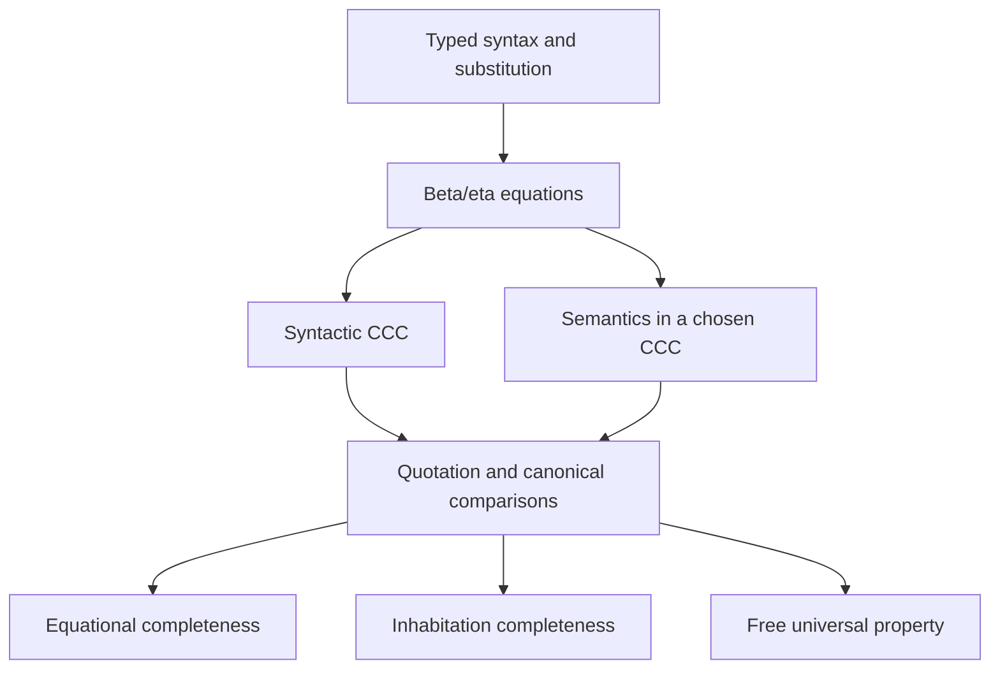

# Understanding the STLC theory

# 理解 STLC 理论

This guide explains the mathematical route through the flat STLC modules.
Read the [checked tutorial](../book/STLC.v) first if lambda syntax or intrinsic
typing is new to you. It follows identity and duplication through the whole
construction. The source modules provide local explanations of the definitions
and the proof dependencies; this guide connects those explanations.

本指南说明平铺 STLC 模块之间的数学路线。若第一次接触 λ 语法或内在类型化，
先读[经过编译检查的教程](../book/STLC.v)：它用恒等与复制贯穿整个构造。
源码模块解释各个定义及证明依赖，本指南负责把这些局部解释连起来。

## 1. What is being constructed? / 构造的是什么？

The language has base-type labels, unit, binary products and function types,
with no primitive term constants. Three results share one implementation:

- **Equational completeness:** two given terms are beta/eta equal exactly
  when they are equal in every CCC model at a common universe bound.
- **Inhabitation completeness:** a context and type have a term exactly when
  a uniform family supplies the corresponding morphism in every such model.
- **The free CCC property:** a base assignment extends to a structure-preserving
  interpretation, canonical up to a specified natural isomorphism and uniqueness.

The two completeness statements provide constructive maps between Types.
They do not assert equality of proof objects or a decision procedure.

语言具有基类型标签、单位、二元积与函数类型，没有原始项常量。
同一套实现支持三个结论：

- **等式完备性：**两个给定项 βη 相等，当且仅当它们在共同宇宙界内的每个
  CCC 模型中解释相等。
- **可居留性完备性：**上下文与类型具有一个项，当且仅当一个统一见证族能在
  每个这样的模型中提供相应态射。
- **自由 CCC 性质：**基类型赋值扩张为保持结构的解释；指定的自然同构与
  唯一性说明这种扩张的规范性。

两个完备性陈述给出 Types 之间的构造性映射，不断言证明对象相等，也不提供
判定过程。

## 2. Reading map / 阅读地图

The diagram is a conceptual dependency map. The table below names the actual
files. The reference reading editions additionally respect every source import.

下图是概念依赖图，后表列出实际文件。参考阅读版还会遵守全部源码导入依赖。



| Stage / 阶段 | Modules / 模块 | Question / 问题 |
| --- | --- | --- |
| Raw language / 原始语言 | [Syntax](../theories/STLC/Syntax.v), [Renaming](../theories/STLC/Renaming.v), [Substitution](../theories/STLC/Substitution.v) | What can be built and substituted? / 能构造、替换什么？ |
| Equations / 等式 | [Equivalence](../theories/STLC/Equivalence.v), [Set](../theories/STLC/Set.v) | Which terms count as equal? / 项按什么关系相等？ |
| Context category / 上下文范畴 | [Category](../theories/STLC/Category.v), [Context](../theories/STLC/Context.v), [Product](../theories/STLC/Product.v) | Why are substitutions arrows and concatenations products? / 为什么替换是箭头、连接是积？ |
| Syntactic CCC / 语法 CCC | [Packing](../theories/STLC/Packing.v), [Exponential](../theories/STLC/Exponential.v), [CCC](../theories/STLC/CCC.v) | Why do function types have the full exponential property? / 为什么函数类型满足完整指数泛性质？ |
| Presentations / 呈现 | [TypeCategory](../theories/STLC/TypeCategory.v), [ContextEquivalence](../theories/STLC/ContextEquivalence.v) | How can types replace contexts as objects? / 如何改用类型作为对象？ |
| Interpretation / 解释 | [Semantics](../theories/STLC/Semantics.v), [Interpretation](../theories/STLC/Interpretation.v), [TypeInterpretation](../theories/STLC/TypeInterpretation.v) | How does syntax become a CCC functor? / 语法如何成为 CCC 函子？ |
| Comparison / 比较 | [Quotation](../theories/STLC/Quotation.v), [Comparison](../theories/STLC/Comparison.v) | How are recursive and literal representations related? / 递归表示与字面表示如何联系？ |
| Goal entries / 目标入口 | [Equational](../theories/STLC/Equational.v), [Inhabitation](../theories/STLC/Inhabitation.v), [Free](../theories/STLC/Free.v) | What do all-model validity and the free property guarantee? / 全部模型有效性和自由性质保证什么？ |

The flat organization is intentional. The two goal entries share the same
syntax, category and comparison constructions. Inhabitation imports the
comparison theory directly; it does not need the universal equation-validity
interface from the equational entry.

平铺组织是有意保留的。两个目标入口共享语法、范畴与比较构造。
可居留性直接导入比较理论，无须使用等式入口中“全部模型的等式有效性”接口。

## 3. Reading the syntax / 阅读语法

The judgement `Γ ⊢ t : A` is represented by a value `t : Tm Γ A`.
The context and result type are indices of the term datatype. Application
therefore requires an argument with the function's declared input type;
abstraction requires its body in a context extended by the input type.
Ill-typed applications
cannot be supplied to these constructors. This is **intrinsic typing**, not
inference of types for an independently given untyped expression.

判断 `Γ ⊢ t : A` 由一个值 `t : Tm Γ A` 表示。上下文与结果类型是项数据类型
的索引，因此应用要求实参具有函数声明的输入类型，抽象则要求项体位于按输入
类型扩张的上下文中。无法给这些构造器提供类型错误的应用。这是**内在类型化**，不是为一个
独立给定的无类型表达式推断类型。

In `∅ ▻ A ▻ U`, `𝟘` is the newest variable of type `U`, while `↑v 𝟘` is
the older variable of type `A`. They remain different positions even if
`A` and `U` coincide. Variables are implemented by an ordinary sum of older
positions and a small indexed marker for the newest binding. Consequently,
lookup and binder lifting do not need decidable equality of base labels.
Parenthesize nested function types explicitly, for example `A ⇒ (U ⇒ A)`.

在 `∅ ▻ A ▻ U` 中，`𝟘` 是类型为 `U` 的最新变量，`↑v 𝟘` 是类型为 `A`
的旧变量。即使 `A`、`U` 相同，它们仍是不同位置。变量由旧位置与最新绑定的
小型索引标记组成普通和类型，所以查找及绑定提升不需要基类型标签相等可判定。
嵌套函数类型应显式加括号，例如 `A ⇒ (U ⇒ A)`。

A base label describes a type, not an element of it. Interpreting one label
by the Boolean setoid does not add Boolean constants or negation to the syntax.
The tutorial's Boolean example evaluates terms built from variables and the
unit/product/function constructors.

基类型标签描述一个类型，不是该类型中的元素。把某个标签解释为布尔广集，
并不会给语法加入布尔常量或取反操作。教程中的布尔例子求值的仍是由变量及
单位、积、函数构造器组成的项。

## 4. Substitution and binding / 替换与绑定

A substitution `σ : Sub Δ Γ` builds every variable requested by `Γ` from
inputs available in `Δ`. Its categorical direction is `Δ → Γ`. Its action
on terms goes from `Tm Γ A` to `Tm Δ A`, because the term can use those
constructed components as its inputs. This is precisely precomposition.
A renaming is the special case that assigns only variable terms.

替换 `σ : Sub Δ Γ` 用 `Δ` 中可用的输入构造 `Γ` 所需的每个变量，范畴方向
是 `Δ → Γ`。它对项的作用从 `Tm Γ A` 到 `Tm Δ A`，因为原项可以把构造好的
分量作为输入。这正是预合成。重命名是只赋予变量项的特殊替换。

```text
σ : Sub Δ Γ       τ : Sub Θ Δ
σ ∘Sub τ : Sub Θ Γ
(σ ∘Sub τ) A x = (σ A x)[τ]
t[σ][τ] = t[σ ∘Sub τ]
```

Under a lambda, the old assignments and the fresh binding have different
roles. Every old assigned term is weakened into the extended source context;
the fresh variable maps to itself. For the informal term `λ y, x`, replacing
its free `x` by a term `u` produces a lambda whose body is weakened `u`.
It does not replace `x` by the new bound variable. The tutorial checks this
calculation on raw syntax in `ignore_fresh_substitution`.

进入 λ 后，旧赋值与新绑定具有不同角色：每个旧赋值项先弱化到扩张后的源
上下文，新变量映为自身。对非形式记法 `λ y, x`，用项 `u` 替换自由变量 `x`，
结果的 λ 项体是弱化后的 `u`，不会变成新绑定变量。教程中的
`ignore_fresh_substitution` 在原始语法上检查了这一步计算。

The substitution laws compare assignments pointwise. That is enough to prove
structural equalities of substituted terms and, later, category laws. No step
requires equality of the functions implementing two assignments.

替换定律逐点比较赋值，已经足以证明替换后项的结构相等，以及后续范畴律。
不需要证明实现两个赋值的函数相等。

## 5. Which equality? / 使用哪一种相等？

| Comparison / 比较 | Meaning / 含义 | Typical use / 用途 |
| --- | --- | --- |
| Raw `eq` / 原始 `eq` | The same syntax tree / 同一棵语法树 | Structural substitution calculations / 结构替换计算 |
| `TmEq`, `SubTmEq` | Beta/eta derivations, pointwise for assignments / βη 推导，赋值逐点比较 | Syntactic hom equality / 语法 Hom 相等 |
| `HomEq` | The equality specified by the target category / 目标范畴指定的相等 | Semantic soundness / 语义可靠性 |
| Object or natural isomorphism / 对象同构或自然同构 | Explicit invertible categorical comparison / 显式可逆的范畴比较 | Packing, presentation equivalence, free interpretation / 打包、呈现等价、自由解释 |

`TmEq` includes reflexivity, symmetry, transitivity, constructor congruence,
and the unit/product/function equations. Beta checks elimination after
introduction. Eta reconstructs an element from its elimination behavior.
Their symmetric closure is an equational theory, not a chosen evaluation
strategy. Distinct raw trees can therefore be beta/eta equal.

`TmEq` 包含自反、对称、传递、构造器同余及单位、积、函数方程。β 检查引入
后的消去，η 根据消去行为重建元素。对称闭包给出等式理论，而不是选定的求值
策略。因此，不同原始树可以 βη 相等。

`TmS Γ A` retains raw terms as its carrier and chooses `TmEq` as equality.
It is a setoid, not a quotient datatype. Derivations remain Type-valued data,
and no equality of derivations is imposed. `Proper` proofs show that an
operation preserves the specified relation; they are the permission to replace
inputs by equal ones when composing respectful maps and functors.

`TmS Γ A` 保留原始项作为载体，选择 `TmEq` 为相等。它是广集，不是商数据
类型。推导保留为 Type 值数据，也未对推导施加相等。`Proper` 证明操作保持
指定关系，使组合保相等映射与函子时能够替换相等的输入。

## 6. Interpreting terms in a CCC / 在 CCC 中解释项

Choose a category `C`, explicit chosen structure `HC : CCC C`, and base
assignment `I : B → Ob C`. These are parameters of the interpretation.
A CCC is used through its terminal, product and exponential universal
properties; `SetCat` is one concrete model, not the definition of semantics.

选定范畴 `C`、显式结构 `HC : CCC C` 和基类型赋值 `I : B → Ob C`。
这些都是解释的参数。使用 CCC 时依赖其终对象、积和指数泛性质；`SetCat`
只是一个具体模型，并非语义的定义。

| Syntax / 语法 | Interpretation / 解释 |
| --- | --- |
| `⊤` | Chosen terminal object / 选定终对象 |
| `A × U` | Product of the two interpreted types / 两个解释类型的积 |
| `A ⇒ U` | `(TyI I U ^ TyI I A)` / 相应指数对象 |
| Empty context / 空上下文 | Terminal object / 终对象 |
| Context extension / 上下文扩张 | Product with the new interpreted type / 与新解释类型取积 |
| Pair, projection / 配对、投影 | Pairing, composition with projections / 配对、与投影复合 |
| Lambda, application / λ、应用 | Curry, evaluation / 转置、求值 |

`Env I X Γ` gives each variable an arrow out of a common object `X`.
The evaluator first works for arbitrary `X`; under a binder it uses
`X × TyI I A`, reindexes old assignments by the first projection, and uses
the second projection for the fresh variable. This generality is what makes
the substitution and binder proofs line up.

`Env I X Γ` 为每个变量提供一条从共同对象 `X` 出发的箭头。求值器先允许任意
`X`；进入绑定时使用 `X × TyI I A`，旧赋值沿第一投影预合成，新变量使用
第二投影。这份一般性使替换和绑定的证明能够衔接。

The canonical projection environment specializes evaluation to `tm_interp`.
`env_tuple` then assembles variable assignments into a map to the nested
context product. Its beta and eta laws give semantic substitution:

规范投影环境把求值特化为 `tm_interp`。`env_tuple` 再将变量赋值组成指向
嵌套上下文积的映射，其 βη 律给出语义替换：

```text
tm_interp I (t[σ]) ≈ tm_interp I t ∘ sub_interp I σ
```

Equational soundness is proved by induction on a beta/eta derivation.
Its beta cases use substitution compatibility; eta uses the target universal
properties. This proof is needed before assembling interpretation functors,
so it lives in [Semantics](../theories/STLC/Semantics.v), while the all-model
equational entry lives in [Equational](../theories/STLC/Equational.v).
Both results are exposed by the equational entry.

等式可靠性对 βη 推导归纳。β 情形使用替换相容性，η 情形使用目标泛性质。
构造解释函子之前就需要此证明，因此它位于
[Semantics](../theories/STLC/Semantics.v)，全部模型的等式入口则位于
[Equational](../theories/STLC/Equational.v)。等式入口公开这两部分结果。

The constructions reuse [products](../theories/Cat/Product/Core.v),
[exponentials](../theories/Cat/Exponential/Core.v),
[exponential transport](../theories/Cat/Exponential/Transport.v), and
[CCC-functor comparisons](../theories/Cat/Functor/Closed.v). Their general
universal-property proofs are not duplicated for each syntax presentation.

这些构造复用一般的[积](../theories/Cat/Product/Core.v)、
[指数](../theories/Cat/Exponential/Core.v)、
[指数运输](../theories/Cat/Exponential/Transport.v)与
[CCC 函子比较](../theories/Cat/Functor/Closed.v)，不会为各个语法呈现重复证明
一般泛性质。

## 7. Why syntax is itself a CCC / 为什么语法自身是 CCC

In `CtxCat B`, objects are contexts and arrows are simultaneous substitutions.
Hom equality is pointwise beta/eta. Empty context is terminal because it has
no components to fill. Concatenation is product because assignments split into
left and right blocks and can be reconstructed from those blocks.

在 `CtxCat B` 中，对象是上下文，箭头是同时替换，Hom 相等为逐点 βη。
空上下文没有待填分量，因而是终对象。赋值可以拆成左右两块，并由两块重建，
因而连接给出积。

For exponentials, abstraction constructs a mediator, function beta verifies
its evaluation equation, and function eta proves uniqueness. First do this
for singleton inputs and outputs. Then encode a whole context by its packed
type and transport the exponential property along the packing isomorphisms.
This separates the essential function argument from representation bookkeeping.

对指数而言，抽象构造中介，函数 β 检查求值方程，函数 η 证明唯一性。
先对单变量输入和输出完成证明，再用打包类型编码整个上下文，沿打包同构运输
指数泛性质。这把函数的核心论证与表示细节分开。

```text
CtxTy ∅ = ⊤
CtxTy (Γ ▻ A) = CtxTy Γ × A
Γ ≅[CtxCat B] (∅ ▻ CtxTy Γ)
```

`TyCat B` uses types as objects and singleton-context substitutions as arrows.
Its unit, products and functions are the literal type constructors. It is an
induced category, not a second implementation of substitution composition.
`ContextCategoryEquivalence` compares it with `CtxCat B` by functors and
natural isomorphisms. The different object presentations are not required
to be equal.

`TyCat B` 以类型为对象、单变量上下文替换为箭头，其单位、积和函数直接使用
字面类型构造器。它是诱导范畴，不是第二套替换复合实现。
`ContextCategoryEquivalence` 用函子与自然同构将其同 `CtxCat B` 比较，
不要求不同的对象呈现相等。

## 8. Quotation and comparison / 语法还原与比较

A recursively interpreted type inside `TyCat B` need not be definitionally
the original type. Chosen terminal/product representations and the source
context shape must still be accounted for. An equality of their underlying
functions would be stronger than the mathematics needs.

在 `TyCat B` 内递归解释类型，所得结果不必按定义相等就是原类型。选定的
终对象、积表示以及源上下文形状仍须处理。要求底层函数相等，会强于数学本身
所需要的比较。

There are two complementary tools:

- `quote_tm` represents a term by a literal arrow `CtxTy Γ → A`.
  Its faithfulness is proved by extracting a component and substituting the
  packed identity environment back in. Quotation is not normalization.
- `type_compare` and `context_compare` compare recursive interpretation with
  any CCC-preserving functor `F`, relative to specified base isomorphisms.
  The comparison for a function type uses inverse transport in its argument.

有两组互补工具：

- `quote_tm` 把项表示为字面箭头 `CtxTy Γ → A`。从箭头相等取出分量，再代回
  打包的恒等环境，便证明其忠实性。语法还原不是正规化。
- `type_compare`、`context_compare` 相对于指定基类型同构，将递归解释与
  任意保持 CCC 结构的函子 `F` 比较。函数类型的比较在参数处使用逆向运输。

Their central compatibility law is:

二者衔接的核心定律是：

```text
type_compare(A).1 ∘ tm_interp I t
  ≈ fmap F (quote_tm t) ∘ context_compare(Γ).1
```

The statement first compares evaluation in related environments; specialization
then gives the displayed equation. Using the identity functor yields the
canonical-model comparisons needed by both completeness arguments.

先比较相关环境中的求值，再特化便得到上面的方程。使用恒等函子，就得到
两个完备性论证共同使用的规范模型比较。

## 9. Two goals, four directions / 两个目标、四个方向

| Goal / 目标 | Soundness / 可靠性 | Completeness / 完备性 |
| --- | --- | --- |
| Equations / 等式 | A beta/eta derivation gives equal interpretations in each model / βη 推导给出每个模型中的解释相等 | Equality in every model gives a beta/eta derivation / 全部模型中的解释相等给出 βη 推导 |
| Inhabitation / 可居留性 | A term gives a semantic morphism in each model / 项给出每个模型中的语义态射 | A uniform semantic morphism family gives a term / 统一语义态射族给出项 |

The equational problem starts with `t` and `u`. The inhabitation problem starts
only with `Γ` and `A`. In both cases, “every model” is essential: a particular
model can forget distinctions, and a morphism in one particular model is not
a uniform family of morphisms across the models.

等式问题从 `t`、`u` 出发，可居留性问题只从 `Γ`、`A` 出发。两者中的“每个
模型”都很关键：一个特定模型可能忘记某些区别，在一个特定模型中的态射也不等于
跨模型的统一态射族。

### 9.1. Equational completeness / 等式完备性

1. Specialize all-model equality to `TyCat B`, its chosen CCC, and `ty_base`.
2. Use the comparison equation for both terms to get equality of quoted arrows
   after a common context comparison.
3. Cancel that context isomorphism by its inverse.
4. Apply `quote_tm_faithful` to recover `TmEq t u`.

This is the proof of `tm_interp_canonical_reflect`, used by
`tm_soundness_iff_completeness`. It constructs an equational derivation and
never searches for a normal form.

1. 把全部模型的相等实例化为 `TyCat B`、其选定 CCC 以及 `ty_base`。
2. 对两个项使用比较方程，得到语法还原箭头在同一个上下文比较之后的相等。
3. 用逆箭头消去该上下文同构。
4. 使用 `quote_tm_faithful`，恢复 `TmEq t u`。

这就是 `tm_soundness_iff_completeness` 所使用的
`tm_interp_canonical_reflect` 的证明。它构造等式推导，不搜索正规形。

### 9.2. Inhabitation completeness / 可居留性完备性

The premise `H : TmModelInhabited Γ A` is a function returning a morphism for
any model, chosen CCC structure and base assignment at the common bound.
Specialize it to the syntactic CCC, obtaining `h`. Inside this model, let
`z` be the context comparison and `a` the type comparison:

前提 `H : TmModelInhabited Γ A` 是一个函数，在共同大小界内对任意模型、选定
CCC 结构与基类型赋值返回态射。把它实例化为语法 CCC，得到 `h`。在该模型内部，
令 `z` 为上下文比较，`a` 为类型比较：

```text
h : CtxI ty_base Γ → TyI ty_base A
z : CtxI ty_base Γ ≅ CtxTy Γ
a : TyI ty_base A ≅ A
σ := a.1 ∘ h ∘ z.2.1 : CtxTy Γ → A
result := (σ A var_zero)[ctx_pack_sub Γ] : Tm Γ A
```

The last step uses the literal meaning of a `TyCat` arrow: it is a substitution
between singleton contexts. Selecting its newest component gives a term with
one packed-context input. Substituting the packed identity environment restores
the original context. Every step projects or composes existing data.

最后一步使用 `TyCat` 箭头的字面含义：它是两个单变量上下文间的替换。
取最新分量，就得到只有一个打包上下文输入的项；再代入打包的恒等环境，恢复
原上下文。每一步都只是投影或复合已有数据。

## 10. The free property / 自由性质

Fix a target CCC, base assignment `I`, CCC functor `F`, and specified
isomorphisms `β b : I b ≅ F (ty_base b)`. Recursive interpretation gives
`TypeInterpretF I`. The theorem `type_interpretation_universal` gives its
natural isomorphism to `F`, unique among natural transformations with those
same base components.

固定目标 CCC、基类型赋值 `I`、CCC 函子 `F` 及指定同构
`β b : I b ≅ F (ty_base b)`。递归解释给出 `TypeInterpretF I`。
`type_interpretation_universal` 给出它到 `F` 的自然同构，并在具有同样基类型
分量的自然变换中证明唯一性。

Uniqueness follows the type constructors. Unit uses terminality; the product
components are forced by projection naturality; function components are forced
by evaluation naturality and the invertible argument comparison. Candidate
natural transformations need no extra preservation fields. The theorem compares
their components by hom equality, not their naturality proofs or functor records.

唯一性沿类型构造器展开：单位使用终对象性质；投影自然性确定积分量；求值
自然性与可逆参数比较确定函数分量。候选自然变换无须附加保持结构的字段。
定理按 Hom 相等比较分量，不比较自然性证明或函子记录。

## 11. Witnesses and universes / 见证与宇宙

`TmModelInhabited` returns actual morphisms. Replacing that with Prop-level
nonemptiness changes the interface: it does not generally permit extracting
a term in Type. There is also a distinction between merely having a witness
family and requiring equations relating its choices across different models;
the current interface asks only for the family.

`TmModelInhabited` 返回实际态射。将其改成 Prop 层非空性会改变接口：通常不能
从中提取 Type 中的项。拥有见证族，与要求该族在不同模型的选择之间满足方程，
也是不同的要求；当前接口只要求见证族。

The library's `↔` is `iffT`, a pair of maps between Types. It does not assert
that the maps are inverse, that the Types are equal, or that arbitrary model
witnesses equal the interpretation of the extracted term.

库中的 `↔` 是 `iffT`，即 Types 之间的一对映射。它不断言映射互逆、Types 相等，
也不断言任意模型见证等于提取项的解释。

At the common bound `Cat@{b b e l l}`, objects and hom carriers have bound `b`,
hom equality witnesses have bound `e`, and category laws use auxiliary `l`.
The syntactic model fits its required constraints, including separated levels
`b < e < l`. Quantifying over these model records lives in a suitably larger
universe, not in an assumed small universe containing all categories.
General soundness allows other model-size arrangements as well.

在共同界 `Cat@{b b e l l}` 中，对象和 Hom 载体的界为 `b`，Hom 相等见证的
界为 `e`，范畴律使用辅助宇宙 `l`。语法模型符合所需约束，包括分离层级
`b < e < l`。对模型记录的量化位于适当的更大宇宙，不是假定存在一个包含所有
范畴的小宇宙。一般可靠性还允许其他模型大小排列。

## 12. Boundaries and checks / 边界与检查

These results do not supply normalization, decidable beta/eta equality,
inhabitation search, type inference for raw untyped terms, or a syntax with
primitive constants. Those are separate constructions. No function
extensionality, proof irrelevance, UIP, choice, resizing or quotient axiom
is introduced by the present proofs.

这些结果不提供正规化、βη 相等判定、可居留性搜索、无类型原始项的类型推断，
也不提供带原始常量的语法。这些属于独立构造。现有证明没有引入函数外延、
证明无关性、UIP、选择、大小重设或商公理。

The tutorial examples compile with the library. The retained universe regression
in [Universes](../tests/Universes.v) checks the goal interfaces with separated
levels. Focused `Print Assumptions` commands are temporary audits rather than
compiled reference material. Build and validate with the initialized toolchain:

教程例子与库一起编译。[Universes](../tests/Universes.v) 中保留的宇宙回归检查
目标接口的分离层级。针对性的 `Print Assumptions` 是临时审计，不是编译进库的
参考材料。使用已初始化的工具链构建与验证：

```sh
opam exec --switch=rocq-env -- nix-shell --run \
  'dune build @all @runtest @install'
```

Use the [reading-edition guide](./Documentation.md) to export both languages.
The milestone records are [#9](https://github.com/Godalin/rocq-cats/issues/9),
[#20](https://github.com/Godalin/rocq-cats/issues/20), and
[#32](https://github.com/Godalin/rocq-cats/issues/32). Reduction and normalization
remain the independent directions [#24](https://github.com/Godalin/rocq-cats/issues/24)
and [#25](https://github.com/Godalin/rocq-cats/issues/25).

按[阅读版指南](./Documentation.md)导出两种语言。里程碑记录见
[#9](https://github.com/Godalin/rocq-cats/issues/9)、
[#20](https://github.com/Godalin/rocq-cats/issues/20) 和
[#32](https://github.com/Godalin/rocq-cats/issues/32)。归约与正规化仍是独立方向
[#24](https://github.com/Godalin/rocq-cats/issues/24) 和
[#25](https://github.com/Godalin/rocq-cats/issues/25)。
