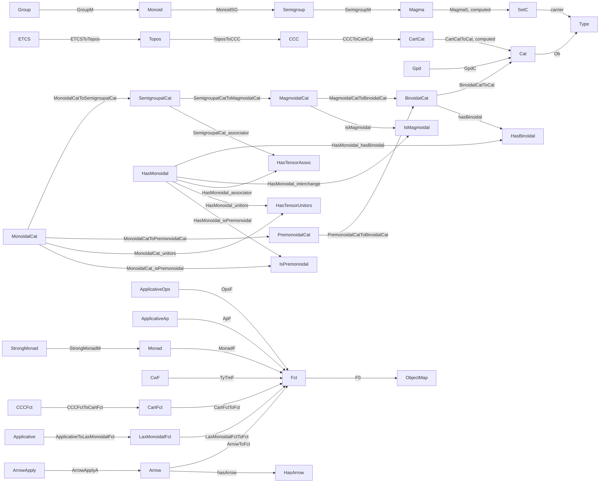

# Bundled interfaces and underlying views

Historical audit. Names, implementation choices and validation results below refer
to their recorded revisions. For current authoring rules, see the
[mathematical interface guide](../development/HierarchyDevelopment.md).


For new migrations, follow the [mathematical interface guide](../development/HierarchyDevelopment.md).

Public identifiers in this guide follow the current
[abbreviation map](../development/Abbreviations.md); dated baseline inventories below
remain historical evidence.

The [dated whole-library audit](#library-wide-structure-and-naming-audit)
started with all 87 class/record interfaces at baseline `5d87331`, growing to
100 interfaces at its later synchronized checkpoint. It records the structural
naming and inheritance findings after the CCC changes. The complete-category
slice below gives a fresh inventory for its own integration baseline.

The lax monoidal interface now bundles its underlying functor and structure
in one record, exposing a single coercion to `Fct`. The first follow-up
from the library-wide survey now adds bundled cartesian and cartesian closed
functors. Existing fixed-data preservation interfaces remain available for
general theorems alongside those bundles.

The [structured-category universes](../theory/StructureUniverses.md) now build a
cartesian category of cartesian categories and a groupoid of groupoids and
equivalences. Both support self-membership at distinct universe instances.

The current local follow-up also makes `CartFct` and `CCCFct`
complete records. Their unique parent projections are `CartFctToFct` and
`CCCFctToCartFct`; `MakeCartFct` and `MakeCCCFct` are direct
constructors. `CCCFctOfIsCCCF` retains the useful fixed-functor preservation
presentation. `IsCartF` and `IsCCCF` remain classes. `functor_*` and
`exponential_*` identifier segments now use `fct` and `exp`, with the exact
map in [the naming guide](../development/Abbreviations.md). Historical class inventories
below describe their dated baselines.

`HasLaxMonoidalF F` gives a fixed functor its unit comparison,
natural tensorator and three coherence laws. `MakeLaxMonoidalFct F`
packs this choice. The bundle exposes its underlying functor through
`LaxMonoidalFctToFct` and its chosen comparisons through `hasLaxMonoidalF`.

For a monoidal category `C`, `IsMonoidObj A e m` states the laws of
given maps. `HasMonoidObj A` chooses the maps and their laws on `A`.
`MakeMonoidObj A H` packages that choice as a `MonoidObj C`.
Use `M` directly as its underlying object. The notations `e[M]` and `m[M]` give
the unit and multiplication selected in `M`.

`MonoidalFct` now extends that same `LaxMonoidalFct` through the unique
`MonoidalFctToLaxMonoidalFct` projection and the
`MonoidalFctOfLaxMonoidalFct` packing function. In this library, an unqualified
monoidal functor means a strong monoidal functor: its stored unit and tensor
comparisons are invertible. Only Type-valued inverse witnesses are added;
forward maps and coherence stay in the lax parent. `MonoidalUnitIso` and
`MonoidalTensorIso` expose transparent views, and `MonoidalTensorInvN`
derives inverse naturality through the general natural-isomorphism theory.
`IdMonoidalF` extends the exact lax identity and is explicitly selected.
Tensorial strength remains a separate notion.

`Applicative C` extends the cartesian lax endofunctor. Its `HasApplicative`
mixin chooses a natural pure map compatible with that parent's unit and
tensorator. `ApplicativeOfLaxMonoidalFct L H` packs the selected lax functor
and its pure structure. The binary lifting and closed application
presentations, `ApplicativeOps` and `ApplicativeAp`, each extend an
endofunctor directly and use the fixed-operation laws of `IsApplicativeOps`.
Separately, `HasStrength F` selects a tensorial strength on a fixed endofunctor.

The binoidal migration starts the monoidal category hierarchy at its
weakest layer. [IsFct](../../theories/Cat/Functor/Core.v) groups respectfulness,
identity and composition laws on supplied maps. `HasBinoidal C` selects one
object tensor and two arrow actions; `isBinoidalL` and `isBinoidalR`
apply that same law interface separately. The `MakeFct` constructor assembles the
fixed-context functors without selecting another object map. `BinoidalCat`
is now a complete record, with `BinoidalCatToCat :> Cat`, one `hasBinoidal`
choice and direct constructor `MakeBinoidalCat`.

[Functor.Core](../../theories/Cat/Functor/Core.v) declares `MakeFct` with
`fobj`, `fmap`, and the matching `isFct` witness. The laws
`fmap_proper`, `fmap_id`, and `fmap_comp` come from that witness.

`BifctHasBinoidal` and `ArrowHasBinoidal` supply choices on fixed
categories. `BifctBinoidal` and `ArrowBinoidal` bundle those exact choices
and categories. `PremonoidalCat` shares the category and tensor of
`BinoidalCat` and adds the associator and coherent unitors. Minks generates
its ancestor views. `MonoidalCat` combines the premonoidal and semigroupal
branches and exports `HasMonoidal` on the fixed category.
Both structures use `HasTensorAssoc`, `HasTensorUnitors` and `IsPremonoidal`
directly on the selected tensor.

The bifunctor and Arrow models use Minks-generated packing functions to
add components to their direct parents. The cartesian model constructs
one monoidal category from its product bifunctor. Its fixed-category
choice reads the same components through [MonoidalCatToHasMonoidal](../../theories/Cat/Monoidal/Monoidal.v).

### Wedges and selected ends

[Wedge](../../theories/Cat/End/Wedge.v) is a record at a fixed bifunctor
and apex. `WedgeOfLegs` packages the diagonal legs and their commuting
equation, and the leg projection still gives the function view.
[Cowedge](../../theories/Cat/Coend/Wedge.v) stores the corresponding opposite
wedge, with `CowedgeOfOpWedge` as its constructor. `CowedgeOf` assembles
that same record from legs and equations in the original category.

`HasEnd` and `HasCoend` are classes for selected universal wedges of
a supplied bifunctor. `is_end` and `is_coend` describe the candidate
properties. `HasCoendOfOpEnd` uses the supplied opposite-end choice
directly, preserving its Type-valued mediator witnesses. Day convolution
and profunctor composition continue to use their particular coend choices.

## Pre-stable refactoring policy

[Issue #42](https://github.com/Godalin/rocq-cats/issues/42) is the sole
repository-wide structure architecture issue. Before a stable release, prefer
clean mathematical interfaces over historical source compatibility. Migrate
actual clients, proofs, models, tests and bilingual documentation together.
Remove obsolete compatibility aliases, transitional classes and wrappers;
do not preserve constructor shapes, implicit argument forms or universe
argument positions solely because previous releases used them. Useful
mathematical views remain justified by their actual clients, rather than by
compatibility. The [README](../../README.md) states the public policy and
[AGENTS.md](../../AGENTS.md) gives the development rules.

This policy relaxes backward compatibility, not mathematical correctness.
Preserve specified setoid equality, Type-valued computational witnesses,
coherent inheritance, intended independent universe bounds, transparency and
absence of unintended axioms. Universe *positions* may change; needed size
independence must still be verified. Keep bounded changes and serial
integration instead of attempting an all-library rewrite in one batch.

## Complete algebra hierarchy: current migration

The concrete algebra work is recorded in
[issue #15](https://github.com/Godalin/rocq-cats/issues/15#issuecomment-6906208038).
The current local batch starts at `aa66f9a`, following accepted monoid
prerequisite `b9b357b`, on `hierarchy-packed-algebra-42`. The user expanded its
scope from fixed-parent group extensions to the whole existing vertical chain
`Magma → Semigroup → Monoid → Group`, with its actual clients. This local
batch has passed source, regression and installation validation;
it is not an accepted integration result. The user requested review before a
further integration submission.

The ergonomic follow-up starts at published review commit `e30adfa`, applying
the new directional-parent and operation-subject rules from #42. Its exact
54-name map is recorded separately in
[the naming guide](../development/Abbreviations.md#algebra-interface-ergonomics)
and [#38's naming review](https://github.com/Godalin/rocq-cats/issues/38#issuecomment-6908412626).
The earlier 195-entry abbreviation table and frozen sources are preserved.
This follow-up has passed local validation and is retained for user review;
it is not an integration result.

The user has approved saving the completed local algebra work as a review
checkpoint. Earlier descriptions of uncommitted work below record the editing
history; this checkpoint includes the parent-named direct constructors,
Comm/Ext client migration, derived inverse respectfulness and simplified
unit typing. The last relevant edit passed six concrete targets and six
closed temporary reports; the preceding inverse-respectfulness step passed
14 affected targets and six closed reports. Earlier naming/constructor
checks are recorded at their respective checkpoints. Full-library integration
acceptance, push and further hierarchy migrations are separate actions.

The four complete interfaces are unparameterized records generated by
`Minks.Struct`. Each packs one setoid and the selected mixins.
`HasMagma` selects respectful multiplication. `IsSemigroup` and
`HasUnit` both extend that selection, respectively by associativity and
a unit with its laws. `HasInverse` extends the selected unit and
multiplication by an inverse and its laws. The generated ancestor views
recover the exact stored components.

For carrier and equality levels `u` and `p` and law bound `l`,
the records have sort `Type@{max(u+1,p+1,l)}`. The `Proper` witness
requires `u <= l` and `p <= l`. All four records list their universes as `@{u p l}`.

In [the monoid core](../../theories/Algebra/Monoid/Core.v), `mul_unit` is the
actual `HasUnit` field; `mul_unit_l/r` are the actual `IsUnit` fields.
There are no additional exported definitions to emulate the old unit APIs.
The numeral notation explicitly uses the complete monoid's stored evidence.
Fixed-parent clients use these same fields with their supplied evidence.
Likewise `mul`, `mul_proper`, `mul_assoc`, `inv` and
`mul_inv_l/r` are the actual extension/property fields, without `chosen`
intermediate names or same-name forwarding definitions. Multiplication and
inverse notation pass the complete object's stored evidence explicitly.
Respectful maps and derived inverse laws remain genuine constructions; no
view independently redefines an operation or proves its laws again.

Multiplication sections `(x ⋅−)` and `(−⋅ y)` denote the existing respectful
left- and right-multiplication maps. The shared `algebra_scope` provides
these notations; their composites use ordinary `∘r`. For example,
associativity gives `((x ⋅ y) ⋅−) ≈f ((x ⋅−) ∘r (y ⋅−))`.

The fixed-parent inverse-uniqueness theorem `mul_ext_inv_unique` types
its elements in `MonoidOfSemigroup SG HM`, so both inverse hypotheses use
bare `1`. This view has definitionally the same carrier and specified
equality as `SG`, retaining exactly the supplied `HM`; moving the annotation
introduces no additional mathematical assumption or transport.

All four cores share that one scope, delimited by `%alg`. The magma core
fixes multiplication's common grammar with `Reserved Infix` before the
operation is defined, then binds its interpretation once the complete
magma's stored evidence is available. It also defines both respectful
sections once. The semigroup core re-exports them; the monoid and group
cores add only `1` and `x⁻¹`, respectively. Their `Require Export` chain
exposes the whole family when importing only `Algebra.Group.Core`.
Each client uses `Local Open Scope algebra_scope`, or explicit `%alg`;
importing a core does not open the algebra scope for its clients.
No Notations module, automatic scope binding or repeated inherited
interpretation is needed. The old `magma_scope` / `monoid_scope` and
their `%magma` / `%monoid` delimiters are removed.

Reservations declare grammar only. They do not make an operation, scope
interpretation or instance available before its definition. Reserve only
the shared multiplication grammar here; ordinary declarations suffice for
the closed sections, unit and inverse. In particular, do not reserve the
preexisting numeral `1`. A compiled prototype also confirms that Rocq 9.3
rejects `where` clauses on `Record`/`Class`; reserve syntax and bind it
after the declaration instead of adding a staging interface or alias.
The [group-only import regression](../../tests/algebra/AlgebraNotation.v) checks
all five forms, precedence, explicit delimiters and local scope lifetime.

The selected inverse is the single `inv` field. The unit is named
`mul_unit`: the bare name `unit` already denotes Rocq's one-element type.
Neither stronger structures nor notation duplicate these choices. Where
short names conflict with other theories, use qualified access such as
`Cats.Algebra.Magma.Core.mul`, or supply the selected `HasMagma` explicitly.
Routine expressions use `⋅`, `1` and `⁻¹`, not repeated explicit projection
applications. For example, the transported operation is simply
`g (f x ⋅ f y)`. Ordinary law applications use inference directly, as in
`rewrite mul_assoc` in ordinary equational proofs; do not introduce local
forwarding bindings when the selected structure is already inferred. Supply factor
arguments only to identify a particular rewrite site. Unit and inverse laws
likewise infer their parent and operation; write `rewrite mul_unit_l` rather
than expanding projection parameters. `units_equiv` infers its semigroup,
elements and unit witnesses from the expected equality. Ordinary uses of `1`
need no type annotation when the expression determines its monoid. When inference cannot
identify the intended evidence, select it explicitly, without a forwarding
binding. Actual `rewrite` clients check multiplication and both section
instances through map composition. The general `func_apply_proper` instance
allows a varying bundled map to be rewritten after evaluation.
Transport laws apply the primitive preservation witnesses directly: setoid
rewriting can insert opaque standard-library helpers into Type-valued proof
data, blocking their previously transparent computations.
At a boundary between two structures on one carrier, annotate the intended
bundle, as in `f ((x : MagmaTransport) ⋅ y)`. Fixed-parent candidate theorems
still pass their independently supplied choices explicitly.

The next user-reviewed naming step uses `Comm`, `Ext` / `ext` and `Of`:
`IsCommMagma`, `MagmaOfSetC`, `MonoidOfSemigroup`, `GroupOfMonoid`,
`SemigroupOfMagma`, `mul_ext_inv_unique` and `inv_ext_unique`.
Related commutativity instances and actual clients migrate together.
The exact 11-name step is recorded in the naming guide; module paths and
ordinary prose retain their spelling, with no compatibility aliases.

Historical source-pinned sections below retain their original names; use
the current map when reading them against this branch.

The [boolean](../../theories/Instance/Bool/Group.v), endomorphism
([magma](../../theories/Algebra/Magma/Category.v),
[semigroup](../../theories/Algebra/Semigroup/Category.v),
[monoid](../../theories/Algebra/Monoid/Category.v),
[group](../../theories/Algebra/Group/Category.v)),
[transport](../../theories/Algebra/Group/Transport.v), and sphere clients are
migrated together in this local batch. Transport takes its complete source
before the two maps; each stronger transport reuses the exact preceding parent. The batch
adds neither categories of complete algebraic objects nor an unrelated
multiple-parent diamond, and does not expand Batch 4's historical 195-entry
abbreviation map.
Sphere regressions fix both strict input carrier/equality orders and verify
by conversion that the complete object stores the specified class setoid.
The derived sphere carrier contains boundary data, and its generated equality
contains witnesses; their bounds need not equal those of the input simplicial
setoid. The commutativity comparison now uses the coefficient law directly,
through a reusable product lemma, rather than selecting a complete monoid
just to prove a law. Cylinder comparisons state the actual product, constant
unit and selected inverse directly, with only the choices needed by each
operation; the packed operations still reduce to these same data.

At published checkpoint `77a7cf0`, on Rocq 9.3.0 / Stdlib 9.2.0, the batch passed
`dune build -j2 @all @runtest @install`. Regressions cover distinct choices on
the same parent, inherited law tokens, strict native universe orders, the
transparent parent chain, actual transport and sphere computations, and
explicit model enabling. Temporary audits checked 104 algebra declarations,
58 model declarations, 44 current public names, four notation computations
and eight instance/composition probes: all 218 reports are closed. Negative
checks reject all 44 retired public names and nine older transitional names.
The 63 migrated Rocq files follow the exact identifier map, apart from three
formula line wraps; imports and mathematical content are unchanged. No
HTML/PDF export was performed.

Earlier notation and unit-renaming checkpoints passed full build/tests/install.
The notation checkpoint retained 218 closed temporary reports and added 12;
the later unit-name checkpoint had 231 closed reports. These are historical
results for those exact inputs, rather than reruns of the current source.
The historical 195-entry table is unchanged; the current algebra map has 54
identifiers and four scope/delimiter migrations.

The current review checkpoint removes the 26 explicit multiplication
applications and all 30 proposed local law bindings. Algebra laws infer
ordinary parameters, including all arguments of `units_equiv`. The reusable
`func_apply_proper` instance supports actual rewriting through varying
bundled maps; four regression examples exercise products, both multiplication
sections under composition and inferred unit laws. Transport constructions
retain direct primitive applications to preserve selected witness reduction.

Following the user-directed editing validation trial, the final affected
algebra targets, Set/Bool models and representative interface/transport
regressions pass with `-j2`. Sixteen temporary reports are closed: eight
rewriting/instance checks, five inferred-witness/strict-universe/assumption
checks, and three observable transport-witness computations. An interrupted
broad build is not counted as successful; full delivery validation remains
separate. This branch is saved for user review, with no integration handoff,
export or shared-environment change.

### Local review closeout (2026-11-16)

The current proof cleanup and 11-name Comm/Ext/Of migration pass a final
project-switch `dune build -j2` of 34 concrete targets: all 31 modified Rocq
modules plus the inherited-notation and transport computation/universe
regressions. The existing monoid/group extensions, Boolean and sphere
clients are included. Rocq 9.3.0, Stdlib 9.2.0 and Dune 3.23.1 are used.
The attempted full build was interrupted after the user requested a faster
validation strategy; it is not counted as successful. Its cache is retained.

Fresh checks confirm that the 29 renamed files equal their pre-rename
snapshots after exactly the specified 11-name substitution, preserving the
earlier proof edits. Retired names are absent from theory/test sources;
the cumulative 54-row and separate 11-name tables agree, and both edited
guides' local links pass. The existing 11 closed signature/assumption
reports and retired-name checks are reused for unchanged inputs. This is
not a fresh rerun of all historical audits. Permanent regressions check
competing stored choices, strict universe orders, actual rewriting and
transparent transport witnesses.

The concrete target list, exit status, log and source hashes are retained
in `/tmp/hierarchy42-final-review-20261116`. Editing validation follows the
current mainline rule now synchronized into this worktree's AGENTS: select
checks by mathematical impact and reuse unchanged evidence. Targeted
validation establishes the listed coverage; final integration still requires
the full library build on its exact resulting SHA. This remains uncommitted
local review work based on `4814341`, with no push or integration handoff.
Broader #15, #38 and #42 work remains open. No additional theory, permanent
test, export or shared-environment change was introduced in this closeout.

### Derivable respectfulness and interface requirements

Before adding `Proper` or analogous evidence that an operation is
well-defined on the specified equality, derive it from the existing
structural laws whenever possible. Keep the proof at the weakest sufficient
layer and expose it as an instance when appropriate. Callers should supply
independent defining data and laws, while the interface provides the
operational compatibility that follows from them. Preserve the required
Type-valued witnesses, transparency and independent universe bounds.

For example, a raw magma's binary operation needs respectfulness as an
input: an arbitrary function on representatives need not preserve setoid
equality. In contrast, an operation satisfying `IsInverse M i` is respectful
by inverse uniqueness, using the monoid's respectful multiplication and
the two inverse laws. No additional inverse-respectfulness field is needed.
The general `inv_proper` instance now takes a supplied monoid, candidate
inverse and `IsInverse` witness directly. Complete groups obtain it through
their stored inverse laws, without a second instance. This rule concerns operational well-definedness, and does not
ask for an artificially minimal group axiom system or move ordinary group
theorems such as cancellation into required fields.

The inverse-respectfulness follow-up passes 14 concrete group, transport,
Boolean and sphere targets with the project switch. A permanent regression
rewrites a raw inverse candidate under multiplication using only `IsInverse`.
Six temporary assumption reports are closed, including strict carrier/equality
orders and actual candidate/complete-group rewriting. At explicit transport
and cylinder boundaries, clients pass the stored `IsInverse` witness to pin
the intended parent and universe bounds. `inv_resp` likewise uses its stored
witness; no additional group-specific instance is added. Evidence:
`/tmp/hierarchy42-inv-proper`, with the initial failed inference check kept
separate from the final passing build. This remains uncommitted local work;
no full-library build is claimed.

### Named algebra record constructors

The user-directed follow-up makes `MagmaOfSetC`, `SemigroupOfMagma`,
`MonoidOfSemigroup` and `GroupOfMonoid` the actual record constructors. The four
separate packing definitions are removed. Each constructor directly takes
its immediate parent and extension/property witness; `Arguments ... : clear
implicits` keeps both arguments explicit. Named-field literals, parent
coercions, instance projections and selected computational witnesses use
the same fields. No forwarding alias or new mathematical structure is added.

Names follow `TargetOfParent`, paired with the stored `TargetToParent`
projection. The witness type expresses which additional choices or laws
are required; constructor names consistently describe the parent instead.

| Constructor | Parent projection |
| --- | --- |
| `MagmaOfSetC` | `MagmaToSetC` |
| `SemigroupOfMagma` | `SemigroupToMagma` |
| `MonoidOfSemigroup` | `MonoidToSemigroup` |
| `GroupOfMonoid` | `GroupToMonoid` |

The preceding 29-file snapshot-substitution result describes the earlier
rename-only checkpoint. These four core files now additionally change the
constructor declarations; the public rename map still has 54 rows, with four
constructor targets updated to the parent-based names. Validation of this
follow-up is recorded separately from that earlier result.

Final current-source validation with the project switch passes all 34
concrete algebra/client/regression targets. Temporary constructor-pattern
and public-signature checks give 19 closed assumption reports; the four
intermediate names and the default `Build_*` names are absent. Strict
universe orders, competing stored choices and transparent transport-witness
computations are covered by the compiled regressions. Eleven client/core
files are exact token renames; the semigroup core additionally preserves
the user's proof formatting, with a missing sentence terminator repaired.
The four constructors have explicit parent/witness arguments, and the
named-field literals remain valid. Evidence is retained separately in
`/tmp/hierarchy42-parent-constructors`. No full build was run for this step;
the changes remain uncommitted local review work.

### Historical first-slice evidence

The earlier fixed-parent monoid slice was accepted as `b9b357b` from frozen
`4a2cf72`, after appended compatibility corrections to original `128774b`.
Its full library/tests/install, 35 closed probes, ten complete old/new API
comparisons and seven old calls passed. The
[independent acceptance record](https://github.com/Godalin/rocq-cats/issues/15#issuecomment-6906061569)
remains valid for that precise historical result. Those old signature and
universe-position comparisons do not impose compatibility obligations on the
current complete-object migration. Frozen sources and their refs remain
preserved.

## Cat Record foundation and Adj naming follow-up

The user requested continuing from categories themselves while completing
the remaining adjunction abbreviations. On `9dd8b86`, the first bounded
foundation changes complete `Cat` from `Class` to `Record`. It owns the same
object type, hom-setoids, identities, composition and laws once. `Ob :> Type`
remains its sole sort view; `Hom` and `HomEq` are still computed from the
same `HomSet`. Composition respectfulness remains a defining field, not an
extra equivalence or unproved assumption. No staging data record or chosen
category class is introduced.

Generic objects use their named category (`X : C`, or explicit `@Ob C`)
where the former ambient-class default supplied it. Arrow projections keep
implicit category parameters inferred from those object types. Fixed-data
`Has*` and `Is*` extensions retain their category parameters and classes;
their operations and choices are not repacked. `SetCat`, `FctCat`, `CatCat`
and `FamCat`, the former `Cat` instances, become canonical record values.
Canonical inference uses their `Ob` projections; `HomSet` is marked
`canonical=no` so common hom-set constructors do not select a category.
This removes global ambient-category choice while retaining the object view.
The interface regression rejects selecting an ambient category merely by
class search after importing the set model. The named ambient argument of
`HomSet` is now `C`; former explicit `Cat := ...` callers are updated.

The independent 34-name `Adj` / `Of` map is recorded in the naming guide.
It shortens the remaining `adjunction` components and updates the selected
constructors `AdjOfHom`, `FreeObjOfUniversal` and `ClosOfUniversal`, while
retaining the mathematical transposition names `adjunct` and `unadjunct`.
Actual clients and bilingual code references migrate together. `Cat`, its
models and affected consumers are validated before any wider
cartesian, monoidal, Topos or CwF hierarchy migration. The user approved
saving this reviewed batch, the lift follow-up and development-check rules
as a local checkpoint. No push or integration handoff is included.

Validation uses Rocq 9.3.0, Stdlib 9.2.0 and Dune 3.23.1 in the existing
`rocq-cats` switch. At the Cat Record/Adj naming checkpoint, before the
lift follow-up, the incremental build passed all 776 `.vo`
targets (605 theory modules and 171 tests), with unchanged source/build
inputs during that pass. Temporary audits check the 34 renamed signatures
and retired names; all 34 assumption reports close under the global context.
A separate Cat audit passes strict hom/equality universe orderings, the four
canonical object/Hom views, transparent set-model computations and 13 closed
assumption reports. The ambient-category rejection now lives in
`tests/category/CoreInterfaces.v`; temporary audit files stay outside the repository.
`git diff --check` passes. No HTML/PDF export or CI claim is included.

## Native maps across universe lifts

`LiftT` exposes the constructor `Lift`, so single-field values and
equality tokens use `Lift x` instead of a record literal.
`Set.Morphism.unlift_resp`, written `f^↓S`, recovers a native respectful
map from a map between lifted sets. Its source and target lift bounds are
independent, and its native Proper bound stays independent of both.
`unlift_resp_apply` handles arbitrary wrapped inputs;
`unlift_lift_resp` recovers a lifted native map pointwise. Their statements
use specified set equality, without comparing preservation records.

Both adjunction hom maps now use this common recovery operation.
Their inverse equations reuse `unlift_resp_apply`, and naturality uses
the short `Lift` constructor at the remaining universe boundary.
The forward and inverse maps, including their preservation witnesses,
remain transparent.

This later local slice uses targeted validation: `@check-core`, the set
adjunction model, adjunction-induced monads, free-object adjunctions,
exponential Hom and closure regressions. Temporary audits check strictly
separated native/lift/Proper levels, both hom/equality level orderings,
rewriting, identity-adjunction reduction, observable equality-token reduction
and eight closed assumption reports. The earlier full-build record above
belongs to its preceding checkpoint; no new full-library or full-test run
is claimed for this slice.

## Natural transformations as records

The `828db11` follow-up changes `Nat F G` from a class into a record.
Its endpoints remain supplied functors; the component family `nt` is
the unique function view, and `nat_naturality` stores the same Type-valued
hom equations. No category, component family or law is duplicated.
Naturality is not rebuilt by clients, and pointwise equality continues to
ignore native equality of component functions and law fields.

`IdN` and `CompN` are transparent definitions, with no notation wrapper
or global instance choosing a transformation. Inverse, whiskering,
horizontal composition and opposite transformations use direct N-suffixed
construction names. The `NatPrism*` clients and all affected consumers
follow the exact map in [the naming guide](../development/Abbreviations.md).
The foundational regression checks that fixing endpoints does not make
instance search select even the identity transformation.

`CartesianCat` is renamed `CartCat`; its current category parameter,
choices and class status remain. Its computed category view is
`CartCatToCat`; the CCC parent becomes `CCCToCartCat`, and that same
projection remains registered for inherited instance search.
CCC exponentials still use its parent's selected products. Complete
`CartCat` / `CCC` bundling remains the next structural slice.

Local validation used the project switch (Rocq 9.3.0, Stdlib 9.2.0 and
Dune 3.23.1). `@check-library @check-tests` passed with `-j 2`, selecting
605 theory and 172 test modules, in 19 minutes 6 seconds. Subsequent
whitespace-only edits in `Cartesian/Core.v` and `End/{Core,Wedge}.v`
and formatting in `Bicategory/Cat.v` were preserved and checked with
the affected modules, `@check-core`,
Set/CCC, Topos/ETCS, STLC/CCC, Coend, Day and the computation regression.
Temporary audits also passed: strict independent universes, actual
coercions, component reduction and distinct selected inverse witnesses;
all eight semantic assumption reports and forty rename reports were
closed. These audits are temporary checks, not additional committed
tests. No HTML/PDF export or CI result is claimed.

## CCC theory organization and CCCCat

The user-reviewed CCC organization places the bundle in
[CCC/Core.v](../../theories/Cat/CCC/Core.v), preservation and bundled functors
in [CCC/Functor.v](../../theories/Cat/CCC/Functor.v), and the category of
complete CCCs in [CCC/Category.v](../../theories/Cat/CCC/Category.v).
The former `Cat.CCC` and `Cat.Functor.Closed` module paths are removed
without compatibility stubs. General exponential comparison wrappers now
live in `Cat.Functor.ExponentialComparison`, as transparent views of its
existing construction. They do not import the CCC theory.

`CCCCat` uses complete bundles as objects and CCC-preserving functors as
arrows. Its hom-setoid retains natural-isomorphism witnesses and ignores
native equality of preservation fields. `CCCForgetF` maps into `CatCat`
and is faithful. This is an actual client of the packed architecture; the general
architecture remains here and the mathematical construction is described in
[the CCC guide](../theory/CCCStructure.md#ccc-modules-and-the-category-of-cccs).

## Groupoid Record follow-up

The user has completed the local review and approved saving this groupoid
and division batch as a local checkpoint. Earlier uncommitted-status notes
below describe its editing stages. Validation remains the documented
28-target groupoid naming checkpoint and six-target division follow-up,
with their signature, assumption and retired-name checks; later formatting
preserves the same tokens. Full-library integration acceptance and pushing
are separate actions.

On local algebra checkpoint `4788f85`, the user requested a bounded groupoid
migration for review. `Gpd` is now a `Record`; `GpdOfCat` is its actual
constructor and `GpdToCat :> Cat` its sole category projection. The constructor
takes the category and `IsGroupoid` witness explicitly. The fixed-category
`IsGroupoid C` remains a class, and the same `isGroupoid` field supplies
inherited instance search. The former `GpdFromProperty` packing definition
and `GpdC` name are removed, without aliases.

The unique view chain remains `Gpd → Cat → Type`. No category, inverse,
property witness or selected equality is copied. The opposite and product
constructions, preorder groupoids and one-object groupoids use the direct
constructor. Existing inverse theory and its derived respectfulness keep
their fixed-category assumptions. The interface regression additionally
checks the supplied parent and property by conversion. No change to `Cat`,
other hierarchy families or concrete-model enabling is included.

Project-switch validation passes 16 concrete core/model/interface/nerve
and strict-universe targets. Nine temporary assumption reports are closed;
constructor-pattern checks accept `GpdOfCat` and reject the two retired
names and default `Build_Gpd`. The fixed-category inverse theory is
byte-for-byte unchanged, including derived respectfulness. Source clients
outside the core/regression are exact identifier substitutions. The two
edited guides' local links and `git diff --check` pass. Evidence and exact
targets are retained in `/tmp/hierarchy42-gpd-record`. No full-library build,
commit, push or integration handoff is included; the user requested review.

The dated first-slice report below retains its historical class and naming
choices. This follow-up is a separate, uncommitted review batch; validation
is recorded for its own source inputs, without a full-library acceptance claim.

### IsGpd and gpd operations

The user's naming review then expands this pending batch to `IsGpd`,
`isGpd`, `gpd_iso` and the `gpd_*` operation/law family. Related `_IsGpd`
instances and `BoolGpd` migrate with actual clients. The exact 48-name map
is in the naming guide. The earlier 16-target result above is evidence for
the preceding constructor-only checkpoint; the current renamed interface
has its own validation inputs. Dated historical reports retain their old names.

The old bundle-only `gpd_inv` wrapper is removed so that the general
fixed-category inverse can use this name directly. Its hypotheses are
`C : Cat` and `IsGpd C`; inverse respectfulness remains derived. Explicit
selection uses the bundle's stored `isGpd` witness, without a second inverse
operation, a forwarding alias or equality of property records. The two
competing-choice regressions exercise exactly that stored-witness use.
Module paths, chosen data, ordinary mathematical statements and universe
conventions are preserved. No commit, push or integration handoff is included.

The final naming checkpoint passes 28 concrete affected/representative
targets with the project switch. All 48 public signatures have closed
assumption reports, and all 48 retired-name checks pass. The fixed-category
inverse theory is unchanged after the exact identifier substitution;
20 ordinary clients match that substitution byte for byte. Core and bundle
regressions additionally remove the conflicting wrapper and select the
stored property explicitly. Strict universes, selected inverse computations,
models and nerve/horn clients are covered by the compiled targets. Exact
maps, source snapshots, logs and review patch are retained in
`/tmp/hierarchy42-gpd-names`. This is uncommitted review work; no full build,
push or integration handoff is claimed.

### Division abbreviations

The next user-approved naming step uses `HasDivR`, `HasDivL`, `div_r`,
`gpd_HasDivR`, `gpd_HasDivL`, `div_r_IsGpd`, `div_l_IsGpd`,
`div_r_gpd_iff` and `div_l_gpd_iff`; the naming guide records all nine names. `HasDivL C` is definitionally
`HasDivR (C^op)`, preserving the existing opposite construction and its
computational witnesses. Only identifiers in the division core and horn
client change. The module remains `Cat.Groupoid.Division`, and no new
operation, assumption or compatibility alias is added. This step remains
uncommitted for review, separately from the preceding naming checkpoints.

The division rename passes six concrete division/horn/interface/universe
targets. All nine public signatures and retired-name checks pass; ten
temporary assumption reports are closed, including the definitional
opposite identity. Both modified Rocq files exactly match the specified
token substitution, so proofs and selected witnesses are preserved.
Evidence: `/tmp/hierarchy42-div-names`. No full build, commit, push or
integration handoff is included.

## Complete category bundles: first slice

The user-directed structural migration starts from integrated naming result
`76642d4`. This first bounded slice changes [Cat](../../theories/Cat/Core.v) to
expose `Ob :> Type`, so an object can be written `X : C`. It adds the complete
[Gpd](../../theories/Cat/Groupoid/Core.v) class with `GpdC :> Cat` and inherited
`isGroupoid :: IsGroupoid GpdC`. The sole view chain is `Gpd → Cat → Type`;
the category and computational inverse witnesses are stored once. Fixed-data
`IsGroupoid C` and the general inverse theory remain independently reusable.

`GpdFromProperty` packages an explicitly supplied category and property.
`OpGpd` and `ProdGpd` reuse the existing opposite/product constructions and
their inverse laws. [PreorderGpd and CodiscreteGpd](../../theories/Cat/Groupoid/Preorder.v)
and [GroupGpd](../../theories/Algebra/Group/Category.v) similarly reuse the thin and
one-object theories. The existing
[EqGpd](../../theories/Instance/Set/Groupoid.v) and
[BoolGroupoid](../../theories/Instance/Bool/Action.v) now return complete `Gpd`
values; their category projections reduce to the original categories.
Their explicit property views read the same stored witnesses. Model modules
export the groupoid interface so clients can use its coercion chain. Clients
that selectively import only `EqGpd` explicitly import `Cat.Groupoid.Core`
as well; selecting a constructor alone does not activate its coercion.

For an abstract `G : Gpd`, the existing `groupoid_inv f` infers its inherited
property. When two properties live on the same definitionally equal category,
ordinary instance search can choose either in-scope property; use
`gpd_inv G f` to select precisely the bundle's witnesses, or pass the desired
property explicitly to the fixed-data theory. Creating a concrete bundle is
an explicit selection; importing models alone supplies no arbitrary `Gpd`
or groupoid structure on an unrelated category.

The [bundled-groupoid regression](../../tests/category/BundledGroupoid.v) covers dependent
objects, inherited properties, two choices on one category, transparent
boolean/opposite/product inverses, existing CCC/monoidal sort chains and both
strict hom/equality universe orders. The remaining algebra, cartesian/CCC,
topos and monoidal hierarchy migrations are later bounded slices. The dated
inventories below describe their respective baselines. At its `76642d4`
baseline this slice adds one class to 116 interfaces, making 117. Including
the subsequently integrated `ElementMap` record, the rebased tree has 118.

Local validation on the `76642d4`-based working tree passed project-switch
`dune build -j2 @all @runtest @install`, the new interface regression and the
existing nerve strict-universe target. Temporary checks passed 31 public
signatures/closed assumption reports, the unique coercion graph and two
model-only imports. The first full build exposed two selective-import
failures; all five such clients were given the explicit interface import and
passed targeted validation before the successful full build. The original
fixed-category inverse theory and opposite/product proofs are byte-for-byte
preserved. The 370 exact naming rows and all touched-document paths resolve;
whitespace checks pass. No HTML/PDF export or shared-toolchain change. This
slice has user approval for committing and submission to the designated
integrator; integration acceptance is pending.

## Scope and decision rule

The survey was performed on 2026-11-09 in the issue #35 task worktree,
based on integrated commit `8ae7cbd9f09c1738e9e30f4c637004552338036d`
plus the uncommitted issue #35 work. It inventories all 246 theory source
modules: 50 `Class` declarations, 25 `Record` declarations, field coercions,
and the two explicit `Coercion` declarations. Candidate interfaces and
their principal clients were then read directly. This is an interface
survey, not a review of every proof body.

Use a bundle when an object has a distinguished underlying map, functor or
carrier together with chosen structure. Keep the data and laws in one
record/class, with one underlying view exposed through `:>`. Use `::` for
inherited instances. Derived representations are separate constructions,
and comparisons use designated equality or natural isomorphism.

A property or chosen operation on already fixed data has a different role.
Such interfaces may also contain computational witnesses in `Type`: for
example, product preservation contains universal mediators, and invertibility
contains an inverse. Calling them fixed-data interfaces does not discard
those witnesses or assert proof irrelevance.

## Implemented bundles

[LaxMonoidalFct MC MD](../../theories/Cat/Monoidal/Functor.v) now stores
`LaxMonoidalFctToFct :> Fct C D`, the unit comparison, natural tensorator and
three coherence laws. Clients use `L X` and `fmap L f`. The
[identity](../../theories/Cat/Monoidal/Functor.v) and
[constant](../../theories/Cat/Monoidal/Constant.v) constructors explicitly
choose their underlying functors. The
[monoid transport](../../theories/Cat/Monoidal/Transport.v) remains derived
from `L`, including its action on homomorphisms.

Only the base functor is a coercion target. Storing an independent functor
on monoid objects would require additional compatibility data with the base
functor; the current construction determines its operations and arrow action
directly, so no such independent choice is needed.

The 2026-11-10 follow-up, based on integrated commit
`b7455f5869a76862c0388967f31719058789fc47`, implements the first two survey
candidates. [CartFct](../../theories/Cat/Functor/Cartesian.v) stores one
`Fct` with inherited `IsCartF` evidence. It requires only the named
source terminal/products. [CCCFct](../../theories/Cat/CCC/Functor.v) adds
exponential comparison invertibility, with the single coercion chain
`CCCFct → CartFct → Fct`. Its derived `IsCCCF` instance
shares the stored cartesian evidence. Preservation adapters, identity and
composition constructors reuse the existing proofs and computational witnesses.

General theorems keep accepting fixed `F` and preservation evidence. STLC
interpretations can therefore be packaged without changing their universal
properties; their broad migration remains a separate task. No second direct
CCC-to-functor coercion or globally chosen concrete functor is introduced.

## Existing bundles that already fit

| Interface | Underlying view | Finding |
| --- | --- | --- |
| [SetC and FunS_resp](../../theories/Set/Morphism.v), [SetC carrier](../../theories/Set/Core.v) | Carrier or respectful function | Already bundled; preserve pointwise setoid equality |
| [Fct](../../theories/Cat/Functor/Core.v), [Nat](../../theories/Cat/Natural.v) | Object map or component family | Already expose the unique computational view |
| [Monad](../../theories/Cat/Monad/Core.v), [MonoidObj](../../theories/Cat/Monoidal/Monoid.v) | Endofunctor or ambient carrier | Model for the new lax bundle; fixed-data law predicates also remain |
| [CwF](../../theories/DTT/CwF.v) | `TyTmF :> Fct (C^op) FamCat` | Already bundles the functor and context extension; inherited terminal/context structures use `::` |
| [GraphMap](../../theories/Graph/Morphism.v), [GenNat](../../theories/Cat/Diagram/Generator.v), [Chain](../../theories/Cat/Chain.v) | Vertex map or component family | Existing coercions support direct application |
| [FamS](../../theories/Instance/Set/Fam/Core.v), [FamMap](../../theories/Instance/Set/Fam/Fixed.v), [FamC and FamF](../../theories/Instance/Set/Fam/Cat.v) | Fiber family, fiberwise maps or base map | Keep the selected view; other family components stay explicit |
| [SectionS_resp](../../theories/Instance/Set/Fam/Section.v), [SieveMatching](../../theories/Instance/Set/Sieve/Matching.v) | Section or generator values | Already apply directly and compare values without proof-field equality |
| [Mono and Sub](../../theories/Cat/Morphism.v), [SliceHom](../../theories/Cat/Slice/Core.v) | Underlying arrow | Already bundled; `Mono` also has an explicit domain-object view, which should be considered during any future coercion changes |
| [Cone](../../theories/Cat/Diagram/Core.v), [Cocone](../../theories/Cat/Diagram/Dual.v) | Natural transformation | Cone is a specialization of `Nat`; cocone exposes the ordinary view through `CoconeN` and reuses opposite-cone data |

## Named parameter views and hierarchy audit

The `monoidal-cat-view` follow-up starts from integrated commit
`a7c849423f6f03193c82d5f6bb20230acf63d0a0`. Its fresh inventory covers all
256 theory modules, 52 `Class` declarations, 27 `Record` declarations,
24 existing field coercions and two explicit `Coercion` commands. The
monoidal change adds one field coercion. This inventory excludes the
unintegrated `ccc-equivalence-23` task and supplements the historical
survey above. All declared interfaces were classified; inheritance fields
and the source of each coercion were inspected. Proof bodies were not
audited individually.

[MonoidalCat C](../../theories/Cat/Monoidal/Monoidal.v) initially gained the computed
field `MonoidalC :> Cat := C`. It exposes the supplied category without
storing another one or changing any constructor argument. Clients can write
`Fct MC MD`, `@Ob MC` and `Fct (MC ×C MC) MC`. Tensor, associators,
unitors and their laws still use the named category and selected structure.
Two monoidal structures on the same category remain distinct choices;
recovering their category does not identify their tensor data. The conversion
does not enable any concrete monoidal instance.

A computed view of an existing parameter is compatible with a fixed-data
interface. It is different from replacing that interface by an unindexed
bundle. However, its usefulness and the whole coercion graph still need
checking: `::` supplies instance search, whereas `:>` inserts a conversion
in a term. Neither mechanism should choose a model's structure by import.

| Family | Current chain or boundary | Decision |
| --- | --- | --- |
| [CCCFct](../../theories/Cat/CCC/Functor.v) | `CCCFct → CartFct → Fct → object function` | Already complete; no direct bypass |
| [LaxMonoidalFct](../../theories/Cat/Monoidal/Functor.v), [Monad](../../theories/Cat/Monad/Core.v), [VtxFct](../../theories/Instance/Set/Vertex/Functor.v) | Each goes through its unique `Fct` to the object function | Keep `fmap` for arrows; the respectful vertex-map adapter stays explicit |
| [CwF](../../theories/DTT/CwF.v) | `CwF → Fct → object function`; an image is a [FamC](../../theories/Instance/Set/Fam/Cat.v) | Its selected primary view is the type-and-term functor; adding a category view needs a separate interface decision |
| [FamC and FamF](../../theories/Instance/Set/Fam/Cat.v), [FamS](../../theories/Instance/Set/Fam/Core.v) | `FamC → FamS → fiber function`; `FamF → FunS_resp → base function`; fibers go through `SetC → Type` | Already chainable; the fiber action of a family morphism remains explicit |
| [Cocone](../../theories/Cat/Diagram/Dual.v), [Nat](../../theories/Cat/Natural.v) | `Cocone → Nat → component function` | Already complete; keep the opposite-cone construction underneath |
| [Sub and Mono](../../theories/Cat/Morphism.v), [SliceHom](../../theories/Cat/Slice/Core.v) | Subobjects reach a monomorphism, then its ambient arrow; `Mono` also exposes its domain object | Preserve existing targets; check both paths before extending |
| [MonoidObj](../../theories/Cat/Monoidal/Monoid.v) | The carrier target is `@Ob C`, not a fixed record such as `SetC` | Dependent targets can stop chaining; use `MonoidCarrier A` when a concrete further view is needed |
| [CCC](../../theories/Cat/CCC/Core.v) | `CCC → CartCat → Cat`; the parent shares terminal and product choices | Implemented in the cumulative hierarchy below; no direct bypass |
| [Topos](../../theories/Topos/Core.v), [ETCS](../../theories/Topos/ETCS.v) | `ETCS → Topos → CCC → CartCat → Cat` | `ETCSToTopos` and `ToposToCCC` each store one immediate parent; terminal-dependent fields use that same inherited terminal |
| [Group](../../theories/Algebra/Group/Core.v), [Monoid](../../theories/Algebra/Monoid/Core.v), [Semigroup](../../theories/Algebra/Semigroup/Core.v), [Magma](../../theories/Algebra/Magma/Core.v) | `Group → Monoid → Semigroup → Magma → SetC → Type`; each parent is an inherited instance | Implemented in the algebra hierarchy slice below, sharing one multiplication and named setoid |
| [IsGroupoid](../../theories/Cat/Groupoid/Core.v), [IsStrictTwoCat](../../theories/Cat/Bicategory/Strict.v) | Witnesses on a fixed category/bicategory, including designated equality and comparison data | A parameter view is possible, but needs a client; do not collapse higher structure or change coherence |
| [Dual chosen structures](../../theories/Cat/Colimit/Core.v), [HasInitial](../../theories/Cat/Terminal.v), [HasCoproduct](../../theories/Cat/Coproduct/Core.v), [HasCoequalizer](../../theories/Cat/Coequalizer.v), [HasPushout](../../theories/Cat/Pushout.v) | `::` inherits the original theory on opposite categories | Keep the dual presentation and ordinary wrappers; these are choices on named data, not missing carrier bundles |
| [HasLimitsOfShape](../../theories/Cat/Limit/Core.v), [HasFiniteHomCover](../../theories/Cat/Shape/Finite.v), [HasKanFillers](../../theories/Instance/Set/Simplicial/Horn.v) | Inherited structures depend on diagrams, endpoints or horn indices | Use instance inheritance; no single uniform carrier conversion is needed |
| [Clos](../../theories/Set/Closure/Core.v), respectful maps, [GraphMap](../../theories/Graph/Morphism.v), [GenNat](../../theories/Cat/Diagram/Generator.v), [Chain](../../theories/Cat/Chain.v), sections and matching families | Already expose their operation or component function | Keep their existing unique functional view |
| Remaining `Has*`/preservation interfaces, [Adj](../../theories/Cat/Adjunction.v), [Comprehension](../../theories/Cat/Comprehension.v), [Sieve](../../theories/Cat/Sieve.v) | Operations, relations or multiple views on fixed data | Retain explicit parameters as detailed below; no blanket category/functor coercions |
| [ArrowOb](../../theories/Cat/Arrow/Core.v), [CommaOb](../../theories/Cat/Comma/Core.v), [SliceOb](../../theories/Cat/Slice/Core.v), commuting-square records, [Horn2Presentation](../../theories/Instance/Set/Simplicial/Vertex/Filling.v), [is_unique](../../theories/Meta.v), [LiftT](../../theories/Set/Core.v) | Multiple endpoints or witness/presentation records | No new hierarchy edge justified |
| [Cat](../../theories/Cat/Core.v), [Graph](../../theories/Graph/Core.v), [Bicat](../../theories/Cat/Bicategory/Core.v) | Foundational structures, not an existing inheritance chain | Keep object/vertex types and derived underlying categories explicit |

Temporary elaboration checks confirmed `Fct MC MD`, coexistence of two
structures on one category, unchanged lax object/arrow use, both strict
hom/equality universe orders, and transparent identities in setoid and
endofunctor models. They also checked existing family/CwF chains: with the
relevant interface modules imported, `U x : Type`, `f x : famC_base V` and
`(T X) a : Type` elaborate directly. For
`A : MonoidObj SetCartMonoidal`, `A : @Ob SetCat` works, but
`A : SetC` and `A : Type` do not; `MonoidCarrier A : Type` does.
The coercion graph matches declared targets, so reduction of a dependent
target to a concrete record does not automatically add another graph edge.

The first change implements the monoidal category view; the continuation
below adds group/monoid views and the cumulative cartesian/CCC hierarchy.
The ETCS slice below extends this chain through its shared CCC parent.
At that checkpoint `Cat` had no coercion to its object type; the first
complete-bundle slice above adds it. `Fct` still uses its object function
as its sole function coercion; arrow mapping stays `fmap`.

This follow-up passed `dune build @all @runtest @install` using
`opam exec --switch=rocq-cats`, Rocq/Stdlib 9.2.0, OCaml 5.3.0 and
Dune 3.23.1. Eight temporary `Print Assumptions` checks, covering the view,
ordinary and tensor functors, composition preservation, both equality
levels and concrete identity computation, reported `Closed under the
global context`. Strict bilingual HTML export generated 256 modules per
language and checked links and anchors in 517 pages; the new field's
adjacent explanations were checked in both editions. No permanent test
or shared toolchain change was needed. PDF export belongs to the next
integration batch. These are local results, not a CI-status claim.

## Packed cartesian and topos hierarchy

The user-approved follow-up from `ca985e0` replaces parameterized complete
classes by records. `CartCat` owns `CartCatToCat :> Cat` and its selected
terminal object and products. `CCC` stores these same components together with exponentials
for its stored products. `CCCToCartCat` rebuilds the cartesian parent. `Topos` adds pullbacks and a
classifier relative to the inherited terminal; `ETCS` adds its existing
initial object, well-pointedness, split epimorphisms and NNO relative to
that same terminal. The single chain is
`ETCS → Topos → CCC → CartCat → Cat → Type`.
There is no carrier-equality field, duplicate selection or ancestor bypass.

Record-valued parents are not instances. Their `:>` projections provide
coercions; the stored fixed-data `Has*` and `Is*` fields remain instances.
A bundle variable supplies its own choices through these projections.
Concrete models stay explicit definitions, without global model-selection
instances or canonical registrations that would enable their choices by import.
When several bundles compute to one category, pass the stored evidence
explicitly wherever a construction must distinguish their choices.

```coq
From Cats Require Import
  Cat.Core
  Cat.Functor.Core
  Cat.Terminal
  Cat.Product.Core
  Cat.CCC.Core.

Section CumulativeViews.
Context (C : CCC).

Definition cartesian_view
  : CartCat
  := C.
Definition category_view
  : Cat
  := C.
Definition identity_view
  : Fct C C
  := IdF.
Definition inherited_terminal
  : HasTerminal C
  := ltac:(typeclasses eauto).
Definition inherited_product
  : HasProduct C
  := ltac:(typeclasses eauto).
End CumulativeViews.
```

General product, exponential, Topos logic and computational Arrow theorems
keep their weaker fixed-data hypotheses. Freyd is still an extension on
named categories: it stores `hasValueTerminal` and `hasValueProduct`, replacing
its former cartesian bundle field without adding a second value category.
CCC preservation instead takes complete endpoints: `IsCCCF F` is indexed
by the selected CCCs, and `CCCFct C D` stores the same underlying cartesian
functor and preservation witnesses. No extra functor is introduced.

STLC semantics now takes `C : CCC`; its all-model families quantify
`CCC@{b b e l l}` directly. Explicit result bounds on `CtxCat_CCC` and
`TyCat_CCC` retain strict `b < e < l`, while interpretation and preservation
also retain both strict hom/equality size orderings. The older class-based
checkpoints elsewhere in this document are historical.

Local validation passed with Rocq 9.3.0, Stdlib 9.2.0 and Dune 3.23.1:
`@check-library @check-tests` selected 605 theory and 173 test modules
(2 minutes 54 seconds at `-j 2`, reusing the worktree cache). After adding
native-category conversion assertions for the presheaf and normalization
gluing models, the same aliases passed again with unchanged library inputs.
`BundledCartesian` checks explicit model selection, actual ETCS coercions,
ordinary inherited notation, and two distinct terminal-map computations over
one category. Existing universe regressions and STLC completeness also pass.
Twenty temporary assumption reports are closed, including both strict size
orders, dependent classifier/NNO choices and concrete witnesses. The updated
README and hierarchy code examples compile. No HTML/PDF or CI result is claimed.

The [setoid](../../theories/Instance/Set/Cartesian.v),
[context syntax](../../theories/STLC/CCC.v) and
[type syntax](../../theories/STLC/TypeCategory.v) models expose explicit
cartesian bundles, reused by their existing CCC bundles. Importing them
does not choose a concrete instance. The
[cartesian monoidal construction](../../theories/Cat/Monoidal/Cartesian.v)
still derives from the selected terminal and products when requested;
it is not another stored parent or coercion path. General product and
exponential theorems retain their weaker original hypotheses.

This hierarchy change passed the full build, test and install targets with
the existing `rocq-cats` switch (Rocq/Stdlib 9.2.0, Dune 3.23.1). Forty-four
temporary `Print Assumptions` checks reported `Closed under the global
context`. They cover the coercion chain and inherited choices, both strict
hom/equality universe orders, the three model assemblies, and six concrete
setoid reductions. Negative checks confirm that import alone selects no
model and that the cartesian bundle supplies no exponential instance.
The existing universe test only updates two fully qualified projection
names to their new parent module. No permanent test or shared alias was
added. Strict bilingual HTML generated 278 modules per language and checked
561 pages; all six new or updated source pages were checked in both
languages. PDF export remains with the integration batch.

## Computational-model continuation

**Historical checkpoint:** the parameterized algebra interfaces and parent
instance registrations described in this section belong to the named earlier
baseline. For the current complete-record migration, use the
[current algebra section](#complete-algebra-hierarchy-current-migration).

The continuation on `monoidal-cat-view`, following `3a47f38`, applies the
same design to the algebraic foundations of the computational models.
[Monoid M](../../theories/Algebra/Monoid/Core.v) originally had the computed
field `MonoidS :> SetC := M`. The algebra slice below moves that view to
[Magma](../../theories/Algebra/Magma/Core.v) as `MagmaS :> SetC := M`, and
stores the intermediate parents as `MonoidSG :> Semigroup M` and
`SemigroupM :> Magma M`. The first hierarchy-normalization slice makes
[Group G](../../theories/Algebra/Group/Core.v) expose its parent directly as
`GroupM :> Monoid G`, with `Existing Instance GroupM` for inherited search.
The unique chain is now `Group → Monoid → Semigroup → Magma → SetC → Type`;
the chosen
algebraic operations and carrier are shared. The original continuation had
26 field coercions and three explicit coercion commands; the current
hierarchy uses the direct parent field instead of the separate group
coercion command.

Given `HG : Group G`, clients can pass `HG` where `Monoid G` or `SetC`
is expected and bind `x : HG` as an element of the original setoid. For
example, `SetMonoidObj HG` builds the internal monoid object using the
same selected operations. The [lax transport](../../theories/Cat/Monoidal/Transport.v)
now uses `L A` and `Hom A B` through the existing monoid-carrier view.
Its tensorator notation keeps explicit carrier projections: constructing
a pair before checking its dependent endpoint does not distribute
coercions into both pair components.

Monad and lax monoidal functors already have their unique underlying
functor chains. Their arrow maps still use `fmap`. Recovering a Monad from
an endofunctor-monoid presentation keeps the explicit `MonoidCarrier`
projection, as required by the dependent-target boundary above. Single-object
category interpretations and Monad/monoid correspondence maps remain derived
constructions. This continuation does not select concrete instances globally
or add Applicative, computational Arrow or tensorial-strength interfaces.

The existing `rocq-cats` switch passed `dune build @all @runtest @install`
after these changes. Temporary checks cover both strict carrier/equality
universe orders, inherited instance search, two structures on the same
setoid, direct group-to-monoid model adapters and transparent Boolean-xor
operations through lax transport. Eleven temporary `Print Assumptions`
checks reported `Closed under the global context`. The checks add no
permanent test sources or shared test aliases. Strict bilingual HTML
export again generated 256 modules per language and checked 517 pages;
the added field and carrier-use explanations were checked in both languages.
PDF export remains with the integration batch.

The next serial slice implements
[Applicative](../../theories/Cat/Applicative/Core.v) with the single chain
`Applicative → LaxMonoidalFct → Fct → object function`, preserving
the selected parent functor and `fmap`. Its pure operation is a natural
transformation with unit/product compatibility, rather than a competing
function coercion. See the [computation audit](ComputationAudit.md#lawful-applicative-slice)
for the proved laws, Reader model, size checks and remaining boundaries.

The operation-comparison slice adds
[ApplicativeOps](../../theories/Cat/Applicative/Operations.v) and
[ApplicativeAp](../../theories/Cat/Applicative/Application.v). Each has a single
`Fct → object function` view, preserving `fmap`; pure and application
stay explicit operations. Their conversions retain that same functor and
compare the supplied operations by designated equality. No competing
coercion to the structural Applicative is registered.

The strength phase adds [StrongMonad](../../theories/Cat/Monad/Strength.v)
with the unique chain `StrongMonad → Monad → Fct → object function`.
Its `hasStrength` field inherits a chosen structure on that same functor;
no second functor view is introduced. The
[MonadA conversion](../../theories/Cat/Monad/Applicative.v) is an explicit
construction, preserving the parent functor and `fmap`, rather than another
coercion path. The [State model](../../theories/Instance/Set/State.v) likewise
provides explicitly selected values.

The computational [Arrow](../../theories/Cat/Computational/Arrow/Core.v)
adds the unique `Arrow → Fct → object function` view, with the source
monoidal structure and target category named separately. `ComputationCat`
is an explicit reindexing of that target, not another coercion. Cartesian
first/second/split/fanout are derived operations. The concrete
[StateArrow](../../theories/Instance/Set/State.v) is explicitly selected and
retains independent ambient carrier/equality levels.

## Follow-up candidates

| Candidate | Current boundary | Proposed treatment | Main clients and risk |
| --- | --- | --- | --- |
| [iso](../../theories/Cat/Core.v), [NatIso](../../theories/Cat/Natural.v) | Sigma bundles with `.1`/`.2` projections; unique forward arrow/transformation | Consider named records with a forward-map coercion while retaining `is_iso` and `is_nat_iso` | Foundation-wide migration, including [CatCat equivalence](../../theories/Cat/CatCat.v) and [representations](../../theories/Instance/Set/Representable.v); separate prerequisite task, not a local rename |
| [SectionOfS](../../theories/Cat/Section.v) | Setoid carrier is a map plus its right-inverse witness | Optional named bundled section with an arrow coercion; reuse current equality | [family sections](../../theories/Instance/Set/Fam/Section.v); lower priority until repeated projection access motivates it |
| [Comprehension](../../theories/Cat/Comprehension.v) | Fixed projection `P`, additional `ExtF`, natural projection and cartesian/pullback preservation | Decide which mathematical view is primary before adding a coercion | `P`, `ExtF` and derived `ComprehensionF : E → Arr B` have different roles; no automatic choice between them |

The cartesian and CCC candidates are implemented above. The remaining
candidates require separate interface decisions and clients.

## Fixed-data and relational interfaces to retain

| Interface family | Reason |
| --- | --- |
| [is_faithful, is_full, is_fully_faithful](../../theories/Cat/Functor/Core.v), [is_monad](../../theories/Cat/Monad/Core.v), [IsMonoidObj and is_monoid_hom](../../theories/Cat/Monoidal/Monoid.v) | State laws about supplied data; fullness and universal properties retain computational witnesses |
| [Adj F G](../../theories/Cat/Adjunction.v) | Relates two specified functors; keep left/right views explicit |
| [HasCartLift P](../../theories/Cat/Fibration.v), [HasFreeObj U](../../theories/Cat/FreeObject/Core.v) | Choose lifts or universal arrows for the existing functor; a future bundled fibration/right-adjoint view can reuse these interfaces |
| [HasDisplay](../../theories/DTT/Display/Core.v), [HasContextExtension and CwF](../../theories/DTT/CwF.v), [HasContextRepresentation](../../theories/DTT/Context/Representation.v) | Describe interchangeable presentations over a fixed presheaf/family functor; CwF already supplies the complete bundled object |
| [Monoid](../../theories/Algebra/Monoid/Core.v), [Group](../../theories/Algebra/Group/Core.v) | Historically fixed-setoid classes; the current local migration replaces them with complete records sharing one immediate parent |
| [HasMonoidal](../../theories/Cat/Monoidal/Monoidal.v), [CCC](../../theories/Cat/CCC/Core.v), [ETCS](../../theories/Topos/ETCS.v), [IsGroupoid](../../theories/Cat/Groupoid/Core.v), [IsStrictTwoCat](../../theories/Cat/Bicategory/Strict.v) | Named-category/bicategory extensions; retain explicit chosen structures, equality relations and comparison maps |
| `HasTerminal`, products, coproducts, exponentials, (co)equalizers, pullbacks/pushouts, [HasLimit and HasLimitsOfShape](../../theories/Cat/Limit/Core.v), [colimit interfaces](../../theories/Cat/Colimit/Core.v) | Choose constructions for fixed categories/diagrams; their derived functors remain derived |
| [HasFiniteCover](../../theories/Set/Finite.v), [finite generators/covers](../../theories/Cat/Shape/Finite.v), [horn fillers](../../theories/Instance/Set/Simplicial/Horn.v), [two-horn fillers](../../theories/Instance/Set/Simplicial/Vertex/Horn2.v), [IsCoskeletal](../../theories/Instance/Set/Simplicial/Coskeletal.v) | Additional evidence or choices for fixed sets/categories/simplicial objects |
| [ArrowHom](../../theories/Cat/Arrow/Core.v), [CommaHom](../../theories/Cat/Comma/Core.v), [ContextMap](../../theories/DTT/Comprehension.v) | A commuting square retains two distinct side maps; choosing one as its universal arrow view would hide part of its structure |
| [Graph](../../theories/Graph/Core.v), [Cat](../../theories/Cat/Core.v), [Bicat](../../theories/Cat/Bicategory/Core.v), [Sieve](../../theories/Cat/Sieve.v) | Existing foundational or indexed structures have no competing stored underlying functor to remove; a new coercion requires a separate inference/use-case justification |

## Migration order and verification

1. The bundled lax monoidal change is implemented in the current task.
2. Cartesian and CCC bundles now reuse fixed-data preservation theorems and
   share inherited data. Migrate STLC clients in their owning task after
   integrating this interface prerequisite.
3. Treat named isomorphism records as a separate foundation task. Update
   natural isomorphisms, category equivalences, representations and dependent
   clients together; compare underlying maps without equality of proof fields.
4. Revisit optional section/comprehension bundles only with a concrete client
   and a clearly selected primary view.

Retained checks cover direct `fmap` use through the bundled coercion,
noninvertible constant comparisons, transparent transported operations, and
both strict hom/equality universe orders. The migration also needs the
full library/tests/install targets, strict bilingual documentation export
and temporary `Print Assumptions` checks of the foundational constructions.
Future bundles should likewise preserve independent law bounds and avoid
globally selecting concrete model structures.

The current bundled-lax migration passed `dune build @all @runtest @install`
with Rocq 9.0.1 and Dune 3.23.1 in the existing `rocq-env`/Nix environment.
Strict HTML export generated 248 modules in each language and checked links
and anchors in 501 pages. Temporary assumption checks for the identity and
constant lax structures, tensorator naturality, monoid transport, homomorphism
transport and the induced functor all reported `Closed under the global context`.
These were local checks of the lax task, subsequently integrated as
`b7455f5869a76862c0388967f31719058789fc47`.

The cartesian/CCC follow-up passed the same full build, test and install
targets with that toolchain. Retained regressions check inherited inference,
explicit model selection, transparent composite product/exponential inverses,
mixed-level composition and STLC interpretation adapters. Strict bilingual HTML
export generated 251 modules per language and checked 507 pages. Temporary
`Print Assumptions` checks of all seven adapters, identity/composition
constructors and the inherited instance reported `Closed under the global
context`. These are local results on the task branch.

## Library-wide structure and naming audit

The original audit reads baseline `5d87331` on `monoidal-cat-view`: 278
theory modules, 60 classes and 27 records. The inventory below follows the
hierarchy, binoidal, premonoidal, Freyd and static-Arrow slices and now
covers 370 modules,
70 classes and 30 records.
It inventories every declaration, checks their parameter/field
roles and coercion declarations, and inspects
principal inheritance clients. It also considers definition-based interfaces
such as `Cone`, `iso`, `NatIso`, `is_monad`, `IsMonoidObj` and
`HasLeftDivision`. It does not audit every proof body. The algebra hierarchy
example from the discussion was temporary; the final algebra slice below
implements Magma and Semigroup in the library with actual clients.

### Naming by interface role

A public mathematical structure uses its mathematical name: `Monoid`,
`Group`, `CartCat`, `CCC`, `Monad`, `Applicative`, `Arrow` or `CwF`.
A named ambient parameter fixes its carrier or category; a computed view
can expose that same parameter. A stored primary parent uses a kind-based
projection and `:>`, with a separate inherited-instance registration when
needed. `CCCToCartCat :> CartCat C` is the implemented category example.

The existing `Has*` interfaces choose objects, operations or families of
witnesses over supplied data. All 29 such classes retain computational
data; `HasProduct C`, for example, chooses products for all pairs, not just
one product object. `Is*` and `is_*` interfaces can also retain Type-valued
witnesses. Prefixes do not distinguish data from propositions or justify
proof irrelevance. A public bundle and an interface on fixed data can
present related mathematics with different API roles.

The approved convention retains `Has*` for construction availability and
its selected witnesses. `HasProduct C` is the appropriate name for products
provided for every object pair. Complete structures and their primary
parent views use direct structural names. The first application below
changes the group parent and the monoidal category name; all 29 `Has*`
class names remain unchanged, together with their computational content
and opposite-based dual constructions.

### Existing layers and primary views

| Layer | Modules | Observed boundary |
| --- | ---: | --- |
| `Meta` | 1 | Constructive, Type-valued logical vocabulary |
| `Set/` | 22 | Setoids, respectful maps, finite covers and closure; no category imports |
| `Graph/` | 6 | Graphs over the set foundation |
| `Cat/` | 183 | Categories, functors, universal properties, monoidal and computational theory |
| `Algebra/` | 14 | Magma/semigroup/monoid/group cores depend on sets; categories/actions add category dependencies |
| `Instance/` | 109 | Models and model-specific bridges |
| `STLC/` | 22 | Syntax, interpretation and free-CCC clients |
| `DTT/` | 10 | Families, display, context extension and comprehension clients |
| `Topos/` | 7 | Elementary topos structure and classifiers, plus optional representation, conjunction, predicate order, NNO and ETCS extensions |

Direct import inspection confirms that `Instance.Set.Core` depends only
on `Cat.Core`; the three STLC, DTT and ETCS directions do not import one
another. Some category theories use the setoid category to express natural
hom correspondences and presheaves, and chains/shapes use the natural-number
order model. These imports serve named mathematical constructions; the
selected setoid terminal/product/CCC models remain separate.



Arrows in this diagram are current views, including computed views; they
are not claims that every node is an inherited typeclass instance. In
particular, a `:>` field does not by itself register its parent for instance
search. `Cat` reaches its object type through `Ob`. A monoid object's carrier
has a dependent target `Ob C`, which does not automatically create a
further coercion to `SetC` when `C` specializes to the setoid category.

### Concrete design findings

| Priority | Evidence | Proposed treatment |
| --- | --- | --- |
| 1 | [Group](../../theories/Algebra/Group/Core.v) now exposes `GroupM :> Monoid G` | Implemented in the first slice, with explicit parent-instance registration and updated model constructors |
| 2 | [MonoidalCat](../../theories/Cat/Monoidal/Monoidal.v) merges `SemigroupalCat` and `PremonoidalCat` | The two parents share the category, tensor actions and associator. `IsPremonoidal` supplies the triangle for their selected associator and unitors |
| 3 | [ETCS](../../theories/Topos/ETCS.v) stores `ETCSC :> Topos C`, whose `ToposC :> CCC C` shares the cartesian closed choices | Topos owns pullbacks and the classifier; ETCS adds its set-theory axioms, with dependent fields on the same terminal |
| 4 | [Monoid](../../theories/Algebra/Monoid/Core.v) inherits [Semigroup](../../theories/Algebra/Semigroup/Core.v), which inherits [Magma](../../theories/Algebra/Magma/Core.v) | Implemented in the algebra slice with weaker multiplication maps, composition laws, Boolean and endomorphism models |
| 5 | [HasStrength](../../theories/Cat/Monoidal/Strength.v) and [HasAxiomChoice](../../theories/Topos/ETCS.v) provide compatible strength and epi-splitting witnesses on fixed data | Keep these construction interfaces under the approved `Has*` convention; preserve their choices and explicit hypotheses |
| 6 | [IsGroupoid](../../theories/Cat/Groupoid/Core.v) is an inverse-witness interface on a fixed category | Keep its current fixed-data role unless choosing a public `GroupoidCat` entry; any such migration must preserve inverses and setoid laws |
| 7 | [CwF](../../theories/DTT/CwF.v), [Comprehension](../../theories/Cat/Comprehension.v), and [IsStrictTwoCat](../../theories/Cat/Bicategory/Strict.v) have different primary views/coherence data | Keep CwF's type-and-term functor view; choose a comprehension view only with a client; strictness stays relative to specified 1-cell equality and comparison |

The already implemented cartesian/CCC, structured-functor and computational
chains fit the direct structural-name rule. The outstanding issues concern
parent selection and naming consistency, not missing coercions for every
parameter. Alternate presentations of Applicative and the monoid/Monad
correspondence remain explicit conversions rather than extra coercion paths.

### The 29 chosen-construction classes

| Family | Actual choice |
| --- | --- |
| `HasTerminal`, `HasInitial` | One selected object with its universal property |
| `HasProduct`, `HasCoproduct`, `HasExponential` | Constructions indexed by object pairs; exponentials depend on the same selected products |
| `HasEqualizer`, `HasCoequalizer`, `HasPullback`, `HasPushout` | Constructions for each supplied parallel pair or cospan/span |
| `HasLimit`, `HasColimit` | One specified diagram's universal cone/cocone |
| `HasLimitsOfShape`, `HasColimitsOfShape` | A family of choices indexed by diagrams of a fixed shape |
| `HasCartLift`, `HasFreeObj` | Chosen lifts over a fixed functor, or universal arrows in structured-arrow categories |
| `HasStrength` | A compatible tensorial natural map on a specified endofunctor |
| `HasRightDivision` | Solutions of composition equations; `HasLeftDivision` is a definition on the opposite |
| `HasContextExtension`, `HasContextRepresentation`, `HasDisplay` | Chosen extensions, representations or coherent displays over a fixed family/presheaf |
| `HasNaturalNumbersObj`, `HasSubObjClassifier` | Selected universal objects relative to the selected terminal |
| `HasAxiomChoice` | Right inverses for all epimorphisms, supplied as Type-valued data |
| `HasFiniteCover`, `HasFiniteGen`, `HasFiniteHomCover` | Finite representatives/generators with covering witnesses |
| `HasHornFillers`, `HasKanFillers`, `HasHorn2Fillers` | Chosen fillers indexed by horns; uniqueness and functoriality are separate requirements |

These names cannot all be shortened to a singular noun without specifying
what the noun packages. For example, a binary-product cone for one pair,
a family of chosen products, and a cartesian category are different
interfaces. Naming changes should retain those boundaries and the single
opposite-based implementation of dual constructions.

### Complete declaration inventory

Every class and record is listed below exactly once. Group assignments
identify API roles; they do not assert that law witnesses live in Prop.
The original audit commit `1d29636` changed documentation only and checked
declaration/count coverage, source links and direct imports. The first
hierarchy application has its own validation below; earlier build and
assumption results above belong to their stated stages.

| Interface | Declaration | Role |
| --- | --- | --- |
| [Interval](../../theories/Cat/Homotopy/Core.v) | `Record` | Diagram and morphism data |
| [Homotopy](../../theories/Cat/Homotopy/Core.v) | `Record` | Diagram and morphism data |
| [VtxPresentation](../../theories/Instance/Set/Vertex/Category.v) | `Class` | Structured categories and functors |
| [ContextSystem](../../theories/Set/Relation/Compatible.v) | `Class` | Foundations and basic maps |
| [Group](../../theories/Algebra/Group/Core.v) | `Record` | Set algebra |
| [Magma](../../theories/Algebra/Magma/Core.v) | `Record` | Set algebra |
| [Monoid](../../theories/Algebra/Monoid/Core.v) | `Record` | Set algebra |
| [IsCommMagma](../../theories/Algebra/Monoid/Commutative.v) | `Class` | Fixed-data laws and relations |
| [Semigroup](../../theories/Algebra/Semigroup/Core.v) | `Record` | Set algebra |
| [Adj](../../theories/Cat/Adjunction.v) | `Class` | Fixed-data laws and relations |
| [ApplicativeAp](../../theories/Cat/Applicative/Application.v) | `Class` | Computational structures |
| [Applicative](../../theories/Cat/Applicative/Core.v) | `Class` | Computational structures |
| [IsApplicativeOps](../../theories/Cat/Applicative/Operations.v) | `Class` | Fixed-data laws and relations |
| [ApplicativeOps](../../theories/Cat/Applicative/Operations.v) | `Class` | Computational structures |
| [ArrowOb](../../theories/Cat/Arrow/Core.v) | `Record` | Diagram and morphism data |
| [ArrowHom](../../theories/Cat/Arrow/Core.v) | `Record` | Diagram and morphism data |
| [Bicat](../../theories/Cat/Bicategory/Core.v) | `Class` | Foundations and basic maps |
| [IsStrictTwoCat](../../theories/Cat/Bicategory/Strict.v) | `Class` | Fixed-data laws and relations |
| [BinoidalCat](../../theories/Cat/Monoidal/Binoidal.v) | `Class` | Structured categories and functors |
| [CCC](../../theories/Cat/CCC/Core.v) | `Class` | Structured categories and functors |
| [CartCat](../../theories/Cat/Cartesian/Core.v) | `Class` | Structured categories and functors |
| [Chain](../../theories/Cat/Chain.v) | `Record` | Foundations and basic maps |
| [HasCoequalizer](../../theories/Cat/Coequalizer.v) | `Class` | Chosen construction |
| [HasColimit](../../theories/Cat/Colimit/Core.v) | `Class` | Chosen construction |
| [HasColimitsOfShape](../../theories/Cat/Colimit/Core.v) | `Class` | Chosen construction |
| [CommaOb](../../theories/Cat/Comma/Core.v) | `Record` | Diagram and morphism data |
| [CommaHom](../../theories/Cat/Comma/Core.v) | `Record` | Diagram and morphism data |
| [Comprehension](../../theories/Cat/Comprehension.v) | `Record` | Dependent semantics |
| [ArrowApply](../../theories/Cat/Computational/Arrow/Apply.v) | `Class` | Computational structures |
| [Arrow](../../theories/Cat/Computational/Arrow/Core.v) | `Minks.Struct` | Pure functor with its chosen `HasArrow` context action |
| [HasCoproduct](../../theories/Cat/Coproduct/Core.v) | `Class` | Chosen construction |
| [Cat](../../theories/Cat/Core.v) | `Class` | Foundations and basic maps |
| [Cocone](../../theories/Cat/Diagram/Dual.v) | `Record` | Diagram and morphism data |
| [GenNat](../../theories/Cat/Diagram/Generator.v) | `Class` | Foundations and basic maps |
| [TwoCocycle](../../theories/Cat/Diagram/Cocycle.v) | `Record` | Diagram and morphism data |
| [HasEqualizer](../../theories/Cat/Equalizer.v) | `Class` | Chosen construction |
| [HasExponential](../../theories/Cat/Exponential/Core.v) | `Class` | Chosen construction |
| [HasCartLift](../../theories/Cat/Fibration.v) | `Class` | Chosen construction |
| [HasFreeObj](../../theories/Cat/FreeObject/Core.v) | `Class` | Chosen construction |
| [IsCartF](../../theories/Cat/Functor/Cartesian.v) | `Class` | Fixed-data laws and relations |
| [CartFct](../../theories/Cat/Functor/Cartesian.v) | `Class` | Structured categories and functors |
| [IsCCCF](../../theories/Cat/CCC/Functor.v) | `Class` | Fixed-data laws and relations |
| [CCCFct](../../theories/Cat/CCC/Functor.v) | `Class` | Structured categories and functors |
| [Fct](../../theories/Cat/Functor/Core.v) | `Record` | Foundations and basic maps |
| [IsGroupoid](../../theories/Cat/Groupoid/Core.v) | `Class` | Fixed-data laws and relations |
| [HasRightDivision](../../theories/Cat/Groupoid/Division.v) | `Class` | Chosen construction |
| [HasLimit](../../theories/Cat/Limit/Core.v) | `Class` | Chosen construction |
| [HasLimitsOfShape](../../theories/Cat/Limit/Core.v) | `Class` | Chosen construction |
| [Monad](../../theories/Cat/Monad/Core.v) | `Class` | Computational structures |
| [StrongMonad](../../theories/Cat/Monad/Strength.v) | `Class` | Computational structures |
| [MonoidalCat](../../theories/Cat/Monoidal/Monoidal.v) | `Record` | Complete monoidal category |
| [HasMonoidal](../../theories/Cat/Monoidal/Monoidal.v) | `Class` | Chosen monoidal data on a fixed category |
| [LaxMonoidalFct](../../theories/Cat/Monoidal/Functor.v) | `Class` | Structured categories and functors |
| [MonoidObj](../../theories/Cat/Monoidal/Monoid.v) | `Class` | Structured categories and functors |
| [PremonoidalCat](../../theories/Cat/Monoidal/Premonoidal.v) | `Class` | Structured categories and functors |
| [SymPremonoidalCat](../../theories/Cat/Monoidal/Symmetric.v) | `Record` | Premonoidal category with chosen exchange |
| [HasSymPremonoidal](../../theories/Cat/Monoidal/Symmetric.v) | `Class` | Chosen symmetric premonoidal structure on a fixed category |
| [FreydCat](../../theories/Cat/Computational/Freyd/Core.v) | `Class` | Structured categories and functors |
| [HasStrength](../../theories/Cat/Monoidal/Strength.v) | `Class` | Chosen construction |
| [Mono](../../theories/Cat/Morphism.v) | `Record` | Diagram and morphism data |
| [Sub](../../theories/Cat/Morphism.v) | `Record` | Diagram and morphism data |
| [Nat](../../theories/Cat/Natural.v) | `Class` | Foundations and basic maps |
| [HasProduct](../../theories/Cat/Product/Core.v) | `Class` | Chosen construction |
| [HasPullback](../../theories/Cat/Pullback.v) | `Class` | Chosen construction |
| [HasPushout](../../theories/Cat/Pushout.v) | `Class` | Chosen construction |
| [HasFiniteGen](../../theories/Cat/Shape/Finite.v) | `Class` | Chosen construction |
| [HasFiniteHomCover](../../theories/Cat/Shape/Finite.v) | `Class` | Chosen construction |
| [Sieve](../../theories/Cat/Sieve.v) | `Class` | Families and matching |
| [SliceOb](../../theories/Cat/Slice/Core.v) | `Record` | Diagram and morphism data |
| [SliceHom](../../theories/Cat/Slice/Core.v) | `Record` | Diagram and morphism data |
| [HasTerminal](../../theories/Cat/Terminal.v) | `Class` | Chosen construction |
| [HasInitial](../../theories/Cat/Terminal.v) | `Class` | Chosen construction |
| [ContextMap](../../theories/DTT/Comprehension.v) | `Record` | Diagram and morphism data |
| [HasContextRepresentation](../../theories/DTT/Context/Representation.v) | `Class` | Chosen construction |
| [HasContextExtension](../../theories/DTT/CwF.v) | `Class` | Chosen construction |
| [CwF](../../theories/DTT/CwF.v) | `Class` | Dependent semantics |
| [HasDisplay](../../theories/DTT/Display/Core.v) | `Class` | Chosen construction |
| [IsWellPointed](../../theories/Topos/ETCS.v) | `Class` | Fixed-data laws and relations |
| [HasAxiomChoice](../../theories/Topos/ETCS.v) | `Class` | Chosen construction |
| [ETCS](../../theories/Topos/ETCS.v) | `Class` | Structured categories and functors |
| [Topos](../../theories/Topos/Core.v) | `Class` | Elementary topos structure |
| [HasNaturalNumbersObj](../../theories/Topos/Nat.v) | `Class` | Chosen construction |
| [HasSubObjClassifier](../../theories/Topos/Sub.v) | `Class` | Chosen construction |
| [Graph](../../theories/Graph/Core.v) | `Class` | Foundations and basic maps |
| [GraphMap](../../theories/Graph/Morphism.v) | `Record` | Foundations and basic maps |
| [FamC](../../theories/Instance/Set/Fam/Cat.v) | `Record` | Families and matching |
| [FamF](../../theories/Instance/Set/Fam/Cat.v) | `Record` | Families and matching |
| [FamS](../../theories/Instance/Set/Fam/Core.v) | `Record` | Families and matching |
| [FamMap](../../theories/Instance/Set/Fam/Fixed.v) | `Record` | Families and matching |
| [SectionS_resp](../../theories/Instance/Set/Fam/Section.v) | `Record` | Families and matching |
| [SieveMatching](../../theories/Instance/Set/Sieve/Matching.v) | `Record` | Families and matching |
| [IsCoskeletal](../../theories/Instance/Set/Simplicial/Coskeletal.v) | `Class` | Fixed-data laws and relations |
| [HasHornFillers](../../theories/Instance/Set/Simplicial/Horn.v) | `Class` | Chosen construction |
| [HasKanFillers](../../theories/Instance/Set/Simplicial/Horn.v) | `Class` | Chosen construction |
| [Horn2Presentation](../../theories/Instance/Set/Simplicial/Vertex/Filling.v) | `Record` | Witness and presentation data |
| [HasHorn2Fillers](../../theories/Instance/Set/Simplicial/Vertex/Horn2.v) | `Class` | Chosen construction |
| [VtxFct](../../theories/Instance/Set/Vertex/Functor.v) | `Record` | Families and matching |
| [is_unique](../../theories/Meta.v) | `Record` | Witness and presentation data |
| [Clos](../../theories/Set/Closure/Core.v) | `Record` | Foundations and basic maps |
| [SetC](../../theories/Set/Core.v) | `Record` | Foundations and basic maps |
| [LiftT](../../theories/Set/Core.v) | `Record` | Witness and presentation data |
| [HasFiniteCover](../../theories/Set/Finite.v) | `Class` | Chosen construction |
| [FunS_resp](../../theories/Set/Morphism.v) | `Record` | Foundations and basic maps |

## First hierarchy-normalization slice

**Historical checkpoint:** the parameterized algebra interfaces and parent
instance registrations described in this section belong to the named earlier
baseline. For the current complete-record migration, use the
[current algebra section](#complete-algebra-hierarchy-current-migration).

The user-approved serial slice starts from `1d29636` on `monoidal-cat-view`.
[AGENTS.md](../../AGENTS.md#structural-hierarchies) now records the hierarchy
rules: mathematical structure names, retained `Has*` construction interfaces,
named ambient parameters, computed carrier/category views, one stored
immediate parent, `:>` with separate instance registration when needed,
shared dependent choices and minimal assumptions in general theorems.

[Group](../../theories/Algebra/Group/Core.v) now declares
`GroupM :> Monoid G` directly and exports the same projection as an
inherited instance. The Boolean and endomorphism group constructors use
the named parent field; existing inverse proofs and operations are reused.
In that slice the monoidal category interface became
[MonoidalCat](../../theories/Cat/Monoidal/Monoidal.v), retaining the named category,
computed `MonoidalC`, tensor, natural isomorphisms and coherence laws. All
clients and documentation use that name. No compatibility aliases or new
intermediate algebra theories are introduced in this slice.

The existing `rocq-cats` switch (Rocq/Stdlib 9.2.0, OCaml 5.3.0,
Dune 3.23.1) passed `dune build @all @runtest @install`. Thirty-nine new
and 286 existing temporary `Print Assumptions` checks all reported
`Closed under the global context`. The new checks cover both strict
carrier/equality and hom/equality universe orders, inherited monoid
inference, two groups on the same carrier, five transparent Boolean/model
reductions and explicitly enabled models. Existing Arrow, Applicative,
State and cartesian/CCC checks were rerun after the rename.

Strict bilingual HTML generated 278 modules per language and checked
links and anchors in 561 pages. The renamed monoidal interface, direct
group parent and adjacent field explanations were checked in both
languages. No permanent tests or shared test aliases were added; existing
interface/universe tests only change references to the renamed interface.
PDF export and updates to `typeprop` remain with the integration session.
ETCS parent sharing is the next bounded slice; Magma/Semigroup extraction
remains a later mathematical task with its own useful clients.

## ETCS parent-sharing slice

This section records the earlier CCC-parent checkpoint. The later independent
Topos extraction below inserts `Topos` between `ETCS` and `CCC`, while preserving
the same chosen terminal, products and exponentials.

The user explicitly approved this serial continuation from `a70a0a2` on
`monoidal-cat-view`, before integrating its prerequisite hierarchy changes.
[ETCS](../../theories/Topos/ETCS.v) now stores one `ETCSC :> CCC C` parent
and registers that same projection for instance search. Its only category
view follows `ETCS → CCC → CartCat → Cat`; no direct ancestor bypass
or additional terminal, product or exponential choice is stored.

The subobject classifier, well-pointedness and natural-numbers object are
explicitly indexed by `@hasTerminal C ETCSC`. Initial objects, pullbacks
and Type-valued epi-splitting witnesses remain supplementary fields;
no mathematical hypothesis or explicit model-selection policy changes.
Repository inspection found no concrete ETCS bundle assembly or qualified
use of the removed ETCS projections to migrate. Existing setoid NNO theory
and its explicitly chosen model retain their weaker interfaces.

With the existing `rocq-cats` switch (Rocq/Stdlib 9.2.0, OCaml 5.3.0,
Dune 3.23.1), the affected ETCS module and full
`dune build @all @runtest @install` passed. Forty-nine temporary
`Print Assumptions` checks reported `Closed under the global context`.
They cover all inherited instances, dependent terminal choices, both
strict hom/equality universe orders, two ETCS structures on one category,
identity structured-functor clients and seven transparent assembly or
operation reductions. Native equality is used only to test definitional
projection reduction; mathematical operation checks use specified hom
equality. No permanent tests or shared test configuration were added.

Strict bilingual HTML generated 278 modules per language and checked links
and anchors in 561 pages; both ETCS interface pages were inspected. Batch
PDF export and integration into `typeprop` remain with the integration
session. Magma/Semigroup extraction remains a separate subsequent task.

## Algebra hierarchy slice

**Historical checkpoint:** the parameterized algebra interfaces and parent
instance registrations described in this section belong to the named earlier
baseline. For the current complete-record migration, use the
[current algebra section](#complete-algebra-hierarchy-current-migration).

The user-approved serial continuation starts from `c3fa956` on
`monoidal-cat-view`. [Magma](../../theories/Algebra/Magma/Core.v) now stores
one respectful multiplication and computes `MagmaS :> SetC := M`.
[Semigroup](../../theories/Algebra/Semigroup/Core.v) stores
`SemigroupM :> Magma S` and adds associativity.
[Monoid](../../theories/Algebra/Monoid/Core.v) stores
`MonoidSG :> Semigroup M` and adds only a two-sided unit; `SG` names the
semigroup parent distinctly from the setoid suffix `S`. Both parent
projections are exported as inherited instances. The group parent stays
`GroupM :> Monoid G`. Multiplication, its preservation proof and the
carrier are never duplicated along this chain.

The moved operations are `magma_mul`, `magma_mul_proper`,
`magma_mul_l_resp` and `magma_mul_r_resp`; associativity is now
`semigroup_assoc`. Left/right multiplication maps need only a magma and
respect their fixed factors pointwise. The semigroup layer proves their
composition and left/right commutation laws without assuming a unit or
commutative multiplication. Existing `monoid_scope` clients retain their
multiplication/unit notation; `magma_scope` exposes the same operation
without requiring a monoid. No compatibility aliases retain the former
stronger operation names.

The Boolean model explicitly builds magma, semigroup, monoid and group in
that order. [EndMagma](../../theories/Algebra/Magma/Category.v) and
[EndSemigroup](../../theories/Algebra/Semigroup/Category.v) isolate respectful
composition and associativity; `EndMonoid` adds identities to that same
parent. Single-object categories, group laws and chain proofs consume the
weaker operation/law fields. [Set magma multiplication](../../theories/Instance/Set/Magma.v)
packages the product-input map with only a named magma; `SetMonoidObj`
reuses it. Concrete structures are still explicitly enabled.

With the existing `rocq-cats` switch (Rocq/Stdlib 9.2.0, OCaml 5.3.0,
Dune 3.23.1), `dune build @all @runtest @install` passed, including the
unchanged concrete computation regressions. All 89 temporary
`Print Assumptions` checks reported `Closed under the global context`.
They cover the entire inheritance chain, both strict carrier/equality
and hom/equality universe orders, multiple choices on one carrier, non-native setoid
equality, transparent Boolean/model/endomorphism computations and
negative checks against implicit concrete choices. Explicit nonassociative
and unit-free examples validate the weaker interfaces.

Strict bilingual HTML generated 283 modules per language and checked
links and anchors in 571 pages. Seven new or changed interface/model pages
were inspected in both languages. The inventory covers all 89 declarations
exactly once (62 classes and 27 records); all 29 `Has*` classes are retained.
No permanent tests or existing test files were changed. Batch PDF export
and `typeprop` integration remain with the integration session.

## Binoidal context prerequisite

The current [BinoidalCat](../../theories/Cat/Monoidal/Binoidal.v) record stores
`BinoidalCatToCat :> Cat` and one `HasBinoidal` choice. The original
parameterized class used the computed `BinoidalC` view; that presentation
has migrated to the named-category `HasBinoidal C` interface. Both context
law groups now use `IsFct` on the shared tensor's exact maps. Units and
associators remain absent at this weakest layer; `is_central` still retains
Type-valued witnesses separately from choosing the tensor.

[MonoidalBinoidal](https://github.com/Godalin/rocq-cats/blob/0a41be9/theories/Cat/Monoidal/Binoidal.v) and
[ArrowBinoidal](../../theories/Cat/Computational/Arrow/Binoidal.v) are explicit
adapters at this checkpoint. The monoidal category's primary view then stayed Cat; Arrow's primary
view stays its pure functor. No competing coercions or globally selected
models are introduced. See the [computation audit](ComputationAudit.md#two-sided-context-and-centrality-prerequisite)
for the relationship to the remaining premonoidal and Freyd layers.

At the binoidal delivery, the inventory contained 287 modules, 63 classes
and 27 records,
with every interface listed once. Full-library build/test/install targets,
73 temporary assumption checks and strict bilingual HTML passed; the
[computation audit](ComputationAudit.md#two-sided-context-and-centrality-prerequisite)
records the exact scope, state-order counterexample and remaining layers.

## Premonoidal parent layer

[PremonoidalCat](../../theories/Cat/Monoidal/Premonoidal.v) stores a category,
its tensor actions, an associator and coherent unitors. Minks generates
`MakePremonoidalCat` and the `PremonoidalCatToBinoidalCat` view. The
generated projections provide the chosen associator and coherent unitors.

[HasTensorAssoc](../../theories/Cat/Monoidal/Associator.v) chooses a
last-variable natural isomorphism family. `IsTensorAssoc` constrains its
same components by first- and middle-variable naturality, centrality and
pentagon. `TensorAssocLIso` and `TensorAssocMIso` expose these
other natural-isomorphism views with exactly the stored inverses.
[HasTensorUnitors](../../theories/Cat/Monoidal/Unitor.v) independently chooses
one unit and two central natural isomorphisms. `IsPremonoidal`
gives triangle compatibility for these two choices on the same tensor. Inverse centrality and naturality
remain derived laws, with only the
relevant associator or unitor assumption.

`Reserved Notation` fixes grammar before the fields. Field-local `where`
interpretations permit `𝐈`, associator and unitor notation in subsequent
fields; Rocq 9.3 does not export those interpretations. Public `Notation`
bindings therefore remain necessary after the declarations. `𝐈[P]`
selects an explicit unit package; `𝐈` infers the selected package.

[MonoidalPremonoidal](https://github.com/Godalin/rocq-cats/blob/0a41be9/theories/Cat/Monoidal/Premonoidal.v) is an explicit
adapter that reuses the existing tensor, unit, structure maps and inverse
components. At that checkpoint `MonoidalCat` retained its primary category view;
changing it to inherit the new parent and deriving the tensor bifunctor
are a later coordinated migration. No global model choices, symmetry or
interchange for arbitrary effects are added by the premonoidal interface.

The inventory at the premonoidal delivery contained 290 modules, 64 classes and 27 records,
covering all 91 interfaces exactly once and retaining all 29 `Has*`
classes. The [computation audit](ComputationAudit.md#premonoidal-structure-prerequisite)
records validation and remaining computational-category work.

## Monoidal inheritance and derived tensor

The tensor family lives under [Cat/Monoidal](../../theories/Cat/Monoidal)
following [issue #46](https://github.com/Godalin/rocq-cats/issues/46).
Its core interfaces share this directory. `Semigroupal.v` defines the two
triple tensor functors and the joint associator. `Bifct.v` assembles the separate actions, structural
choices, and complete categories from the same supplied bifunctor.

[Binoidal](../../theories/Cat/Monoidal/Binoidal.v) supplies
the object tensor `X ⊗ Y` in `ob_scope`, the left and right actions,
and their ordered composition `tensor_sequence`.
[Magmoidal](../../theories/Cat/Monoidal/Magmoidal.v) adds interchange on those
actions and derives `f ⊗ g` in `hom_scope` and the bifunctor `tensorF`.
The action and coherence notation stays in `monoidal_scope`.

[MagmoidalCat](../../theories/Cat/Monoidal/Magmoidal.v) bundles the
binoidal parent and interchange. [SemigroupalCat](../../theories/Cat/Monoidal/Semigroupal.v)
adds `HasTensorAssoc` on that tensor. The associator supplies the pentagon, which
[Day convolution](../../theories/Cat/Day/Semigroupal.v) lifts to its derived tensor.

[PremonoidalCat](../../theories/Cat/Monoidal/Premonoidal.v) extends
`BinoidalCat` with an associator, unitors and their `IsPremonoidal` triangle.
[MonoidalCat](../../theories/Cat/Monoidal/Monoidal.v) uses `extends` to merge
that branch with `SemigroupalCat`. The two branches share the category,
tensor, and associator. Minks generates both parent views and one
`MonoidalCatToBinoidalCat` for the shared ancestor.

[BifctMonoidal](../../theories/Cat/Monoidal/Bifct.v) assembles the
complete category from a bifunctor and structural natural isomorphisms.
`BifctHasMonoidal` exposes the same choices on the supplied category.
`CartMonoidal` uses the first construction to own the parent and
`CartHasMonoidal` supplies `HasMonoidal C` by instance search when the
terminal object and binary products are already selected on `C`. The
reconstructed tensor is compared to the supplied functor by a natural
isomorphism with identity components.

[Cartesian lifting](../../theories/Cat/Monoidal/Cartesian.v) retains
ordinary product notation in weaker lax clients. Applicative, strength,
Monad and Arrow specializations use the product/horizontal-composition
comparison laws. Monad–monoid functors retain the same underlying natural
transformations and transport their preservation witnesses explicitly.
The computational Arrow interchange assumptions come from the same
fixed-category structure. The [computation audit](ComputationAudit.md#monoidal-parent-migration)
records validation and the remaining Arrow/Freyd work.

At the monoidal migration, the inventory covered 291 modules and all 91 interfaces once
(64 classes, 27 records), retaining all 29 `Has*` classes. Full-library
build/test/install, 212 temporary assumption checks and strict bilingual
HTML (587 checked pages) passed. No old tests or shared test configuration
were modified; batch PDF export remains with integration.

## Computational Arrow inherits the same context parent

[ArrowPremonoidal](../../theories/Cat/Computational/Arrow/Premonoidal.v)
adds an explicit premonoidal construction for cartesian computational
Arrows. Its single parent is the existing `ArrowBinoidal A`; coercion and
inherited instance search follow `PremonoidalB` and `BinoidalC` to the
same computation category. All tensor/context choices are inherited once.
Pure images of the selected value associator/unitors provide the
structural isomorphisms, retaining their computational inverses. General
premonoidal laws provide inverse centrality and naturality.

[ArrowPremonoidal](../../theories/Cat/Computational/Arrow/Premonoidal.v)

This added one theory module and no class/record interface. At that stage
the inventory covered 292 modules and all 91 interfaces once (64 classes,
27 records), retaining all 29 `Has*` classes. No model structure is
globally selected, and no effect interchange is added. The
[computation audit](ComputationAudit.md#computational-arrow-premonoidal-structure)
records the proof reuse, validation and remaining symmetric/Freyd work.

## Symmetric computations and the Freyd inclusion

[SymPremonoidalCat](../../theories/Cat/Monoidal/Symmetric.v)
extends `PremonoidalCat` with three mixins. `HasTensorSym` selects
central, involutive exchange with left-variable naturality on the
binoidal tensor. The inverse, right-variable naturality and recovery of
right action follow from this mixin. `IsSymHexagon` relates the exchange
to the associator. `IsSymUnit` relates it to the unitors. The triangle
between the associator and unitors is inherited with the premonoidal
parent. Minks exports `HasSymPremonoidal` on a fixed category for Freyd
computations. [Cartesian values](../../theories/Cat/Monoidal/Cartesian.v)
and [computational Arrows](../../theories/Cat/Computational/Arrow/Symmetric.v)
supply all three mixins on their existing premonoidal choices.

[FreydCat C K](../../theories/Cat/Computational/Freyd/Core.v) has the pure
ambient functor `FreydF :> Fct C K` as its unique primary view.
Its computed `FreydComputations` reindexes ambient hom-sets by value
objects, rather than choosing a second category. Supplementary named
`hasValueTerminal`, `hasValueProduct` and `hasSymPremonoidal`
fields select the value and
computation structures. `FreydPureF` uses the shared
[InducedF](../../theories/Cat/Induced.v) and has identity object map.
Tensor/unit object equalities determine every boundary transport in its
context, associator, unitor and symmetry preservation laws. All arrow
laws use specified hom equality, with no equality of functions or records.

[ArrowFreyd](../../theories/Cat/Computational/Arrow/Freyd.v) retains the
same pure functor, value choices and symmetric computation parent.
All its object boundaries are reflexive and compute to identities.
At the symmetric/Freyd delivery, the inventory contained 297 modules and
93 interfaces (66 classes,
27 records), with all 29 `Has*` classes retained. The
[computation audit](ComputationAudit.md#symmetric-contexts-and-freyd-foundation)
records validation and the remaining reverse translation/round trips.

## Freyd reconstruction and round-trip comparisons

[TransportF](../../theories/Cat/Functor/Transport.v) changes a functor's object
representatives along chosen isomorphisms, with a transparent natural
isomorphism to the original functor. Its shared boundary-naturality lemma
requires only a natural incoming boundary and an invertible outgoing one.
[Tensor-boundary laws](../../theories/Cat/Monoidal/Center.v) reuse the
existing context functors and centrality of transported identities.

[FreydArrow](../../theories/Cat/Computational/Freyd/Arrow.v) reconstructs a
computational Arrow from the existing Freyd pure inclusion and transported
context action. It retains the selected value products and all supplied
tensor/unit equality witnesses. Naturality across boundary transformations
derives unit and associativity laws from the general premonoidal theory.

[Round-trip comparisons](../../theories/Cat/Computational/Freyd/RoundTrip.v)
recover Arrow pure maps and context in specified hom equality, and compare
the pure functors by natural isomorphism. The Freyd side supplies an actual
categorical equivalence of value-indexed computation categories, a natural
isomorphism of pure inclusions, and boundary comparisons for both actions,
both unitors, associator and symmetry. This comparison level concerns
these supplied structures and computations; it does not assert a
2-category equivalence or a characterization of an Arrow syntax.

This slice added five modules without new classes or records. At that
delivery, the inventory covered 302 modules and all 93 interfaces once (66 classes,
27 records), retaining all 29 `Has*` classes. The
[computation audit](ComputationAudit.md#freyd-reconstruction-and-round-trips)
records validation and the remaining computation-theory work.

## Static computational Arrow

[StaticArrow](../../theories/Cat/Computational/Arrow/Static.v) builds a
computational Arrow from an Applicative on chosen finite products and
exponentials. Its [StaticCat](../../theories/Cat/Computational/Arrow/Static.v)
hom-sets are global effectful internal functions, using the base Hom
setoids unchanged. Pure inclusion names an ordinary map; context extension
maps the ordinary internal context operation. The construction requires
neither a monad nor a separately selected functor strength.

[Internal context diagrams](../../theories/Cat/Exponential/Context.v) and
[shared-context lifting](../../theories/Cat/Applicative/Lifting.v) are reusable
at their respective theory layers. Internal sequencing reorders the inputs
of the existing internal composition, so computation composition combines
the input computation's effects before the following computation's effects.
No interchange of two effects is assumed. Unit and associativity proofs
reuse the general lax laws, with no model-specific coherence proofs.

[Reader](../../theories/Instance/Set/Reader.v) now keeps its environment and
ambient levels separate throughout its pure, tensorator, lax and Applicative
packaging. This repairs a signature restriction exposed by the static
client without changing its operations. Explicit closed-setoid instances
retain their existing universe closure bounds; abstract static Arrows keep
independent object, hom and hom-equality levels. No default model is enabled.

This slice added three modules without changing the 93 class/record
interfaces or the 29 `Has*` classes at that delivery, which covered 305
modules. The [computation audit](ComputationAudit.md#static-arrow-construction)
records validation and the remaining syntax/representation comparisons.

## Static values and Applicative operations

[Static values](../../theories/Cat/Computational/Arrow/Static.v) compares
terminal-input static computations with global Applicative values. Evaluation
and abstraction are transparent, respect the original hom equality, and are
mutually inverse in every external context. They commute with substitution.
The construction reuses the selected exponential-unit isomorphism; it adds
no chosen structures or class registrations.

Pure values, ordinary result maps and ordered application are preserved and
reflected. Every binary Applicative lifting has a sequential static
representation: abstract the left value, then compose with the effectful
function selected by the right value. General evaluation diagrams live in
[exponential context theory](../../theories/Cat/Exponential/Context.v), before
any effectful lifting. The binary diagram needs only products and
exponentials; terminal evaluation additionally needs the selected terminal.

These results compare actual arrows and their specified equality. They do
not infer an arbitrary functor or its law records from global elements, or
establish a typed syntax equivalence. No well-pointedness, strength, monad
or effect commutativity is required. At that delivery, direct comparison with derived
Arrow fanout was still pending; it is completed below. The inventory then
covered 330 modules and the same 97 interfaces. Syntax is deferred until
the categorical semantics and its correspondences are established.

## Static Arrow fanout and binary lifting

[Static cartesian operations](../../theories/Cat/Computational/Arrow/Static.v)
compares the actual derived `first`, ordered `split` and `fanout` operations
with Applicative lifting. The internal function pairing is the existing
inverse product-exponential comparison, not another selected product or
independently proved universal property. Ordinary
[context diagrams](../../theories/Cat/Exponential/Context.v) establish the
comparison before introducing effects. Right context is derived by pure
exchange from the original left context; no second action is selected.

[Static cartesian operations](../../theories/Cat/Computational/Arrow/Static.v)

At terminal input, evaluation preserves ordered Applicative pairing and
pure postcomposition recovers every binary lifting. The inverse value map
reflects these same operations as actual Arrow fanout followed by the pure
binary operation. Hom equality and left-before-right effects are retained;
no interchange or monad is assumed. Generic diagrams need only products
and exponentials, with a terminal object added for unit evaluation.

The current inventory covers 351 modules and 98 interfaces
(69 classes, 29 records), including all 29 `Has*` classes. Work continues
with categorical semantic structures and their correspondence conditions;
typed syntax is deferred until that semantic development is established.
The [audit](ComputationAudit.md#static-cartesian-operation-comparisons)
records validation and the exact delivered comparison level.

## Terminal-input computation functors

[Global](../../theories/Cat/Computational/Arrow/Global.v) reuses the covariant
Hom functor and pure inclusion to send a value object to its terminal-input
computation setoid. Ordered fanout supplies a lax monoidal structure into
the category of setoids. Its proof reuses
[general pairing laws](../../theories/Cat/Computational/Arrow/Pairing.v), with
no Monad, exponentials or effect interchange. Value and computation
categories keep separate hom/equality sizes. This is generally a setoid-valued
functor; an endofunctor on the value category requires a suitable model or
representation condition.

[Constant maps](../../theories/Set/Constant.v) provide the independent
setoid-level primitive needed by the subsequent pure-value construction,
with target equality and no category imports. No interfaces or chosen
instances are added. The declaration inventory remains 97 interfaces.

## Arrow values and static Applicative recovery

[The setoid adapter](../../theories/Instance/Set/Arrow.v) turns terminal-input
computations into `ArrowA`. Its computation hom carrier and equality levels
match the ambient setoid levels, while the computation-object level remains
independent. Pure values are pure constant arrows; the lax parent is the
same global-computation construction above. Binary lifting is actual
ordered fanout followed by a pure binary operation. Neither strength,
Monad nor exponentials are needed by this adapter, and imports select no
chosen model structure.

[Static recovery](../../theories/Instance/Set/StaticArrow.v) specializes to the
existing closed setoid model at a common carrier/equality level. Applying
the adapter to an Applicative's static Arrow yields a functor naturally
isomorphic to the original Applicative. The transparent comparison composes
two existing exponential-unit isomorphisms: evaluating the global element,
then evaluating the internal function through the original functor.
Both directions preserve pure values, pairing and every binary lifting.
No equality of functor records or proof fields is used.

This delivers the Applicative-to-static-Arrow-to-Applicative semantic round
trip on that model. It does not reconstruct every Arrow from its global
values; precise static/dynamic reconstruction conditions remain separate
semantic work. The inventory now covers 351 modules and all 98 interfaces.
Syntax remains deferred until the semantic development is established.

## Static interpretation into the original Arrow

[Global contexts](../../theories/Cat/Computational/Arrow/Global.v)
attach a terminal-input computation to an ordinary input. Pure
substitution, ordered pairing and nested context require only selected
finite products. [Static evaluation](../../theories/Cat/Computational/Arrow/Static.v)
adds selected exponentials and interprets a global internal function by
pure evaluation after that attachment. Pure names, ordered composition
and left context are preserved in the computation category's Hom equality.
The value/computation category sizes remain independent; no Applicative
endofunctor representation is needed by this general theory.

[The setoid interpreter](../../theories/Instance/Set/StaticInterpret.v)
provides `StaticInterpretF` from the static category of an Arrow's
extracted Applicative into its original computation category. The existing
closed setoid model uses a common carrier/equality level, matched by the
computation hom-setoids, with an independent computation-object level.
The object map is the original Arrow's pure object map. Identity-component
`StaticInterpretPureIso` compares the composite static pure inclusion
with the original pure functor. This slice delivers interpretation and
operation preservation; the subsequent reconstruction results are described
below. No model choice is enabled by import. At delivery, the inventory
contained 97 interfaces over 344 modules; syntax stays deferred.

## Static representations and inverse reconstruction

[Static representation](../../theories/Cat/Computational/Arrow/Static.v)
states `is_static_arrow` as invertibility of the specified global-function
evaluation maps. It is equivalent to supplied Type-valued unique fibers,
using native computation equality. The transparent inverse preserves pure
names, ordered composition and the same context action. Every
Applicative-generated static Arrow satisfies this criterion over any base
with the selected finite products and exponentials. The proof reuses the
existing terminal-input value/function inverse, without well-pointedness.

[Static representation](../../theories/Cat/Computational/Arrow/Static.v)

[The setoid reconstruction](../../theories/Instance/Set/StaticRepresentation.v)
identifies the criterion with full faithfulness of the existing interpreter
at the closed model's common carrier/equality bound. `StaticRepresentationEq`
gives an actual category equivalence with the original Arrow's value-indexed
computation category, using the general
[fully faithful inverse](../../theories/Cat/Functor/FullyFaithful.v).
The two inverse functors preserve pure arrows and context, with composition
inherited from their functor laws. This conclusion concerns the objects used
by the Arrow; it does not select representatives for other ambient objects.
The general theory retains independent category hom sizes, and the setoid
client retains an independent computation-object size.

At static reconstruction delivery the inventory covered 347 modules and
97 interfaces (68 classes, 29 records), including all 29 `Has*` classes.
The following slice adds ArrowApply and its Kleisli instance; the reverse
Monad construction and typed syntax remain deferred. The
[audit](ComputationAudit.md#static-representation-and-inverse-reconstruction)
records exact hypotheses, temporary computations and validation.

## Dynamic Arrow application and Kleisli models

[ArrowApply](../../theories/Cat/Computational/Arrow/Apply.v) stores exactly one
`ArrowApplyA :> Arrow` parent. Its existing pure-functor and object-map views
remain available through that chain; arrow maps still use `fmap`. The new
operation accepts a native computation Hom value and an ordinary input,
then runs that computation. Pure pairing, input computation substitution
and output computation postcomposition are its three laws, matching
[Control.Arrow](https://downloads.haskell.org/ghc/9.6.7.20250131/docs/libraries/base-4.18.3.0/Control-Arrow.html)
after expanding `first` on pure arrows. The fixed-computation application
law follows from these fields and ordinary Arrow equations in native Hom
equality; it does not assume that pointwise tests determine computations.

This interface uses the setoid base, matching computation hom carrier and
equality levels to their ambient setoid levels, with an independent
computation-object level. It requires no selected exponentials. It does
not provide an internal representation of computation homs in every
abstract CCC. [Pointwise strength](../../theories/Instance/Set/Strength.v)
first proves that any supplied setoid strength pairs a fixed context with
the functor result, so its components are unique in specified equality.
Its carrier/equality levels remain independent.

[KleisliArrowApply](../../theories/Instance/Set/KleisliApply.v) extends the
exact existing Kleisli Arrow of a supplied strong Monad. Applying a
Kleisli computation is ordinary respectful function evaluation. The
input-substitution law reuses the general pointwise strength result and
Kleisli extension; no model-specific law proof is copied. Native
Kleisli Hom-as-input uses the stated common carrier/equality bound.
[StateArrowApply](../../theories/Instance/Set/State.v) explicitly selects this
construction for the existing state Monad, retaining separate state
carrier/equality levels below that bound. Imports select no model instance.

The inventory now covers 351 modules and all 98 interfaces (69 classes,
29 records), including the same 29 `Has*` classes. This delivers the
strong-Monad-to-ArrowApply direction on the stated base. Constructing a
Monad from ArrowApply and proving the desired reverse comparisons remain
subsequent semantic work; syntax remains deferred. The
[audit](ComputationAudit.md#lawful-arrowapply-and-kleisli-dynamic-application)
records validation and exact boundaries.

## Dynamic Arrow adjunction and Monad recovery

[Dynamic naming and evaluation](../../theories/Cat/Computational/Arrow/Dynamic.v)
provide inverse respectful Hom maps. Naming uses only the ordinary Arrow;
its inverse uses ArrowApply. The
[dynamic adjunction](../../theories/Cat/Computational/Arrow/Dynamic.v) reuses
`AdjFromHom`, with the pure indexed inclusion on the left and the
covariant Hom functor at terminal input on the right. `ArrowMonad` then
reuses `AdjMonad`, retaining a natural isomorphism to the existing
`ArrowGlobalF`. The unit is the existing pure global value; multiplication
runs the returned computation; extension runs a selected continuation.
The computation-object, native Hom carrier and equality levels remain
independent. No exponential choice or new interface class is introduced.

[Kleisli recovery](../../theories/Instance/Set/KleisliRecovery.v) compares
this Monad for `KleisliArrowApply M` with the original supplied strong
Monad. Evaluation at the singleton and constant computation are transparent
inverse natural transformations. Both preserve unit and multiplication,
so `KleisliRecoveryIso` is an isomorphism in the existing `MonadCat`.
Recovery also preserves Kleisli extension and effect order. This client
retains the Kleisli model's stated common native carrier/equality bound;
state carrier and equality may still occupy distinct smaller levels.
An arbitrary ArrowApply round trip, compatibility with all additional
computational structures and typed syntax remain subsequent work.

The current inventory covers 354 modules and the same 98 interfaces
(69 classes, 29 records), including all 29 `Has*` classes. The
[audit](ComputationAudit.md#dynamic-arrow-adjunction-and-monad-recovery)
records the finite phase's validation and precise scope.

## Kleisli comparison and explicit setoid strength foundations

[AdjKleisliF](../../theories/Cat/Monad/Kleisli.v) inverse-
transposes Kleisli arrows of an induced Monad into the adjunction target.
Its full-faithfulness witness keeps transposes as explicit preimages.
This general theorem requires no strength or finite products and does
not select target object representatives.
[SetStrength](../../theories/Instance/Set/Strength.v) explicitly
supplies coherent tensorial strength for a setoid endofunctor, using its
arrow action on pairing with a fixed ordinary value. `SetStrongM` keeps
the supplied Monad as its unique parent; compatibility follows from
naturality of unit and multiplication. Carrier/equality levels remain
independent. These are constructions, not new classes or globally enabled
model instances. The inventory now covers 356 modules and the same 98
interfaces; dynamic Arrow reconstruction will use these foundations.

## Reconstructing native dynamic Arrows

[Dynamic recovery](../../theories/Cat/Computational/Arrow/Dynamic.v)
explicitly gives the recovered Monad canonical strength and reuses the
existing Kleisli Arrow. Dynamic evaluation specializes the general
adjunction comparison; naming inherits its laws from the full-faithful
inverse. The object maps are identity on value indices, and two transparent
natural isomorphisms compare both composites with identity. This gives
the equivalence with the indexed computation category, without choosing
representatives for unrelated objects of the ambient category.

[Dynamic recovery](../../theories/Cat/Computational/Arrow/Dynamic.v)

Both directions preserve pure arrows, sequential composition and ordinary
left context. The context proof first extracts a weaker
[ordinary-Arrow naming law](../../theories/Cat/Computational/Arrow/Dynamic.v)
using the inverse pure unit-context square. These comparisons retain
independent computation-object, native Hom carrier and equality levels.
At a common native carrier/equality bound, `ArrowKleisliApply` reuses the
same recovered strong Monad and preserves dynamic application in both
directions after reindexing the supplied computation value through naming
or evaluation. Neither operation preservation nor inverse comparisons
require equality of structure records or their law fields.

The current inventory covers 357 modules and the same 98 interfaces
(69 classes, 29 records), including all 29 `Has*` classes. Cross-conversion
compatibility involving the derived Applicative remains a separate semantic
follow-up; syntax remains deferred. The
[audit](ComputationAudit.md#native-dynamic-arrow-reconstruction)
records hypotheses, temporary checks and validation.

## Dynamic reconstruction on the updated integration baseline

Handoff synchronization rebases the task onto
`5631b64a7ad8e854638cd116169ca6ef5ceee761`. The upstream batch adds six
modules, the commutativity of a selected magma (`IsCommMagma`), and the bundled
triangle-label function `TwoCocycle`. The latter exposes its unique
`two_cocycle_triangle :>` function and retains Type-valued normalization
and tetrahedron laws. These additions match the existing distinction
between fixed-data properties and computational bundles.

Three new upstream clients and two references in their new universe
regression still used multiplication and associativity names moved by the
task's earlier hierarchy slice. These references and group-equation
documentation now use `magma_mul_proper`, `magma_mul_l_resp`,
`magma_mul_r_resp` and `semigroup_assoc`. Mathematical operations, law
statements, public construction names and test assertions are retained.
The current inventory covers 363 modules and all 100 interfaces exactly
once (70 classes, 30 records), including the unchanged 29 `Has*` classes.

## Direct Applicative compatibility

[The shared comparison theory](../../theories/Cat/Applicative/Morphism.v)
adds a Type-valued predicate on an existing natural transformation: preserve
pure and ordered pairing. Naturality then gives preservation of every binary
lifting and, with chosen exponentials, application in every ordinary context.
Identity, vertical composition and a chosen natural-isomorphism inverse retain
these laws. This is fixed-data theory; it adds no class, record, coercion path
or chosen model instance.

[Dynamic compatibility](../../theories/Cat/Computational/Arrow/Dynamic.v)
uses the existing naming functor, pure/context preservation and general
Kleisli fanout law. The recovered Monad's Applicative and the Arrow's own
Applicative have an operation-preserving natural isomorphism in both
directions, with independent computation-object, native carrier and equality
sizes. No closed structure or equality of strength records is required.

[The native Kleisli comparison](../../theories/Instance/Set/KleisliApplicative.v)
retains the existing recovery model's common carrier/equality bound and the
original Monad's supplied strength. Evaluation/constant components are reused
on the actual Applicative functors, without equating their functor law
records. Both comparison triangles agree with the existing Monad recovery
maps, and Monad recovery preserves the derived Applicative in both directions.
[Static recovery](../../theories/Instance/Set/StaticArrow.v) also exposes its
existing pure/pairing comparisons through this same predicate.

The current source inventory is 370 modules and 100 interfaces (70 classes,
30 records), including all 29 `Has*` classes. This slice adds three theory/client
modules and no bundled interface. See the [computation audit](ComputationAudit.md)
for assumptions, temporary validation and the agreed endpoint through free
constructions; typed syntax is outside that completion boundary.

This direct-comparison slice is now rebased onto integrated
`8db08e33d0e859c9a62980a2c313b4fb00398607`. All 48 task commits retain their
contents in the range comparison. The new upstream cocycle-completion client
uses the task's existing `magma_mul_proper` and `semigroup_assoc` names. Two
explicit Monoid universe instances in its new simplicial-model regression
are reordered to the existing hierarchy's carrier/equality/law parameter
order, preserving both native size profiles and every strict inequality.
No new interface or shared test configuration is introduced by this adaptation.

## Independent elementary topos layer

[Topos](../../theories/Topos/Core.v) now owns the elementary-topos part of
[ETCS](../../theories/Topos/ETCS.v). Its one immediate parent is `ToposToCCC :> CCC`;
pullbacks and the classifier are supplementary chosen structures. The classifier
is indexed by the same terminal object inherited through `CCC` and
`CartCat`. ETCS stores `ETCSToTopos :> Topos`, retaining its chosen initial
object, well-pointedness, epi-splitting and NNO. No terminal, product, exponential,
pullback or classifier choice is duplicated. Parent records supply coercions; their chosen-structure fields
provide inherited instances.

The classifier interface and proofs live in
[Topos/Sub.v](../../theories/Topos/Sub.v), without any ETCS dependency.
Clients import that module directly. Following the user's module-layout
decision, [Topos/Nat.v](../../theories/Topos/Nat.v) contains the optional NNO
structure, and [Topos/ETCS.v](../../theories/Topos/ETCS.v) contains the stronger
set-theory bundle. The old ETCS directory and compatibility imports are
removed. Direct ETCS assembly still first assembles its Topos parent; no
classification property or Type-valued computational witness changes.

This extraction adds one bundled class. It does not add a model or derive
initial objects, finite colimits or internal logic. In particular, the base
Topos interface requires neither well-pointedness, choice, NNO nor a chosen
initial object. Subsequent sections deliver internal-logic fragments and
the ambient initial-object theorem; finite colimits and meaningful models
remain open milestones of issue #16.

## Characteristic arrows and pullback stability

[Cat.Subobject](../../theories/Cat/Subobject.v) derives `pullback_mono` for a
supplied square and packages its first projection as `PullbackMono`.
`pullback_subobject` transports that square to an equivalent subobject
representative through the existing `pullback_iso` construction. It retains
the comparison factor and requires neither a classifier nor chosen
pullbacks. The generic `pullback_congr` in
[Cat.Pullback](../../theories/Cat/Pullback.v) transports a square along specified
arrow equalities while retaining its universal mediators.
[Sub_fmap](../../theories/Cat/Subobject.v) uses `PullbackMono`. Its domain and
underlying arrow are the chosen pullback and its first projection by
conversion. The same module proves the factorization correspondence
`sub_inverse_factor` and monotonicity `sub_inverse_le`. The setoid-valued
[SubF](../../theories/Instance/Set/Subobject.v) applies monotonicity in both
directions to preserve mutual factorization.

[Topos.Sub](../../theories/Topos/Sub.v) adds characteristic-arrow laws under
only named terminal/classifier choices. `classifier_char_proper` and its
`char_proper` instance ignore changes to monicity witnesses when underlying
arrows are equal. `classifier_char_subobject_eq` identifies equality of
characteristic arrows with mutual factorization of subobjects, without
identifying their domains or witness records. `classifier_char_pullback`
classifies any supplied inverse-image square by precomposition, using the
general pullback-pasting theorem. The truth subobject has characteristic
identity; the largest subobject has the constantly true characteristic.
The existing `classifier_char_unique` witness and the new equivalence
reflection keep their mediator data transparent.
No extra chosen pullbacks, CCC structure, well-pointedness, choice or NNO
are assumptions of these laws. Subsequent sections develop internal logic
and ambient initiality; finite colimits and meaningful models remain open.

## The generic truth subobject

[Topos.Representation](../../theories/Topos/Representation.v) constructs
`ClassifiedSub f` as the chosen inverse image of truth, reusing
[Sub_fmap](../../theories/Cat/Subobject.v). Classifying this subobject
recovers `f`; pulling back truth along a subobject's characteristic arrow
recovers that subobject under mutual factorization. These laws make truth
a universal element of the explicitly lifted `SubF` on the opposite category.
`SubobjectRepresentation` then applies the existing
[lifted universal-element representation theorem](../../theories/Instance/Set/Representable.v).
Its forward map takes the inverse image of truth; its inverse returns the
already chosen characteristic arrow. Both maps retain transparent data.
Subobject values are lifted as well. Native hom carriers and equality
witnesses remain independent; the lifted
comparison uses explicit common ambient bounds rather than resizing.
Only a named terminal choice, classifier and chosen pullbacks are required.
This optional module adds no model choice, structure field or global
selection instance, and does not change the base Topos imports.

## Finite intersections of subobjects

[Cat.SubobjectIntersection](../../theories/Cat/SubobjectIntersection.v) views
the existing Type-valued factorization preorder as `SubCat X`, reusing
`PreorderCat`. Its identity and composition use an explicit transparent
`SubFactorPreorder`, since the old preorder instance proofs are opaque.
This retains actual comparison arrows without changing the old instances.
Parallel comparison witnesses have the thin category's singleton equality;
they are not identified by native equality. The largest subobject is
terminal without any limit choices. With chosen pullbacks, `s ∩Sub t`
retains the chosen pullback domain and the composite through its first
projection as its monomorphism. Factoring any arrow through the intersection
is equivalent to factoring through both subobjects, with transparent maps.

`SubCat_HasTerminal` and `SubCat_HasProduct` expose the existing terminal
and product interfaces and require explicit enabling. Commutativity pairs
the swapped projections using the transparent general product mediator;
associativity reuses the general product associator. Properness,
idempotence and the largest-subobject unit law use the same universal
property. No separate lattice structure or global chosen instance is added.
[Instance.Set.SubobjectIntersection](../../theories/Instance/Set/SubobjectIntersection.v)
extends the existing inverse-image operation: it preserves subobject
inclusion, largest subobjects and binary intersections. All comparison
factors remain transparent. Only named chosen pullbacks are required;
these statements do not require a classifier, terminal object in the
ambient category, CCC or ETCS. They provide finite intersections, not the
remaining initial-object/finite-colimit or full internal-logic milestones.

## Classifier conjunction

[Topos.Conjunction](../../theories/Topos/Conjunction.v) defines `Conj` as the
characteristic arrow of `⟨truth, truth⟩` from the selected terminal object.
For predicates with a common context, `f ∧Ω g` applies this arrow to their
pair. The construction, its Proper instance, substitution law and truth
criterion require only named terminal, classifier and product choices.
The criterion says both predicates are constantly true, retaining their
specified Hom-equality witnesses. The generic `classifier_char_factor`
also retains the actual factor through a monomorphism; identifying a
classifier by this criterion uses no selected pullbacks or products.

With an additional named pullback choice, the characteristic arrow of
`s ∩Sub t` is `χ s ∧Ω χ t`. Reconstruction by inverse image gives the
corresponding subobject intersection with transparent comparison factors.
Commutativity, associativity, idempotence and the truth unit are transported
from the existing subobject-intersection laws. No exponentials, CCC, ETCS,
well-pointedness or classical principles enter these statements. The module
is optional, with no base import change or globally enabled chosen structure.
This is the conjunction fragment; implication, joins, bottom and other
Heyting logic, initial objects/finite colimits and meaningful models remain
separate milestones.

## Predicate entailment

[Topos.PredicateOrder](../../theories/Topos/PredicateOrder.v) defines `f ⊢Ω g`
as an actual factor from `ClassifiedSub f` to `ClassifiedSub g`. The explicit
`PredicatePreorder` reuses the generic inverse-image preorder construction
with the transparent subobject preorder. Identity and transitivity retain
identity and composite arrows. Mutual entailment is equivalent to the
specified Hom equality; respectful transport uses transparent classifier
reflection rather than equality of functions or proof fields. Entailment
also says that the consequent is true on the antecedent's chosen subobject.

Classification commutes with precomposition up to subobject equivalence.
Together with existing inverse-image monotonicity, this gives a transparent
entailment factor after substitution. The constantly true predicate is top.
These statements require named terminal, classifier and pullback choices,
with no products. Adding named products gives conjunction's Type-valued
greatest-lower-bound property and its introduction/elimination factors;
`f ⊢Ω g` is equivalently `f ∧Ω g ≈ f`. No separate lattice bundle or global
chosen model is added. This supplies entailment and finite meets; the next
section develops the implication arrow. Joins, bottom and other remaining
milestones stay open.

## Classifier implication

[Cat.EqualizerMorphism](../../theories/Cat/EqualizerMorphism.v) packages a
candidate equalizer's same inclusion as `EqualizerMono`, reusing the existing
hom-extensionality theorem. Its Type-valued factor correspondence retains the
universal mediator without selecting limits. Separately,
[subobject restriction](../../theories/Instance/Set/SubobjectRestriction.v)
observes that intersection uses the same pullback as inverse image along its
first subobject. The existing inverse-image factor theorem therefore gives
`r ∩Sub s ≲Sub t ↔ Sub_fmap r s ≲Sub Sub_fmap r t`, with transparent factors
and only named pullbacks.

[Topos.Implication](../../theories/Topos/Implication.v) classifies the equalizer
of `Conj` and first projection as `Imp`. Applying it to a pair gives
`f ⇒Ω g`. Named terminal, classifier, product and equalizer choices suffice
for the arrow, Proper, substitution and the criterion
`f ⇒Ω g ≈ truth ∘ ! ↔ f ∧Ω g ≈ f`; no pullbacks or exponentials are needed
at that layer. With named pullbacks, subobject restriction transfers to
predicate entailment and gives the transparent Heyting adjunction
`r ∧Ω f ⊢Ω g ↔ r ⊢Ω f ⇒Ω g`, together with evaluation. Equalizer choices are
not registered globally. A topos client explicitly enables the existing
`ProductPullbackEqualizer` with its inherited products and pullbacks; no
Topos/ETCS field or choice is duplicated. There is no ETCS, classical logic,
global-point or model assumption. Joins, bottom, remaining internal logic,
finite colimits and meaningful models remain later milestones.

## Universal quantification along projections

[Cat.ProductPullback](../../theories/Cat/ProductPullback.v) obtains the pullback
of an arbitrary arrow along first projection from the product universal
property. The mediator is the original product pairing. `SubProduct s A`
displays the corresponding inverse image with the same domain `sub s × A`
and arrow `s × id`, using the existing pullback-monicity theorem. Only a
named product choice is needed; no pullback structure is selected.

[Topos.Forall](../../theories/Topos/Forall.v) names the constantly true predicate
on `A` as `ForallTruth A : Hom 1 (Ω ^ A)` and classifies that monomorphism
from the terminal object as `Forall A`. For `f : Hom (X × A) Ω`, the notation
`∀Ω[A] f` applies this arrow to `ƛ f`. The construction, Proper, truth
criterion and context-substitution law need named terminal, classifier,
products and exponentials relative to those products. They reuse the
existing exponential β/η and substitution laws. The truth criterion says
that `∀Ω[A] f` is constantly true exactly when `f` is constantly true;
it does not use a test on external global elements.

With named pullbacks, the explicit product square compares the classified
subobject of `r ∘ π1` with `SubProduct (ClassifiedSub r) A`. This gives the
Type-valued right adjunction `r ∘ π1 ⊢Ω f ↔ r ⊢Ω ∀Ω[A] f`, evaluation,
monotonicity and instantiation by a term in the same context. Context
substitution commutes with quantifying the unchanged object `A`; no
arbitrary-morphism quantifier or complete hyperdoctrine is claimed. Actual
Topos clients use exactly their inherited product, exponential, terminal,
classifier and pullback choices. No new structure fields or globally
selected model instances are added. The next section develops bottom;
joins, remaining internal logic, ambient finite colimits
and meaningful models stay open.

## False predicates and least subobjects

[Topos.Bottom](../../theories/Topos/Bottom.v) defines `Bottom : Hom 1 Ω` by
universally quantifying the truth-value variable: `∀Ω[Ω] π2` in context `1`.
The predicate `⊥Ω` substitutes that same global arrow into any context.
Its substitution law and its expression as quantification of the variable
use the existing quantifier-substitution law, without identifying a context
with its product with `1`. Named terminal, classifier, products and relative
exponentials suffice for these arrows and equations.

With named pullbacks, quantifier instantiation by any predicate `f` gives
`⊥Ω ⊢Ω f`. Predicate equality reflection yields the leastness/uniqueness
criterion `f ⊢Ω ⊥Ω ↔ f ≈ ⊥Ω`, preserving the reverse factor.
`SubBottom X := ClassifiedSub (⊥Ω : Hom X Ω)` factors through every
subobject. Existing classification and inverse-image comparisons transport
these factors and prove inverse image preserves bottom. No proof records
or subobject witnesses are identified by native equality.

`SubCat_HasInitial X` explicitly packages this least subobject as initial in
the existing thin category `SubCat X`. It uses the original `HasInitial`
interface through terminality in the opposite category. Import does not
enable that choice globally. This is an initial object of the subobject
category. The separate [ambient initial construction](../../theories/Topos/Initial.v)
below now upgrades the false subobject of `1` to ambient initiality.
Finite colimits, remaining internal logic and meaningful models stay open.
The next section constructs predicate joins.

## Disjunction as a least upper bound

[Topos.ImplicationLaws](../../theories/Topos/ImplicationLaws.v) first extracts
exchange `r ⊢Ω (s ⇒Ω t) ↔ s ⊢Ω (r ⇒Ω t)` from the existing conjunction
adjunction and commutativity. Both directions retain actual factors.
The truth-antecedent law `(truth ∘ !) ⇒Ω f ≈ f` follows from the same
adjunction and conjunction's truth unit. These laws need named terminal,
classifier, pullbacks, products and equalizers, without exponentials.

[Topos.Disjunction](../../theories/Topos/Disjunction.v) then defines the body
`(((f ∘ π1) ⇒Ω π2) ∧Ω ((g ∘ π1) ⇒Ω π2)) ⇒Ω π2` in `X × Ω`.
Quantifying its truth-value variable for the two projections gives one
arrow `Disj : Hom (Ω × Ω) Ω`; `f ∨Ω g` applies it to `⟨f,g⟩`.
It equals `∀Ω[Ω] (disjunction_body f g)` by the existing quantifier
substitution law. These arrows, Proper instances and substitution laws need
named terminal/classifier/products, exponentials relative to those same
products, and equalizers; they do not need selected pullbacks.
`∨Ω` is right associative at the existing implication level 46; `∧Ω` binds
more tightly. Parenthesize mixed implication/disjunction formulas, as above.

Adding named pullbacks, implication exchange gives the two introduction
factors. Quantifier instantiation by a common upper bound `r` then gives
`(f ∨Ω g) ⊢Ω r ↔ (f ⊢Ω r ∧ g ⊢Ω r)`. This is a correspondence of
Type-valued factors; both directions are transparent. Monotonicity,
commutativity, idempotence, associativity and the false-unit law follow from
this least-upper-bound property. No native equality of predicates, factors
or proof records is required. Actual Topos clients explicitly derive the
equalizers from their inherited products/pullbacks, retaining the same
terminal/classifier/product/exponential choices. No global model or chosen
structure is registered. This supplies predicate joins; subobject unions
and their categorical coproducts, ambient finite colimits,
existential quantifiers, further logic and meaningful models remain later
bounded stages.

## Generic preorder adjunctions outside Topos

[Cat.Logic.Adjunction](../../theories/Cat/Logic/Adjunction.v) is an independent
categorical-logic prerequisite. It uses the existing
[preorder categories and functors](../../theories/Cat/Preorder.v) and
[adjunction construction](../../theories/Cat/Adjunction.v). It imports no
Topos module and assumes no truth-value objects, classifiers, limits or
quantifier constructions.
Given `F : Fct (PreorderCatAt R) (PreorderCatAt S)`, the reverse functor `G`
and maps `S (F x) y ↔ R x (G y)`, `PreorderAdj F G H` assembles `F ⊣ G`
using `AdjFromHom`. The relation witnesses remain arrows. Both native hom
maps retain the corresponding supplied maps definitionally; unit/counit
and naturality use the existing adjunction theory.

No native inverse equations between comparison witnesses are required:
parallel witnesses have the specified singleton equality in these thin
categories. This preserves their data without making arbitrary Type-valued
predicate families a posetal hyperdoctrine, identifying witness records or
truncating them into Prop. `preorder_adjunction_correspondence` recovers
the two witness maps from an existing adjunction; it asserts no equality
between chosen correspondences.

Object, relation-witness, hom-equality and law bounds are separate for both
preorder categories. The existing adjunction interface embeds their homs
in a sufficient common ambient setoid category; this is an upper bound,
not resizing or identification of native levels. `PreorderFAdj` specializes
the bridge to two monotone functions through the existing `PreorderF`,
keeping their supplied monotonicity maps. Neither constructor is a global
instance or chooses model structures by import.

The general bridge was delivered independently. The next section packages
the already proved Topos projection-substitution/forall correspondence as
an actual client of that integrated prerequisite. Classifier-specific
arrows stay specialized; reusable order/adjunction reasoning belongs here
or in the existing general theories. This does not supply arbitrary-arrow
quantifiers, Beck–Chevalley, Frobenius or a full hyperdoctrine, and does not
complete #6 or #16.

## Actual projection-quantifier adjunction

[Topos.PredicateCategory](../../theories/Topos/PredicateCategory.v) uses
`PredicatePreorder X` and the existing `PreorderCat` to define
`PredicateCat X`. Objects are classifier arrows on `X`; morphisms are the
same Type-valued classified-subobject factors. Their specified parallel
hom equality is thin, while identity/composition retain the transparent
original factors. `PredicateReindexF k` reuses `PreorderF` and exactly
`predicate_le_subst k` on arrows. This only needs named terminal,
classifier and pullback choices. Its object maps respect identity and
contravariant composition up to the original classifier-arrow `HomEq`;
there is no native equality claim about selected functors or factor data.

Adding named products and exponentials relative to the same products,
[Topos.ForallAdjunction](../../theories/Topos/ForallAdjunction.v) defines
`PredicateForallF A X` using exactly the old `forall_predicate A` and
`predicate_forall_mono A`. `PredicateForallAdj A X` applies the independent
`Cat.Logic.Adjunction.PreorderAdj` bridge to the existing correspondence
`r ∘ π1 ⊢Ω f ↔ r ⊢Ω ∀Ω[A] f`. Thus projection substitution is left adjoint
to this forall functor in the existing `Adj` interface. No new proof of
that universal property or model choices is introduced.

The two transposes are definitionally the original forward/reverse factor
maps. The unit applies the same forward map to the weakened predicate's
transparent identity; the counit is exactly `predicate_forall_eval`.
Beta/eta, naturality and triangles then follow from the existing adjunction
interface using specified thin hom equality. They do not equate unrelated
computational factors by native equality. Actual Topos clients keep the
same inherited terminal/classifier/pullback/product/exponential choices;
no equalizer, initial-object, choice or NNO assumption is needed.

This is an actual client of the previously integrated general bridge, with
that bridge still outside Topos. It packages quantification only along a
fixed product projection. Arbitrary-arrow quantifiers, complete indexed
coherence, full hyperdoctrines, Beck–Chevalley/Frobenius, ambient
finite colimits and meaningful models remain separate work.

## Pointwise comparisons into preorder targets

[Cat.Logic.Natural](../../theories/Cat/Logic/Natural.v) is a second independent
categorical-logic prerequisite outside Topos. For an arbitrary source
category `C`, a target `PreorderCatAt R`, and functors `F G`,
`PreorderN F G H` turns witnesses `H : ∀ c, R (F c) (G c)` into the existing
`Nat F G`. Naturality uses the specified thin target hom equality.
There is no source preorder or source thinness assumption, no classifier
or limits, and no new transformation interface. Both functors are supplied
explicitly, retaining their arrow maps rather than inferring functor data
from pointwise object images.

`PreorderNatIso F G H` accepts both comparisons at every object and retains
both as its forward/inverse components. Inverse naturality comes from the
existing `InvN` construction. Public native equations expose the
supplied components definitionally. The inverse laws use target `HomEq`,
without native inverse equations between comparison witnesses or native
equality of the functors' object maps. `preorder_nat_eq` compares arbitrary
parallel transformations by the existing `NatEq`; it does not identify
their component functions or proof records by Rocq equality.

The target's object, relation, hom-equality and law bounds remain separate,
as do the source category's native bounds. There are no global instances,
Proper registrations, model choices or new notation. The separate
[Topos reindex client](../../theories/Topos/PredicateReindex.v) below now uses
the classifier's comparison factors for identity/composition natural
isomorphisms and `NatEq` for their coherence diagrams. The general
prerequisite itself does not provide a complete pseudofunctor/hyperdoctrine,
arbitrary-arrow quantifiers, Beck–Chevalley or Frobenius.

## Predicate reindex comparisons

[Topos.PredicateReindex](../../theories/Topos/PredicateReindex.v) is an optional
client of the independently integrated general preorder comparison bridge.
It requires only the named terminal, classifier and pullback choices used
by `PredicateCat` and `PredicateReindexF`. It adds no product, exponential,
CCC, ETCS or model-choice premise. The existing reindex object/arrow maps
are unchanged.

`PredicateReindexEqIso H` transports reindexing along a specified context
arrow equality `H : k ≈ k'`. It compares `f ∘ k` and `f ∘ k'` by the
transparent classifier-reflection factors. `PredicateReindexIdIso X`
compares reindexing by the context identity with `IdF`;
`PredicateReindexCompIso k l` compares `Rk ∘F Rl` with `R(l ∘ k)`.
All three directly use `PreorderNatIso` with explicit functor endpoints.
Six public native equations retain the forward factor and the factor
computed by the general `InvN` construction.

The two unit diagrams compare the composite comparison followed by
base unit-law transport with whiskering of the identity comparison
followed by the corresponding existing functor unitor. The association
diagram compares the two paths for three substitutions, explicitly using
`CompF_assoc` and base `comp_assoc` transport. Parallel paths agree by
`preorder_nat_eq` in existing `NatEq`. No native equality of context
arrows, functor records, comparison components or chosen factors is used.
Even a reflexive base-arrow equality may select a classifier factor
different from the identity factor.

The temporary payload probe makes this distinction observable: comparisons
retain factor 42 in both directions, while the inverse composite has 84
and the identity has 0. The left unit paths compute to 84/42, the right
unit paths to 84/126, and the association paths to 84/210. They satisfy the
specified natural equality. These are computational interface probes,
not meaningful models or native equalities of the paths.

This supplies the selected reindex comparisons and the two unit/one
association diagrams. It does not package a pseudofunctor or hyperdoctrine,
nor provide arbitrary-arrow quantifiers, Beck–Chevalley/Frobenius,
finite colimits or meaningful models. Those remain separate work for
#6/#16. No global instance, Proper registration or notation is added;
the classifier-specific assembly stays here while the comparison theory
remains outside Topos.

## Derived strict ambient initial object

[Topos.Initial](../../theories/Topos/Initial.v) derives an actual initial object
of the ambient category from named terminal, classifier, pullback, product
and relative exponential choices. Each elementary Topos supplies exactly
these inherited choices. No initial-object assumption, well-pointedness,
epi splitting, choice or NNO is needed. This extends the earlier bottom
result from the thin subobject category to the ambient category itself.

`ToposInitial` is the domain of `SubBottom 1`. False is true on this
classified subobject by the original classified truth criterion. More
generally, `bottom_true_section` splits every monomorphism into a context
where false is true: leastness factors its false subobject through that
monomorphism, and the characteristic-arrow criterion factors the identity
through the false subobject. Applying this section to the equalizer of
two parallel arrows proves `bottom_true_hom_eq`. Equalizers come from the
existing `ProductPullbackEqualizer`, using the same products and pullbacks;
the existing `EqualizerMono` bundles its inclusion. There is no extra
chosen equalizer premise or new universal-property proof.

For any object `X`, `InitialProductSub X` displays `ToposInitial × X` as a
subobject of `1`. Its terminal arrow is monic: an incoming arrow makes its
source false, so all parallel arrows from that source agree. Leastness
then supplies `ToposInitial → ToposInitial × X`; projecting gives the actual
universal arrow `topos_init X`. Uniqueness follows from the same
false-context equality theorem. The public data equation retains exactly
this least-subobject factor and product projection.

`topos_initial_universal` proves the existing Type-valued `is_initial`
property, with its category explicitly fixed. `Topos_HasInitial` packages
that witness through terminality in the opposite category, preserving
native object/arrow computations. It is a plain optional definition:
import does not globally enable it, alter Topos/ETCS fields or replace an
existing initial-object choice. `topos_initial_strict f` proves every
arrow `f : X → ToposInitial` invertible, retaining `topos_init X` as its
transparent inverse. All uniqueness and inverse laws use specified
hom equality, without equality of proof fields or a classical principle.

This delivers the ambient initial-object milestone and its strictness.
Finite coproducts/finite colimits, further quantifier stability and
meaningful models remain separate work. Earlier explicit-universe breaking
records are unaffected; this optional construction introduces no old API,
universe or choice migration.

## Images and epimorphic factors

[Cat.Image](../../theories/Cat/Image.v) keeps the general candidate property
`is_image f m` outside Topos. It retains the factor through the candidate
monomorphism and its factor into every other containing subobject.
`image_factor_epi` proves any supplied factor through this image
epimorphic using only named equalizers, with no classifier or limits
beyond equalizers. The following Topos construction is its actual client.

[Topos.Image](../../theories/Topos/Image.v) constructs the image of every
ambient arrow `f : X → Y`. It uses named terminal, classifier, pullback,
product and relative exponential choices, without an initial object,
classical logic, epi splitting or choice. Each elementary Topos supplies
these same inherited choices. This is a core prerequisite toward finite
coproducts/colimits; those constructions are still separate work.

The exponential `Ω ^ Y` parametrizes predicates on `Y` internally.
`image_contains f` universally quantifies their evaluations on `f` over
`X`. Its classified subobject `ImagePredicates f` is the family of
containing predicates. `image_predicate f` then universally quantifies the
evaluation of that family at a variable `y`. Thus it is their intersection.
The existing forall truth criterion, substitution law and product swap
show this intersection true on `f`. Quantification ranges over objects
of the category, without testing only global points or adding a new
power-object or existential-quantifier interface.

Any containing predicate `q` has an existing `exp_name q`.
Its evaluation law shows that name factors through `ImagePredicates f`.
Instantiating the intersection by this retained factor proves
`image_predicate f ⊢Ω q`. Classifying the intersection gives `ToposImage f`;
classification also supplies the actual arrow `topos_image_factor f`
whose composite with the image inclusion is `f` in specified HomEq.

`topos_image_universal f s` is the Type-valued correspondence between
`ToposImage f ≲Sub s` and a factorization of `f` through `s`. It retains
both factor maps. `topos_image_mediator` projects the minimality factor,
and `topos_image_mediator_unique` gives its full uniqueness property by
monicity. A monomorphism is equivalent to its own image. Equal arrows have
images related by actual mutual factors, without native equality of the
chosen internal predicate-family objects or their proof fields.

`topos_image_is_image` assembles the general candidate property from the
same factor and minimality maps. `topos_image_factor_epi` applies
`Cat.Image.image_factor_epi` with equalizers from the existing
product/pullback conversion. The general proof takes parallel arrows
agreeing after this factor and uses their equalizer. The actual Topos
client supplies `ProductPullbackEqualizer`; the general proof uses the
existing `EqualizerMono`. The original arrow factors
through the composite of that inclusion with the image inclusion. Image
minimality then splits the equalizer inclusion, so its commutativity law
gives equality of the original parallel arrows. No independently selected
equalizer or epi section is assumed; the epimorphism law does not assert
native equality of underlying arrows.

All selected factors remain transparent; the equality and epimorphism
proofs use the specified hom equality. The optional module adds no global
instance, Proper registration, notation or changes to existing choices.
This delivers least images and epi–mono factorization. It does not yet
prove image pullback stability or regularity, construct finite coproducts
or coequalizers, or deliver a meaningful model. Those remain open under
#16, together with further quantifier stability.

## Ambient finite coproducts

[Cat.Exponential.DoubleDual](../../theories/Cat/Exponential/DoubleDual.v)
defines `ExpDoubleDualUnit R X : X → R^(R^X)` in any category with named
products and relative exponentials. Its application and naturality laws use
the existing exponential bifunctor and specified hom equality. This general
construction needs neither a terminal object nor a classifier; the following
Topos construction is its actual client.

[Topos.Coproduct](../../theories/Topos/Coproduct.v) derives binary coproducts
from the same named terminal object, classifier, pullbacks, products and
exponentials as an elementary Topos. It assumes no initial object, coproduct,
NNO, well-pointedness, classical principle or splitting of epis.

At the classifier `Ω`, double-dual evaluation is monic: the classifier of
the equalizer of the product projections supplies singleton tests. Applying
two equal evaluations to the same singleton test detects equality of their
inputs. `ToposDoubleDualMono X` retains the general evaluation arrow.

For `A` and `B`, set `P = (Ω^A) × (Ω^B)`. Each double evaluation extends
along its respective projection into `Ω^P`. `ToposCoproductSub A B`
classifies the join of these two image predicates; `ToposCoproduct A B` is
its underlying object. The image factors and join introductions give actual
injections `topos_inl` and `topos_inr`. Image minimality and the join
universal property retain a factor into every subobject containing both
raw inputs.

Given `f : A → Z` and `g : B → Z`, precomposition of predicates gives
`Ω^Z → P`, hence a lift `Ω^P → Ω^(Ω^Z)`. Naturality of double evaluation
shows that both raw inputs land in `ToposDoubleDualMono Z`. Minimality
of their support therefore lets the lift factor through that mono.
`topos_copair f g` is this retained classifier factor, with both beta laws.
For uniqueness, equalize two proposed arrows out of the support. Agreement
on the injections puts both raw inputs in the composite subobject, and
minimality splits the equalizer. Its equation gives equality of the arrows.

`topos_coproduct_universal` exposes the full Type-valued coproduct property.
The optional `Topos_HasCoproduct` packages it through the existing opposite
product interface, without rebuilding dual theory. Its object, injections
and copair reduce to the same constructed data; the existing coproduct
Proper and composition laws apply after explicit selection.

`ToposFiniteCoproductColimits n` combines that binary choice with
`Topos_HasInitial` through the existing opposite finite-product construction.
It supplies all colimits of `DiscreteCat (Fin n)`, including the empty
shape. The existing `FiniteCoproduct`, injections, copairs, beta laws and
uniqueness remain available with these explicitly supplied choices.
Neither importing this module nor having a Topos registers initial objects
or coproducts globally, and a previously chosen coproduct can coexist.

This delivers ambient finite coproducts; the next section adds coequalizers
and finite-shape colimits. Coproduct disjointness/pullback stability, image
stability/regularity, further quantifier stability and meaningful models
remain separate. No old mathematical interface, universe contract or choice
changes.

[Cat.Exponential.DoubleDual](../../theories/Cat/Exponential/DoubleDual.v)

## Coequalizers and finite colimits

[Cat.Exponential.Equalizing](../../theories/Cat/Exponential/Equalizing.v)
works in an arbitrary category with named products, relative exponentials
and equalizers. For `f, g : A → B` and any result object `R`,
`EqualizingTests R f g` equalizes precomposition by `f` and `g` from
`R^B` to `R^A`. Its original equalizer inclusion is retained as
`EqualizingTestMono`. `EqualizingEvaluation R f g` restricts double
evaluation to these tests and identifies `f` with `g`.

If `h : B → Z` also identifies the pair, precomposition with `h` factors
through the same test equalizer. `EqualizingTestFactor R h Hh` retains
that equalizer mediator. Exponential contravariance gives `EqualizingLift`;
its composite with restricted evaluation is double evaluation after `h`.
The proof reuses exponential functoriality and double-dual naturality,
without terminal objects, classifiers, images or a Topos assumption.

[Topos.Coequalizer](../../theories/Topos/Coequalizer.v) specializes these
tests to the classifier `Ω` with equalizers derived from the same named
products and pullbacks. `ToposCoequalizerSub f g` is the image of the
restricted evaluation, `ToposCoequalizer f g` is its domain, and
`topos_coeq f g` is the retained image factor. Monicity of the image
inclusion transfers the identifying equation to that factor.

For an identifying `h`, compose its lift with the characteristic arrow of
`ToposDoubleDualMono Z`. This predicate contains restricted evaluation;
image minimality therefore makes it true on the whole image. Classification
retains the actual factor through double evaluation, read as
`topos_coequalize h Hh`. Monicity proves the beta law. The already proved
epimorphic property of the image factor proves uniqueness, without a
section, a quotient axiom, image pullback stability or regularity.

`topos_coequalizer_universal` supplies the full Type-valued coequalizer
property. Optional `Topos_HasCoequalizer` packages it through the existing
opposite equalizer interface; its projection and descent reduce to the
same constructed maps. Existing coequalizer equations and equality
preservation apply, without requiring equality between law witnesses.
No old mathematical interface, universe contract, choice or opacity changes.

The optional `Topos_HasPushout` uses `CoproductCoequalizerPushout` with the
already accepted coproducts. `ToposFiniteColimits` uses `FiniteColimits`
with a supplied `HasFiniteHomCover J`, retaining object-isomorphism and
hom-equality covering witnesses in Type. `ToposGeneratedColimits` uses
`GeneratedColimits` with a supplied `HasFiniteGen J`; even a finite
generating graph with cycles is permitted. These conversions reuse the
original opposite finite-limit constructions, including their actual
cocones, descent maps and laws. Enable the shape choice explicitly to
use the standard `hasColimit`, `colimit_desc`, beta and uniqueness APIs.
Raw shape size, ambient hom size and equality-witness size are not
identified; finite covers or generators are explicit additional shape data.

Thus the elementary Topos choices construct coequalizers, pushouts and
finite-shape colimits. This does not establish coproduct disjointness or
pullback stability, image stability/regularity, effectiveness of arbitrary
equivalence relations, further quantifier stability or meaningful models.
Existing initial/coproduct/coequalizer choices can coexist; import does
not automatically select any of these derived structures.

[Cat.Exponential.Equalizing](../../theories/Cat/Exponential/Equalizing.v)
